# CommentPulse Ground-Level Implementation and Math Handbook

Purpose: this file prepares you for interviewers who ask, "Do you actually understand the implementation underneath your resume bullets?" It explains the techniques used in CommentPulse from first principles, with simple formulas, code-level mapping, diagrams, and ready-to-say answers.

Resume lines this handbook supports:

```latex
\item Tested prediction endpoints, validated analytics output, and debugged worker job flows.
\item Improved reliability by handling retries, job status polling, and failed background tasks.
\item Containerized the Flask API, Redis queue, and worker service using Docker.
```

Truth boundaries:
- CommentPulse uses classic ML, not deep learning.
- Runtime sentiment inference uses TF-IDF vectorization and a pickled classifier.
- Redis is used for transient async job state and queueing, not as a permanent database.
- Docker Compose runs separate services for Flask, Redis, and the worker.
- Celery is not used in the implemented job flow.

## 1. End-to-End Mental Model

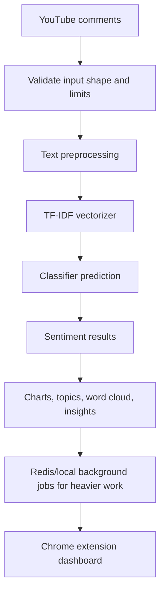

Simple explanation:

"A comment starts as raw text. The backend validates it, cleans it, converts it into numerical TF-IDF features, runs a trained classifier, and returns sentiment. For heavier analytics like topics or charts, Flask creates a background job, Redis stores the job state, and a worker computes the result."

Ground-level interviewer answer:

"The important thing is that the model cannot understand text directly. So I convert text into numbers using TF-IDF. The backend returns fast prediction results first, and moves heavier analytics to background jobs so the UI does not wait for everything synchronously."

## 2. Input Validation Logic

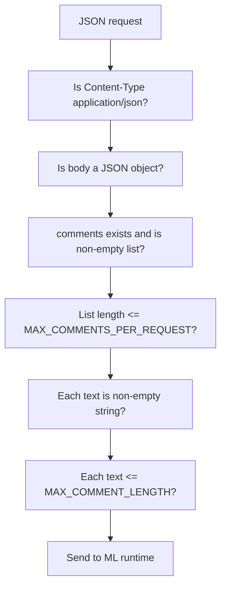

Implementation location:
- `app.py`
- `parse_json_body`
- `validate_comments`
- `validate_sentiment_counts`
- `validate_sentiment_data`

Why it exists:
- Prevents empty requests.
- Prevents huge payloads.
- Prevents model crashes from malformed data.
- Gives predictable error responses.

Simple formula:

For a valid comment list:

```text
1 <= number_of_comments <= MAX_COMMENTS_PER_REQUEST
0 < length(comment_text) <= MAX_COMMENT_LENGTH
```

Ready answer:

"Before inference, I validate both structure and size. A request must be JSON, comments must be a non-empty list, each comment must have non-empty text, and long payloads are rejected before they reach the model."

Common mistake:

Do not say "the frontend validates everything." The backend validates again.

## 3. Text Preprocessing

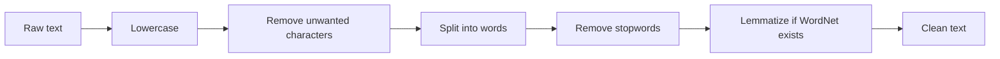

Implementation location:
- Runtime: `analytics_runtime.py`
- Training preprocessing: `src/data/data_preprocessing.py`

Example:

```text
Raw:        "This video is NOT helpful!!!"
Lowercase:  "this video is not helpful!!!"
Cleaned:    "this video is not helpful"
Stopwords:  "video not helpful"
Final:      "video not helpful"
```

Why preprocessing matters:
- Lowercasing makes `Great` and `great` the same feature.
- Removing noise reduces vocabulary size.
- Stopword removal removes frequent low-value words.
- Keeping negation words like `not` helps sentiment.
- Lemmatization maps related words to a base form.

Mathematical intuition:

Preprocessing reduces the number of unique tokens:

```text
Vocabulary_before = many noisy words
Vocabulary_after  = smaller, cleaner set of useful words
```

Smaller vocabulary means:

```text
less noise + fewer dimensions + faster inference
```

Ready answer:

"Preprocessing normalizes comments so the model sees consistent features. Without it, words like `Helpful`, `helpful`, and `helpful!!!` could become separate features, which weakens the model."

Common mistake:

Do not say stemming is used in runtime. The runtime uses lemmatization when WordNet is available.

## 4. Bag-of-Words Intuition

Before TF-IDF, understand Bag-of-Words.

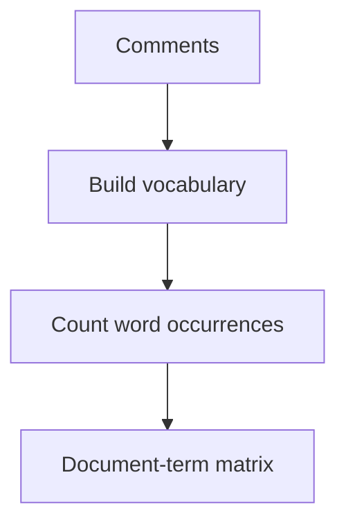

Example:

```text
Comment 1: "great video"
Comment 2: "bad video"

Vocabulary = [great, bad, video]

Comment 1 vector = [1, 0, 1]
Comment 2 vector = [0, 1, 1]
```

Limitation:

The word `video` appears in both comments, but it does not help distinguish sentiment. TF-IDF fixes that by reducing the importance of common words.

Ready answer:

"Bag-of-Words turns text into word-count vectors, but common words can dominate. TF-IDF improves this by weighting rare but meaningful words more strongly."

## 5. TF-IDF Mathematical Explanation

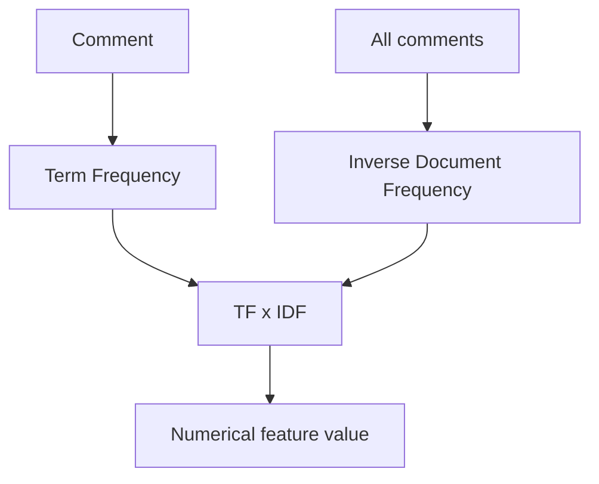

TF-IDF means:

```text
TF-IDF(term, document) = TF(term, document) * IDF(term)
```

Term Frequency:

```text
TF(t, d) = count of term t in document d
```

Inverse Document Frequency:

```text
IDF(t) = log(total number of documents / number of documents containing t)
```

Scikit-learn uses smoothing internally, but interview-level intuition is enough:

```text
common word  -> low IDF -> smaller weight
rare useful word -> high IDF -> larger weight
```

Example:

```text
Documents:
D1 = "great tutorial"
D2 = "great explanation"
D3 = "bad audio"

The word "great" appears in 2 documents.
The word "audio" appears in 1 document.

"audio" gets higher IDF because it is more specific.
```

Why CommentPulse uses TF-IDF:
- Fast.
- Explainable.
- Works well for small classic text classification projects.
- Easy to save as `tfidf_vectorizer.pkl`.
- Easy to run inside Flask.

Implementation:

```python
vectorizer = TfidfVectorizer(max_features=max_features, ngram_range=ngram_range)
features = vectorizer.fit_transform(train_data["clean_comment"].values)
```

Ready answer:

"TF-IDF gives each word a weight based on how important it is inside one comment and how rare it is across all comments. So generic words get low weight, while sentiment-specific words like `great`, `bad`, or `audio` can influence the model more."

Common mistake:

Do not say TF-IDF understands word meaning. It is statistical weighting, not semantic understanding.

## 6. N-Grams

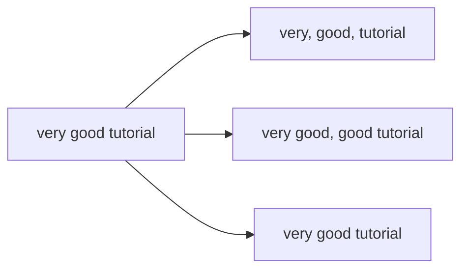

In `params.yaml`:

```yaml
model_building:
  ngram_range: [1, 3]
```

Meaning:

```text
ngram_range = (1, 3)
Use unigrams, bigrams, and trigrams.
```

Why it matters:

Single words can miss context:

```text
"not good"
```

If only unigrams are used:

```text
not, good
```

With bigrams:

```text
not good
```

The model can learn that `not good` is different from `good`.

Ready answer:

"N-grams let the vectorizer capture short phrases, not just individual words. This matters in sentiment because phrases like `not good` or `very helpful` carry stronger meaning than isolated tokens."

## 7. Max Features

In `params.yaml`:

```yaml
max_features: 1000
```

Meaning:

```text
Keep at most the top 1000 TF-IDF features.
```

Why it exists:
- Reduces memory usage.
- Reduces noise.
- Speeds training and inference.
- Prevents very rare words from exploding dimensionality.

Mathematical intuition:

Without max features:

```text
feature_dimension = size of full vocabulary
```

With max features:

```text
feature_dimension <= 1000
```

Ready answer:

"Max features limits the vocabulary size. It is a trade-off: too low can lose useful words, too high can add noise and slow down inference."

## 8. Model Inference Pipeline

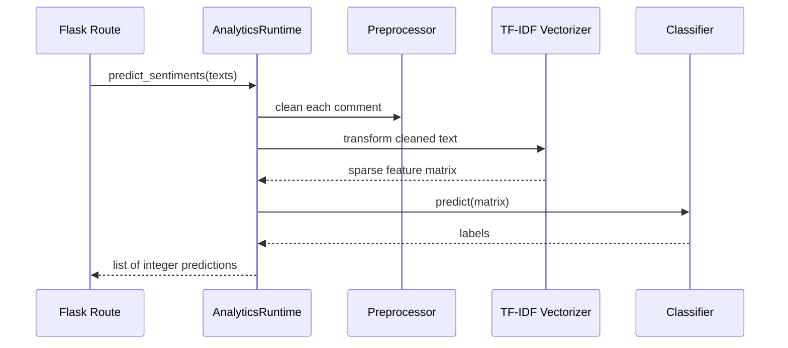

Implementation:

```python
def predict_sentiments(self, texts: list[str]) -> list[int]:
    processed = [self.preprocess_comment(text) for text in texts]
    matrix = self.vectorizer.transform(processed)
    predictions = self.model.predict(matrix)
    return [int(prediction) for prediction in predictions]
```

Important detail:

Training uses `fit_transform`.

Runtime uses `transform`.

Why:

```text
fit_transform = learn vocabulary + convert text
transform     = use already learned vocabulary
```

Ready answer:

"At inference time, we never fit the vectorizer again. We load the trained vectorizer and only call `transform`, so the feature columns match what the model learned during training."

Common mistake:

Do not say the app retrains on every request. It only loads artifacts and predicts.

## 9. Sparse Matrix Explanation

TF-IDF output is sparse.

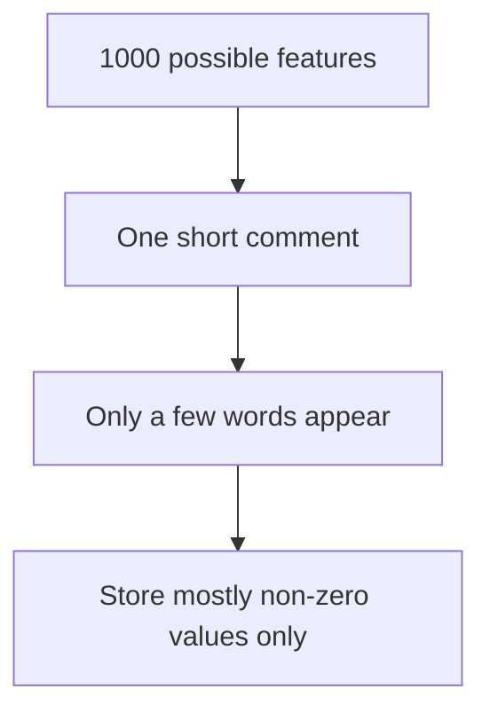

Why sparse:

If vocabulary has 1000 words and a comment has 8 useful words:

```text
992 values are zero
8 values are non-zero
```

Sparse storage avoids wasting memory.

Ready answer:

"Text vectors are usually sparse because each comment contains only a small subset of the vocabulary. Sparse matrices make TF-IDF memory-efficient."

## 10. Classifier Selection

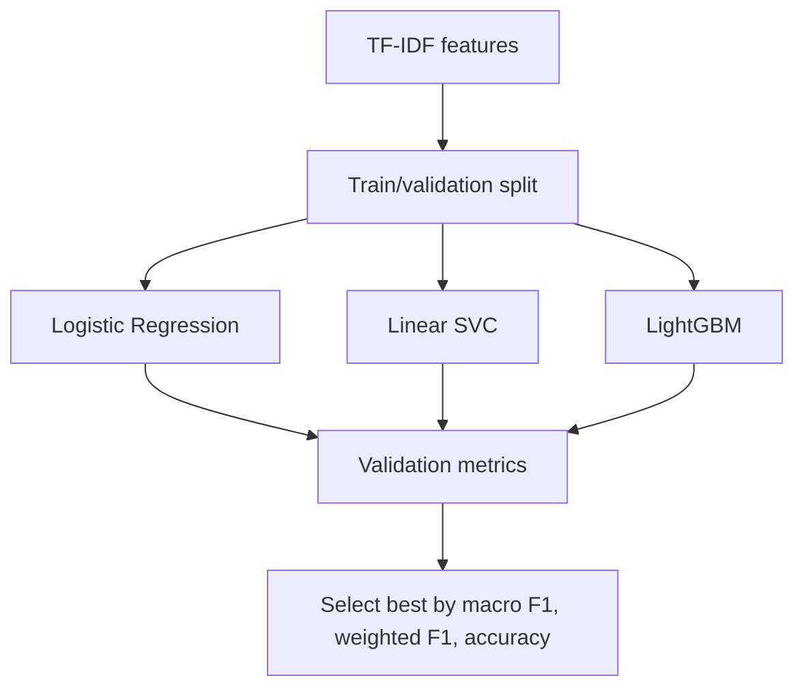

Implementation:

```python
best_model_name = max(
    results,
    key=lambda name: (
        results[name]["validation_metrics"]["macro_f1"],
        results[name]["validation_metrics"]["weighted_f1"],
        results[name]["validation_metrics"]["accuracy"],
    ),
)
```

Meaning:

The project compares candidate models and chooses the best according to:

```text
1. macro_f1
2. weighted_f1
3. accuracy
```

Why macro F1 first:

Macro F1 treats all classes equally.

Ready answer:

"I did not just hardcode a model conceptually. The training script compares candidate classifiers and selects the one with the best validation metrics, prioritizing macro F1 because sentiment classes can be imbalanced."

Truth note:

The committed report selected LightGBM, but the current dataset is very small and prototype-grade.

## 11. Logistic Regression Ground-Level Explanation

Logistic Regression is a linear classifier.

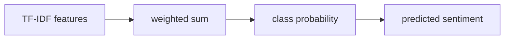

Simple formula:

```text
score = w1*x1 + w2*x2 + ... + wn*xn + b
```

Where:
- `x` = TF-IDF feature values.
- `w` = learned weights.
- `b` = bias.

Intuition:

If words like `great`, `helpful`, `clear` have positive weights, they push the score toward positive.

Ready answer:

"Logistic Regression learns weights for each TF-IDF feature. Sentiment-specific words push the score toward a class, and the model predicts the class with the strongest score."

## 12. Linear SVC Ground-Level Explanation

Linear SVC tries to separate classes with a line or hyperplane.

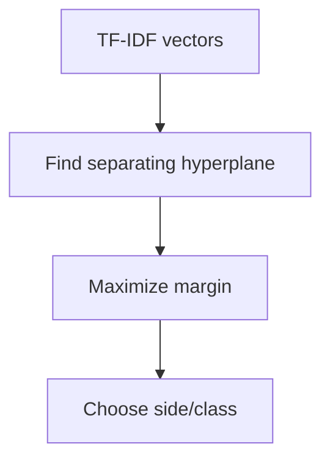

Simple intuition:

```text
positive comments on one side
negative comments on another side
neutral comments separated by learned boundaries
```

Ready answer:

"Linear SVC works well for high-dimensional sparse text features because it tries to find separating boundaries in the TF-IDF feature space."

## 13. LightGBM Ground-Level Explanation

LightGBM is a gradient boosting model using decision trees.

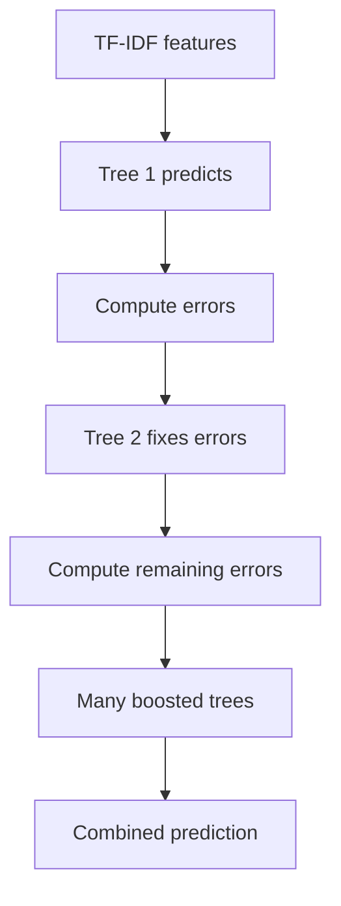

Simple idea:

```text
Final prediction = Tree1 + Tree2 + Tree3 + ... + TreeN
```

Each new tree tries to fix mistakes made by previous trees.

Why LightGBM can help:
- Handles nonlinear feature interactions.
- Efficient gradient boosting implementation.
- Works with tabular/sparse features.

Why be careful:
- Can overfit on small data.
- Needs enough labeled examples.
- Current report shows prototype-grade quality.

Ready answer:

"LightGBM builds many small decision trees sequentially. Each tree focuses on reducing the previous errors, and their combined output becomes the final prediction."

## 14. Sentiment Label Mapping Caution

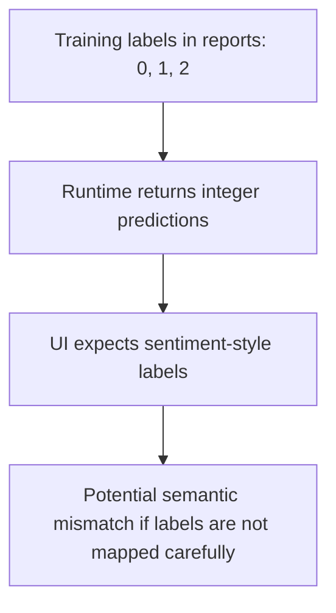

Important:

The UI treats:

```text
1  = positive
0  = neutral
-1 = negative
```

Some training/report files show:

```text
0, 1, 2
```

Safe interview answer:

"One thing I would harden is explicit label mapping. The model returns integer labels, and the UI should have a clear mapping layer so training labels and UI sentiment labels cannot drift."

Why this answer is good:
- It shows honesty.
- It shows code awareness.
- It shows production thinking.

## 15. Prediction Endpoint Testing

Resume line supported:

```text
Tested prediction endpoints, validated analytics output, and debugged worker job flows.
```

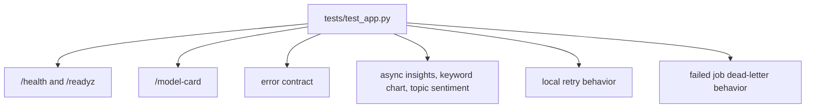

What tests prove:
- API returns expected status codes.
- Readiness endpoint reports dependencies.
- Validation errors return structured JSON.
- Async jobs complete and return results.
- Artifact jobs return image content.
- Retry logic works.
- Dead-letter logic works.

Example test idea:

```python
response = self.client.post("/jobs/insights", json=payload)
self.assertEqual(response.status_code, 202)
job_id = response.get_json()["job_id"]
result = self.wait_for_job(job_id)
self.assertEqual(result["status"], "completed")
```

Ready answer:

"I tested not only the happy-path prediction endpoint but also job creation, polling, artifact responses, validation errors, retry behavior, and dead-letter handling."

Common mistake:

Do not say "I manually tested everything" when the repo has `unittest` coverage.

## 16. Validating Analytics Output

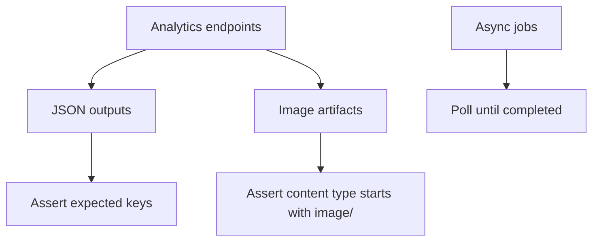

Analytics output types:

```text
Prediction endpoint -> JSON list
Insights job        -> JSON object
Topics job          -> JSON list/object
Keyword chart job   -> image artifact
Word cloud job      -> image artifact
Trend graph job     -> image artifact
```

Validation examples:

```text
status == completed
result contains "insights"
artifact_response.content_type starts with "image/"
```

Ready answer:

"For analytics, validation means checking both the job state and the result shape. For JSON analytics, I check expected keys. For chart artifacts, I check that the artifact endpoint returns an image content type."

## 17. Debugging Worker Job Flows

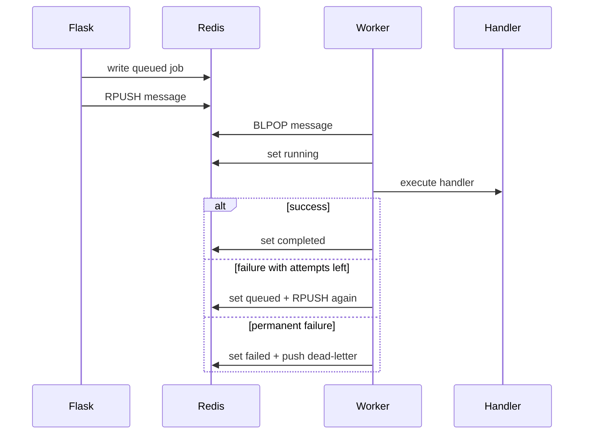

Debug checklist:

```text
1. Did Flask create a job_id?
2. Is the job in queued/running/completed/failed?
3. Is worker.py running?
4. Is REDIS_URL correct?
5. Does job_type exist in create_job_handlers?
6. Did handler raise an exception?
7. Did attempts reach MAX_JOB_ATTEMPTS?
8. Is the job in dead-letter queue?
```

Ready answer:

"When debugging worker jobs, I follow the job state. If it stays queued, I check the worker and Redis URL. If it fails, I check the handler error and attempts. If attempts are exhausted, I inspect the dead-letter queue."

## 18. Reliability: Retries

Resume line supported:

```text
Improved reliability by handling retries, job status polling, and failed background tasks.
```

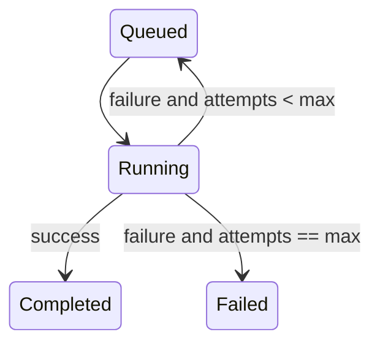

Retry formula:

```text
if attempts < max_attempts:
    retry
else:
    fail permanently
```

Why retries help:
- Temporary errors can recover.
- Worker failures do not immediately fail user-facing jobs.
- Frontend can keep polling status.

Why retries are limited:
- Infinite retries can overload the system.
- Permanent errors need visibility.

Ready answer:

"Retries improve reliability for transient failures, but they are capped by `MAX_JOB_ATTEMPTS` so permanent failures do not loop forever."

Production improvement:

```text
Add exponential backoff:
next_delay = base_delay * 2 ^ attempt_number
```

## 19. Reliability: Job Status Polling

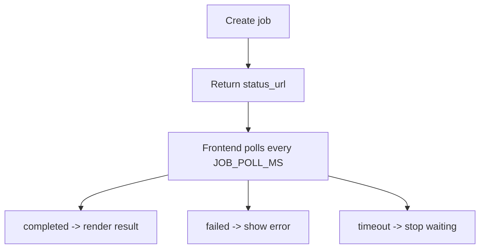

Implementation constants:

```javascript
const JOB_POLL_MS = 600;
const JOB_TIMEOUT_MS = 30000;
```

Polling math:

```text
maximum_poll_count = JOB_TIMEOUT_MS / JOB_POLL_MS
maximum_poll_count = 30000 / 600 = 50 polls
```

Ready answer:

"The frontend does not block forever. It polls roughly every 600 ms and times out after 30 seconds, so the UI can show an error if a background job never completes."

Trade-off:

```text
short poll interval  -> faster UI updates, more API calls
long poll interval   -> fewer API calls, slower UI updates
```

## 20. Reliability: Dead-Letter Queue

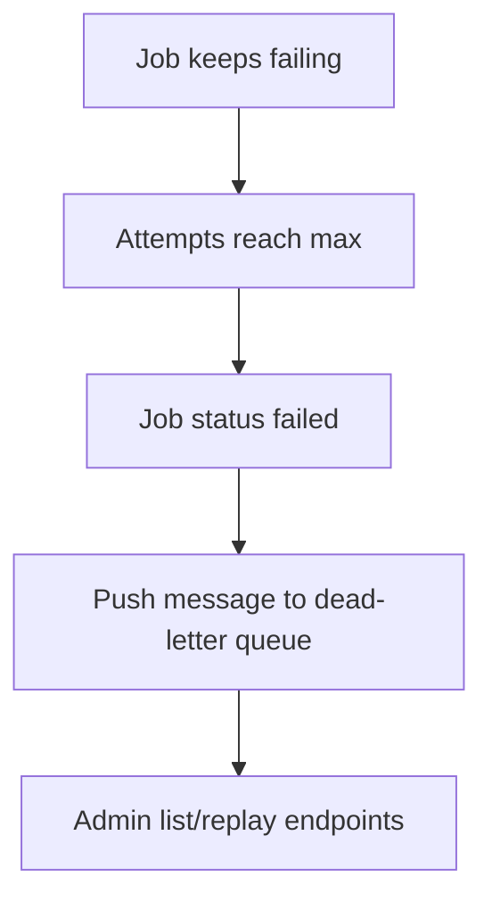

Why dead-letter queues exist:
- Preserve failed work for inspection.
- Prevent infinite retry loops.
- Allow manual replay after fixing the issue.

Ready answer:

"A dead-letter queue is where permanently failed jobs go after retries are exhausted. It helps debugging because the failed payload is not silently lost."

CommentPulse implementation:

```text
primary queue: analytics_jobs
dead-letter queue: analytics_jobs_dead_letter
```

## 21. Redis Data Structures

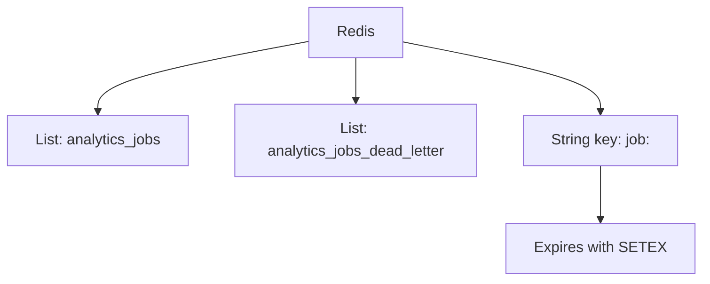

Redis usage:

```text
RPUSH queue message
BLPOP queue message
SETEX job state with TTL
GET job state
LRANGE dead-letter jobs
LREM remove replayed dead-letter job
```

Ready answer:

"I used Redis lists for queues and Redis string keys for job records. The job record expires using TTL so old job states do not stay forever."

## 22. Local Job Manager Fallback

```mermaid
flowchart TD
  AppStart["Flask startup"] --> RedisCheck["Redis URL and ping"]
  RedisCheck --> RedisOK["Use RedisJobManager"]
  RedisCheck --> RedisFail["Fallback to LocalJobManager"]
  RedisFail --> ThreadPool["ThreadPoolExecutor"]
```

Why it exists:
- Local development can work without Redis.
- Public deployment can degrade instead of crashing.

Ready answer:

"If Redis is unavailable at startup, the app can fall back to a local thread pool job manager. That is useful for demos, though in production I would rather alert and fix Redis instead of silently degrading."

## 23. Flask Error Handling

```mermaid
flowchart TD
  Error["Exception"] --> Validation["ValidationError"]
  Error --> JobNotReady["JobNotReadyError"]
  Error --> Unexpected["Unexpected Exception"]
  Validation --> JSON400["Structured error JSON"]
  JobNotReady --> JSON409["409 job not finished"]
  Unexpected --> JSON500["500 internal server error"]
```

Error response shape:

```json
{
  "error": {
    "message": "comments must be a non-empty list.",
    "status_code": 400,
    "request_id": "..."
  }
}
```

Ready answer:

"The backend returns structured errors with a message, status code, and request ID. That makes frontend debugging and log tracing easier."

## 24. Observability: Logs and Metrics

```mermaid
flowchart TD
  Request["HTTP request"] --> RequestID["Generate request_id"]
  RequestID --> Route["Handle route"]
  Route --> Metrics["Prometheus metrics"]
  Route --> Logs["JSON structured logs"]
```

Metrics examples:

```text
HTTP request count
HTTP latency histogram
Inference comment count
External YouTube call count
Model ready gauge
Async job count
Async job duration
Queue depth
```

Ready answer:

"I added operational visibility with request IDs, structured JSON logs, and Prometheus metrics for HTTP traffic, model readiness, async jobs, and Redis queue depth."

## 25. API Endpoint Testing Strategy

```mermaid
flowchart TD
  Testing["Testing strategy"] --> Unit["Flask test client"]
  Testing --> Async["Poll jobs in tests"]
  Testing --> Mock["Mock flaky handlers"]
  Testing --> Redis["Optional Redis integration test"]
```

What is tested:

```text
/health
/readyz
/model-card
validation error contract
/jobs/insights
/jobs/keyword-chart artifact
/jobs/topic-sentiment
local retries
local dead letters
Redis integration when RUN_REDIS_INTEGRATION=1
```

Ready answer:

"I used Flask's test client for API tests and mocked flaky job handlers to prove retry and dead-letter behavior. Redis integration tests are gated behind an environment variable so they run only when Redis is available."

## 26. Confusion Matrix

```mermaid
flowchart TD
  Actual["Actual labels"] --> Matrix["Confusion matrix"]
  Predicted["Predicted labels"] --> Matrix
  Matrix --> Diagonal["Correct predictions on diagonal"]
  Matrix --> OffDiagonal["Mistakes off diagonal"]
```

Simple matrix:

```text
                 Predicted
              Neg  Neu  Pos
Actual Neg     5    1    0
Actual Neu     2    3    1
Actual Pos     0    1    7
```

Meaning:
- Diagonal values are correct.
- Off-diagonal values are mistakes.

Ready answer:

"A confusion matrix shows where the model is confusing classes. It is useful for sentiment because I can see whether neutral comments are being misclassified as positive or negative."

## 27. Accuracy, Precision, Recall, F1

```mermaid
flowchart TD
  Metrics["Classification Metrics"] --> Accuracy
  Metrics --> Precision
  Metrics --> Recall
  Metrics --> F1
```

Accuracy:

```text
accuracy = correct_predictions / total_predictions
```

Precision:

```text
precision = true_positives / (true_positives + false_positives)
```

Recall:

```text
recall = true_positives / (true_positives + false_negatives)
```

F1:

```text
F1 = 2 * precision * recall / (precision + recall)
```

Macro F1:

```text
macro_f1 = average of F1 across classes
```

Weighted F1:

```text
weighted_f1 = class-size-weighted average of F1
```

Ready answer:

"Accuracy gives overall correctness, but F1 is better when classes are imbalanced. Macro F1 treats every sentiment class equally, which is why the model selection script prioritizes it."

Important truth:

Do not invent strong metrics. The committed report shows prototype-grade metrics.

## 28. Topic Extraction With KMeans

```mermaid
flowchart TD
  Comments["Comments"] --> Clean["Preprocess"]
  Clean --> TFIDF["TF-IDF matrix"]
  TFIDF --> KMeans["KMeans clustering"]
  KMeans --> Centers["Cluster centers"]
  Centers --> Keywords["Top keywords per cluster"]
  Keywords --> Topics["Topic labels"]
```

KMeans idea:

```text
1. Choose k cluster centers.
2. Assign each comment vector to nearest center.
3. Move center to average of assigned vectors.
4. Repeat until stable.
```

Distance intuition:

```text
closer vectors = more similar comments
```

CommentPulse:

```python
cluster_count = min(3, len(processed))
kmeans = KMeans(n_clusters=cluster_count, random_state=42, n_init=10)
```

Ready answer:

"For topics, I convert comments into TF-IDF vectors and cluster similar comments using KMeans. Then I inspect the highest-weighted terms near each cluster center to create topic keywords."

Common mistake:

Do not say topics are generated by an LLM. They are local TF-IDF plus KMeans.

## 29. Keyword Chart

```mermaid
flowchart TD
  Comments["Comments"] --> TFIDF["TF-IDF vectorizer"]
  TFIDF --> Sum["Sum scores by term"]
  Sum --> Rank["Sort descending"]
  Rank --> Top10["Top 10 keywords"]
  Top10 --> BarChart["Matplotlib bar chart"]
```

Math:

```text
keyword_score(term) = sum of TF-IDF score for term across all comments
```

Ready answer:

"The keyword chart ranks terms by total TF-IDF weight across the comment batch. Higher total score means the term is more important across the analyzed comments."

## 30. Word Cloud

```mermaid
flowchart TD
  Comments["Comments"] --> Clean["Preprocess"]
  Clean --> Combine["Join text"]
  Combine --> Frequency["Word frequencies"]
  Frequency --> Size["Word size proportional to frequency"]
  Size --> Image["PNG word cloud"]
```

Simple formula:

```text
word_size roughly proportional to word_frequency
```

Ready answer:

"A word cloud is not a model prediction. It is a visual summary where more frequent processed words appear larger."

## 31. Sentiment Aggregation

```mermaid
flowchart TD
  Predictions["Prediction list"] --> CountPos["Count positive"]
  Predictions --> CountNeu["Count neutral"]
  Predictions --> CountNeg["Count negative"]
  CountPos --> Percent["Percentages"]
  CountNeu --> Percent
  CountNeg --> Percent
  Percent --> Dashboard["Dashboard stats"]
```

Formula:

```text
positive_percent = positive_count / total_comments * 100
neutral_percent  = neutral_count  / total_comments * 100
negative_percent = negative_count / total_comments * 100
```

Ready answer:

"After inference, aggregation is simple counting. The frontend and insights code count how many comments fall into each sentiment class and convert that into dashboard metrics."

## 32. Insight Generation

```mermaid
flowchart TD
  Comments["Comments"] --> Predict["Predict sentiment"]
  Predict --> Counts["Count sentiments"]
  Comments --> Themes["Top TF-IDF terms"]
  Counts --> Dominant["Dominant sentiment"]
  Themes --> Summary["Local text summary"]
  Dominant --> Summary
```

Important:

Insights are local deterministic summaries, not OpenAI/LLM calls.

Ready answer:

"The insight generator predicts sentiment, counts each class, extracts top themes, and creates a local summary string. It is not calling an external LLM."

## 33. Docker Ground-Level Explanation

Resume line supported:

```text
Containerized the Flask API, Redis queue, and worker service using Docker.
```

```mermaid
flowchart TD
  Dockerfile["Dockerfile"] --> Image["App image"]
  Image --> Web["Web container"]
  Image --> Worker["Worker container"]
  RedisImage["redis:7-alpine"] --> Redis["Redis container"]
  Web --> Redis
  Worker --> Redis
```

What Dockerfile does:

```text
1. Start from Python base image.
2. Set /app as working directory.
3. Install Python dependencies.
4. Copy project files.
5. Expose port 5000.
6. Run Gunicorn app:app.
```

What Docker Compose does:

```text
1. Starts Redis.
2. Starts Flask web service.
3. Starts worker service.
4. Connects services by Docker network names.
5. Provides shared environment variables.
```

Ready answer:

"Docker gives a repeatable environment. Compose lets me run three services together: Flask for HTTP, Redis for queue/state, and a worker for background analytics."

## 34. Docker Networking

```mermaid
flowchart LR
  Web["web container"] -->|redis://redis:6379/0| Redis["redis container"]
  Worker["worker container"] -->|redis://redis:6379/0| Redis
  Browser["Browser"] -->|localhost:5000| Web
```

Important:

Inside Docker Compose, services use service names:

```text
redis://redis:6379/0
```

Outside Docker, local machine may use:

```text
redis://localhost:6379/0
```

Ready answer:

"Inside Compose, `redis` is the hostname because Docker creates a network and service DNS. The web and worker containers use `redis://redis:6379/0` to reach the Redis service."

## 35. Gunicorn vs Flask Dev Server

```mermaid
flowchart TD
  FlaskApp["Flask app"] --> Dev["Flask dev server"]
  FlaskApp --> Gunicorn["Gunicorn WSGI server"]
  Dev --> Local["Local debugging only"]
  Gunicorn --> Deploy["Container deployment"]
```

Ready answer:

"The Flask dev server is for local debugging. Docker runs Gunicorn because it is a production-style WSGI server that can manage worker processes more reliably."

## 36. Performance Optimization Techniques

```mermaid
flowchart TD
  Performance["Performance"] --> Batch["Batch TF-IDF transform"]
  Performance --> Cache["LRU preprocessing cache"]
  Performance --> Lazy["Lazy heavy imports"]
  Performance --> Async["Background jobs"]
  Performance --> Limits["Input size limits"]
```

Ground-level explanations:

Batch transform:

```text
Transform many comments at once instead of one by one.
```

LRU cache:

```text
If same comment appears again, reuse cleaned text.
```

Lazy imports:

```text
Load Matplotlib/WordCloud only when charts are requested.
```

Async jobs:

```text
Move slower analytics away from immediate HTTP response.
```

Input limits:

```text
Reject too many or too-long comments before expensive processing.
```

Ready answer:

"Performance improvements are mostly practical: batch vectorization, cached preprocessing, lazy imports, async analytics jobs, and strict input limits."

## 37. Load Testing Math

```mermaid
flowchart TD
  Requests["N requests"] --> Concurrency["C workers"]
  Concurrency --> Latency["Measure latency per request"]
  Latency --> Percentiles["p50, p95, p99"]
  Requests --> Throughput["requests / total seconds"]
```

Throughput:

```text
throughput = total_requests / total_duration_seconds
```

Error rate:

```text
error_rate = failed_requests / total_requests
```

p95 latency:

```text
95% of requests completed at or below this latency.
```

Ready answer:

"The load test sends concurrent prediction requests and records throughput, error rate, and latency percentiles. p95 is useful because it shows near-worst-case user experience better than average latency."

## 38. API Status Codes

```mermaid
flowchart TD
  Request["Request"] --> Success["200 success"]
  Request --> Queued["202 job queued/running"]
  Request --> Bad["400 validation error"]
  Request --> Missing["404 job not found"]
  Request --> Conflict["409 job not ready or Redis admin unavailable"]
  Request --> Unavailable["503 model/API key missing"]
  Request --> Upstream["502 YouTube fetch failed"]
```

Ready answer:

"Synchronous success returns 200. Async job creation and in-progress polling use 202. Validation returns 400. A job that is not ready can return 409 for artifact access."

## 39. How To Explain Debugging In Interviews

```mermaid
flowchart TD
  Bug["Bug report"] --> Reproduce["Reproduce request"]
  Reproduce --> Logs["Check request_id logs"]
  Logs --> Status["Check job status"]
  Status --> Handler["Check handler/model error"]
  Handler --> Fix["Fix route/runtime/worker/config"]
  Fix --> Test["Add or run test"]
```

Ready answer:

"I debug by following the request or job ID. For API issues I check validation and response shape. For worker issues I check job status, Redis queue, worker logs, attempts, and dead-letter state."

## 40. Everything You Should Be Able To Say Without Memorizing

```mermaid
mindmap
  root((CommentPulse Ground Level))
    Text
      preprocessing
      TF-IDF
      sparse matrix
    ML
      classifier
      metrics
      model artifacts
    Backend
      Flask routes
      validation
      error handling
    Async
      Redis queue
      polling
      retries
      dead-letter
    Docker
      web
      Redis
      worker
```

Short master answer:

"CommentPulse converts YouTube comments into TF-IDF vectors and runs a classic ML classifier for sentiment. Flask exposes prediction and analytics APIs with validation and structured errors. Heavy analytics can run as background jobs through Redis, where the frontend polls job status and the worker handles retries and dead-letter failures. Docker Compose runs the system as separate Flask, Redis, and worker services, making the deployment repeatable."

What to avoid:
- Do not claim deep learning.
- Do not claim Celery.
- Do not claim Tailwind.
- Do not claim production-grade accuracy.
- Do not claim persistent database storage.

Final interview summary:

"The project is strong because it connects frontend, backend, ML, Redis async processing, testing, and Docker deployment. The safest interview strategy is to explain each piece from the ground up and be honest about production improvements."
