# CommentPulse Software Architecture and ML Interview Handbook

Source basis: this handbook was generated from the tracked repository files, including Flask code, Chrome extension frontend, ML pipeline modules, tests, Docker/Render configs, DVC files, reports, notebooks, logs, package metadata, and git history. It intentionally does not infer unimplemented features.

Important truth flags:
- Tailwind CSS is not implemented. Styling is custom CSS in `popup.html` and inline CSS inside the Flask-rendered homepage.
- Celery is listed in `requirements.txt`, but the application does not use Celery, RQ, or Flask blueprints. Queueing is custom local-thread or Redis-list based.
- There is no user authentication flow.
- There is no application relational database. Redis stores transient job state; MLflow can use local SQLite for experiment tracking.
- The Chrome extension collects visible YouTube comments by injecting JavaScript into the page. The Flask YouTube API endpoint exists, but it fetches only the first YouTube API page and does not implement pagination.
- The current committed model/report data is prototype-grade: reports show 18 labeled rows, 14 training rows, 4 test rows, and low offline metrics.

## SECTION 1 - Project Overview

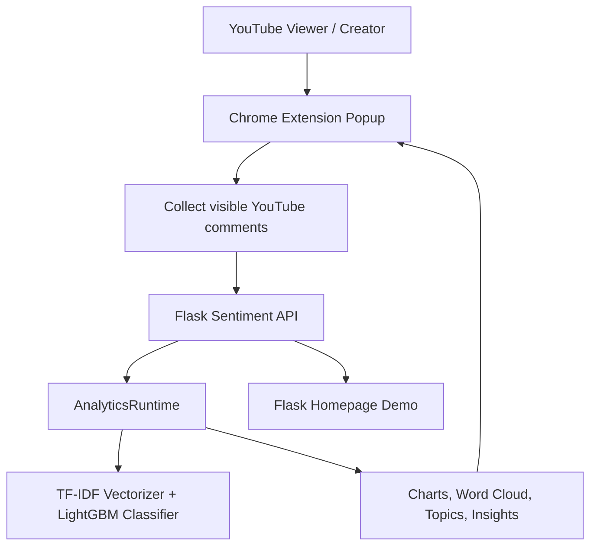

Line by line: the user opens a YouTube video and uses the extension. The extension extracts visible comments, sends them to Flask, Flask delegates ML and analytics work to `AnalyticsRuntime`, and the frontend renders predictions, charts, topics, and insight text. The Flask homepage is a separate demo surface that accepts manual comments rather than a YouTube URL.

Business problem: help a creator or reviewer quickly understand audience sentiment in YouTube comments.

Users: YouTube creators, marketers, reviewers, students demonstrating full-stack ML, and interviewers evaluating the project.

Core features: Chrome extension UI, comment extraction, sentiment inference, sentiment counters, chart rendering, word cloud, keyword chart, topic extraction, topic sentiment, local insight summaries, async jobs, Redis worker support, Docker deployment, and ML pipeline scripts.

Workflow: open video, click extension, resolve backend, extract comments, predict sentiment, request analytics, poll jobs, render final popup.

Technologies used: Flask, Flask-CORS, HTML, CSS, vanilla JavaScript, Chrome Extension Manifest V3, Redis, Docker, Docker Compose, Gunicorn, Render, Prometheus client, pandas, scikit-learn, LightGBM, NLTK, Matplotlib, WordCloud, Seaborn, MLflow, DVC, unittest, GitHub Actions.

Why designed this way: Flask is simple for ML inference APIs; the Chrome extension keeps the user in the YouTube workflow; async jobs prevent expensive analytics from blocking every UI interaction.

Alternatives: React extension, FastAPI, Celery/RQ, hosted managed queues, or server-side YouTube API pagination.

Advantages: small codebase, easy local deployment, clear ML pipeline, direct browser integration.

Disadvantages: no auth, no rate limiting, no persistent app database, no real frontend framework, and limited model data.

Interviewer may ask: "What is the system boundary?" Ideal answer: the system includes the Chrome popup, Flask API, local/Redis jobs, worker, model artifacts, and ML pipeline scripts; it excludes YouTube itself and does not persist user accounts.

Common mistake: saying Tailwind, Celery, or a database exists because dependencies or prompt wording mention them.

Interview Summary: CommentPulse is a Flask-backed Chrome extension and ML demo that analyzes YouTube comments with TF-IDF sentiment inference and async analytics rendering.

## SECTION 2 - Functional Requirements

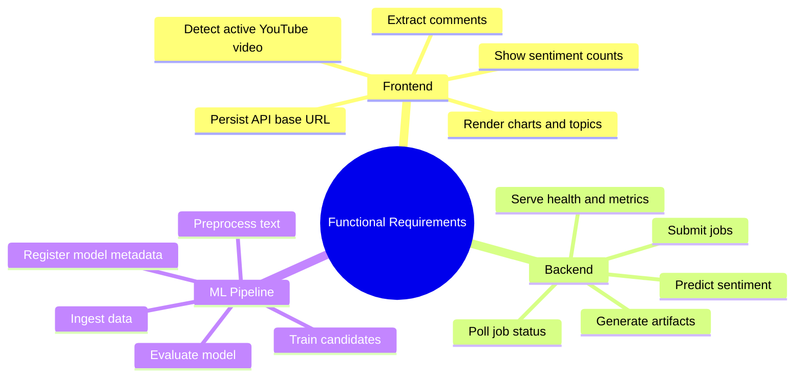

Line by line: requirements are split across frontend, backend, and ML. The extension owns browser interaction and rendering. Flask owns API contracts and job creation. The pipeline owns reproducible training/evaluation artifacts.

Implemented requirements: comment extraction, sentiment prediction, analytics jobs, chart endpoints, topic extraction, readiness, metrics, Docker deployment, Render deployment, DVC stages, and tests.

Not implemented: user login, URL paste workflow in the extension, YouTube API pagination, historical dashboard storage, real database-backed reports, Tailwind build, and Celery workers.

Why designed this way: the repository favors an end-to-end demo over enterprise completeness.

Alternatives: store analyses in PostgreSQL, use YouTube Data API for all collection, or build a React dashboard.

Advantages: faster to explain, demo, test, and deploy.

Disadvantages: limited persistence and production controls.

Interviewer may ask: "Which features are user-facing versus engineering-facing?" Ideal answer: extension/dashboard/API responses are user-facing; DVC, MLflow, load tests, CI, Docker, and Redis worker are engineering-facing.

Common mistake: confusing notebook experiments with production runtime behavior.

Interview Summary: Functional scope is comment collection, inference, analytics visualization, async processing, and reproducible ML experimentation.

## SECTION 3 - Non Functional Requirements

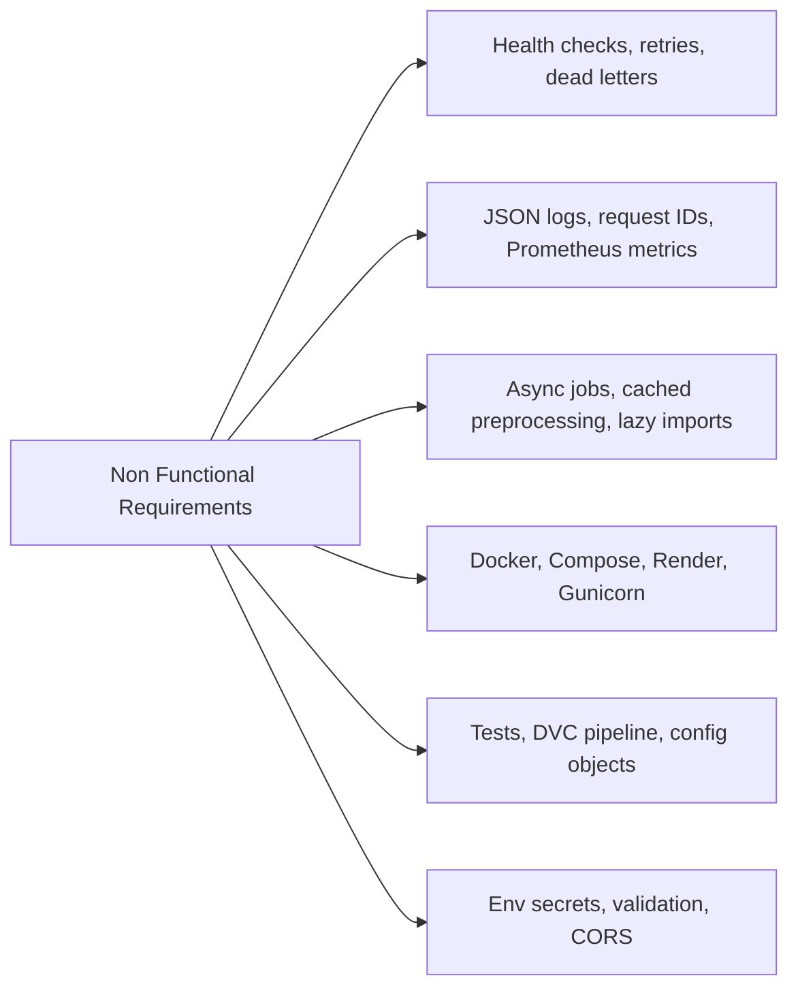

Line by line: reliability is handled through retries and dead letters; observability through logs and metrics; performance through async processing and caching; deployability through container configs; maintainability through tests and pipeline files; security through basic validation and environment variables.

Why designed this way: ML apps need reliability around slow analytics and model availability, while demos need simple deployment.

Alternatives: OpenTelemetry, structured tracing, centralized logging, API gateway rate limiting, Kubernetes autoscaling.

Advantages: practical production-adjacent patterns with little infrastructure.

Disadvantages: no authentication, no distributed tracing, no rate limiting, and limited secret management.

Interviewer may ask: "What is the most important NFR for this app?" Ideal answer: latency and reliability around analytics, because users expect the popup to keep responding while charts/topics compute.

Common mistake: describing enterprise NFRs that are not implemented.

Interview Summary: NFR support is strongest in observability, async reliability, and deployment; weakest in auth, persistence, and rate limiting.

## SECTION 4 - Complete High-Level Architecture

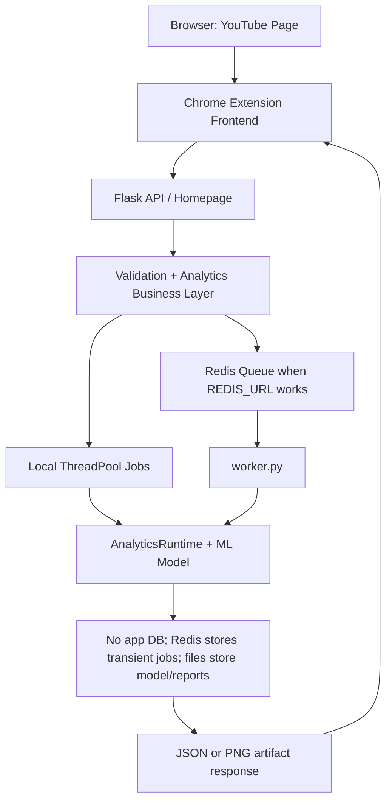

Line by line: the browser hosts YouTube. The extension is the primary frontend. Flask receives requests and validates payloads. Business logic either runs synchronously or creates jobs. Jobs run locally or in a Redis-backed worker. The ML runtime loads pickled artifacts. There is no application database; model/report files and Redis hold state. Responses return JSON or image artifacts.

Components:
- Browser: source of visible comments and active tab URL.
- Frontend: popup UI, settings, extraction, API calls, polling, rendering.
- Flask: route layer, app factory, CORS, metrics, errors.
- Business layer: validation, job submission, runtime calls.
- Redis queue: list-based queue plus job keys with TTL.
- Worker: blocking Redis consumer that runs analytics handlers.
- ML model: TF-IDF vectorizer plus selected classifier artifact.
- Storage: Redis for transient jobs, files for artifacts/reports, MLflow SQLite/file store for experiments.

Why designed this way: separates slow analytics from HTTP request latency while allowing local fallback without Redis.

Alternatives: Celery, RQ, Kafka, SQS, FastAPI background tasks, or direct synchronous execution only.

Advantages: simple local development and realistic worker deployment.

Disadvantages: custom queue lacks visibility, scheduling, concurrency controls, and durability guarantees of mature job systems.

Interviewer may ask: "Where does the database sit?" Ideal answer: no production app database exists; Redis is transient job storage, while MLflow/DVC/files handle experiment and artifact storage.

Common mistake: placing Celery or SQLAlchemy in the diagram.

Interview Summary: The architecture is browser extension -> Flask API -> validation/runtime -> local or Redis jobs -> worker/model -> JSON/PNG response.

## SECTION 5 - Complete Low-Level Architecture

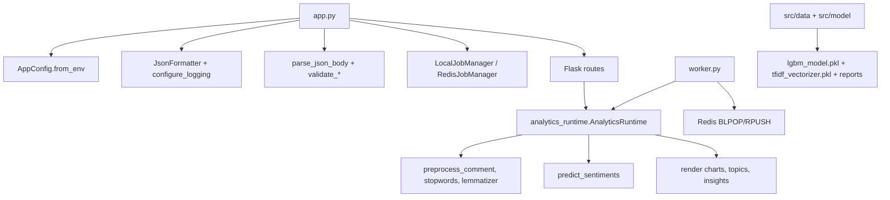

Line by line: `app.py` is both route layer and job orchestration layer. `analytics_runtime.py` owns ML and analytics. `worker.py` is the Redis consumer. `src/data` and `src/model` create model artifacts and reports consumed by runtime and model-card routes.

Why designed this way: the codebase is compact; modules are split mainly by runtime API, worker, data pipeline, and model pipeline.

Alternatives: split into Flask blueprints, services, repositories, schemas, and task modules.

Advantages: easy to trace end to end.

Disadvantages: `app.py` is large and mixes routes, HTML, queueing, validation, metrics, and error handling.

Interviewer may ask: "What would you refactor first?" Ideal answer: split `app.py` into routes, schemas/validation, job services, metrics, and template/static files while preserving API contracts.

Common mistake: calling it a microservice architecture; it is a modular monolith plus optional worker.

Interview Summary: Low-level design centers on `app.py`, `analytics_runtime.py`, `worker.py`, and DVC-driven `src` pipeline modules.

## SECTION 6 - Folder Structure

```text
youtube-sentiment-mlops-pipeline/
|-- app.py                         Flask app, routes, HTML demo, job managers
|-- analytics_runtime.py           Runtime NLP, inference, charts, topics, insights
|-- worker.py                      Redis worker for async analytics jobs
|-- flask_api/main.py              Thin entrypoint importing app
|-- yt-chrome-plugin-frontend/     Chrome extension frontend
|-- src/data/                      Ingestion, preprocessing, dataset curation
|-- src/model/                     Training, evaluation, registration, promotion
|-- tests/                         Flask, Redis, and ML workflow tests
|-- scripts/                       PowerShell task runner and load test
|-- notebooks/                     Experimental Colab notebooks
|-- reports/                       Generated data/model/performance reports
|-- data/                          Raw/interim/external datasets
|-- docs/interview-prep/           Existing interview prep docs
|-- .github/workflows/             CI workflows
|-- Dockerfile                     API image
|-- docker-compose.yml             Redis + web + worker stack
|-- render.yaml                    Render web, worker, and Redis config
|-- dvc.yaml / dvc.lock            Reproducible ML pipeline stages
|-- params.yaml                    Pipeline hyperparameters and data settings
|-- requirements.txt               Python dependencies
|-- *.pkl                          Model and vectorizer artifacts
|-- *.log                          Error logs
```

Line by line: the root contains runtime entrypoints and deployment files. `yt-chrome-plugin-frontend` is the browser UI. `src` is the ML pipeline. `tests` verifies contracts. `reports` and `data` are generated/tracked artifacts used by the app and model-card route.

Why it exists: the structure separates serving, frontend, ML workflow, tests, and infrastructure.

Alternatives: package app code under `commentpulse/`, move templates/static into Flask folders, store notebooks outside production repo.

Advantages: straightforward for a portfolio project.

Disadvantages: mixed generated files, logs, and runtime code at root can confuse production boundaries.

Interviewer may ask: "What is production code versus experiment code?" Ideal answer: production runtime is `app.py`, `analytics_runtime.py`, `worker.py`, Docker/Render, and extension files; notebooks and DVC scripts are experiment/pipeline code.

Common mistake: explaining `notebooks` as production inference.

Interview Summary: The repo combines a Flask runtime, Chrome extension frontend, ML pipeline, deployment configs, tests, and generated artifacts.

## SECTION 7 - Frontend Component Architecture

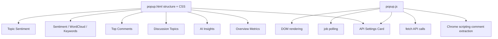

Line by line: `popup.html` defines sections and inline CSS. `popup.js` wires settings, extraction, API calls, polling, and DOM updates.

HTML: static popup document with cards for settings, metrics, insights, topics, comments, charts, and loading message.

Templates: no standalone frontend template system. Flask homepage uses `render_template_string` with inline HTML/CSS/JS inside `app.py`.

CSS: custom inline CSS in `popup.html`; custom inline CSS in Flask homepage.

Tailwind: not used.

JavaScript: vanilla JS, DOMContentLoaded initialization, Chrome extension APIs, fetch calls, blob rendering, job polling.

User interaction: user clicks extension, optionally saves backend URL, waits through loading phases, reads rendered insights.

Reusable components: not formal components; repeated CSS classes like `.card`, `.metric`, `.topic-pill`, and helper functions like `setMutedMessage`, `waitForJob`, `renderStats`.

Why designed this way: a Chrome popup benefits from minimal dependencies and fast loading.

Alternatives: React, Vue, Svelte, Tailwind build, or server-rendered dashboard only.

Advantages: simple extension packaging and no build step.

Disadvantages: limited component reuse, no state management library, inline CSS, and DOM string rendering.

Interviewer may ask: "How does frontend async state work?" Ideal answer: staged loading messages plus `waitForJob`, which polls job status every 600 ms up to 30 seconds.

Common mistake: saying the UI uses Tailwind or Chart.js.

Interview Summary: The frontend is a Manifest V3 Chrome extension built with HTML, custom CSS, and vanilla JavaScript.

## SECTION 8 - Flask Architecture

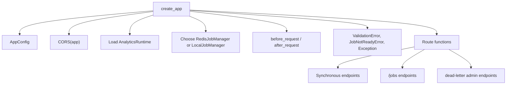

Line by line: Flask initialization reads environment config, enables CORS, loads model artifacts, selects a job backend, registers request hooks, error handlers, and routes.

App initialization: `AppConfig.from_env()` reads host, port, timeout, comment limits, API key, model paths, worker count, Redis URL, queue names, TTL, and max attempts.

Routes: homepage, health, readiness, metrics, model-card, YouTube comments, prediction, charts, insights, topics, job APIs, dead-letter admin APIs.

Blueprints: none.

Controllers/services/utilities: route functions act as controllers; validation functions and job managers act as internal utilities; `AnalyticsRuntime` is the business/ML service.

Business logic: validation, model inference, analytics generation, job submission, artifact delivery.

Why designed this way: all route wiring is visible in one file for a demo app.

Alternatives: blueprints by domain (`health`, `inference`, `jobs`, `admin`), Pydantic/Marshmallow schemas, service modules.

Advantages: minimal indirection.

Disadvantages: `app.py` has high responsibility and is harder to test/refactor at scale.

Interviewer may ask: "Where would blueprints help?" Ideal answer: split public API, job admin, health/metrics, and demo homepage into separate modules.

Common mistake: inventing a blueprint structure.

Interview Summary: Flask is a single-file app factory with route functions, validation helpers, metrics, error handlers, and job managers.

## SECTION 9 - Flask Request Lifecycle

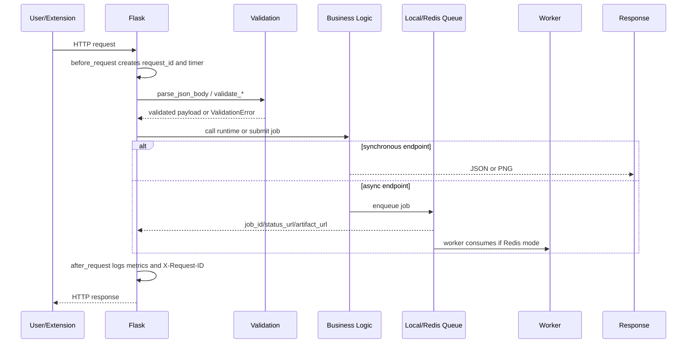

Line by line: every request gets a request ID and start time. JSON endpoints validate content type and shape. Business logic either runs immediately or queues work. Responses include request ID, and metrics/logs are emitted after the route.

Why designed this way: consistent validation and observability make API behavior easier to debug.

Alternatives: middleware libraries, OpenAPI schema validation, response models, tracing.

Advantages: simple and explicit.

Disadvantages: manual validation can grow verbose.

Interviewer may ask: "How are errors normalized?" Ideal answer: custom exceptions are handled by Flask error handlers that return `{"error": {"message", "status_code", "request_id"}}`.

Common mistake: forgetting that async create endpoints return `202`, not final analytics results.

Interview Summary: Flask wraps each request with IDs, validation, route logic, optional queueing, metrics, logging, and structured errors.

## SECTION 10 - YouTube API Integration

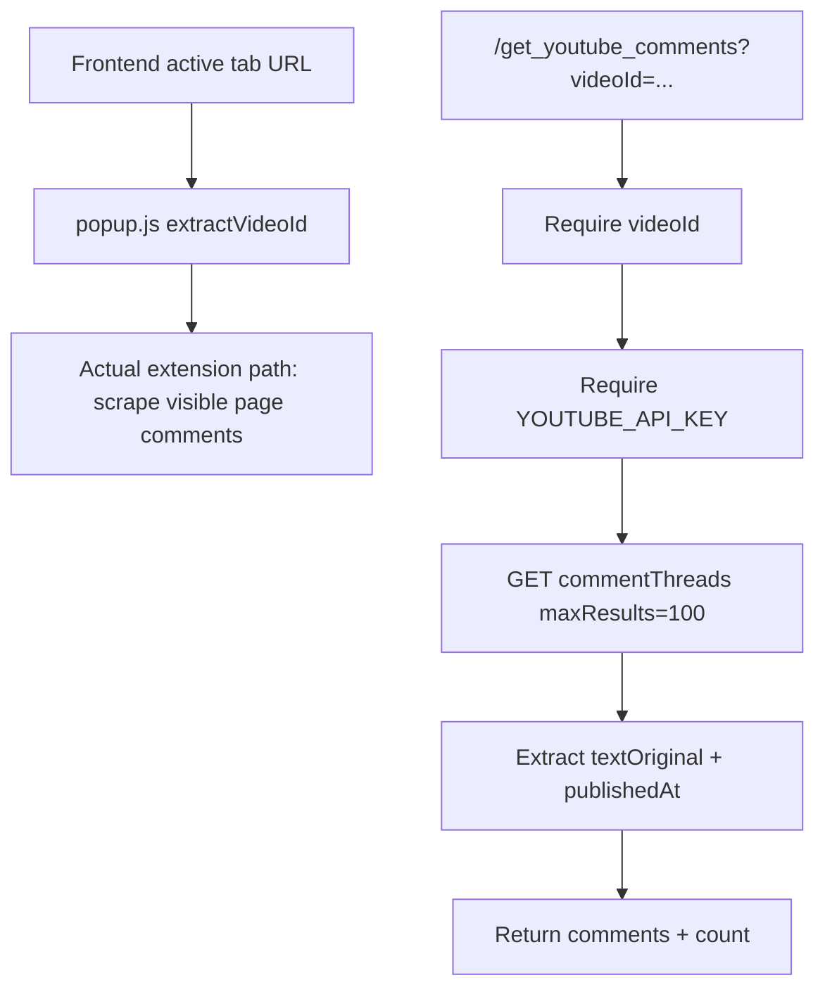

Line by line: the extension extracts the video ID but does not call `/get_youtube_comments`; it scrapes visible comments. The Flask endpoint can call the YouTube Data API when given `videoId` and an API key. It requests up to 100 comments once and maps response items into text/timestamp objects.

URL input: extension reads active tab URL; homepage does not accept a YouTube URL.

Video ID extraction: regex supports `youtube.com/watch?v=`, `youtu.be/`, and `youtube.com/shorts/`.

API authentication: Flask uses `YOUTUBE_API_KEY` from environment.

Comment fetching: requests `commentThreads` with `part=snippet`, `maxResults=100`, `textFormat=plainText`.

Pagination: not implemented in Flask endpoint; no `nextPageToken` loop exists.

Error handling: missing `videoId` -> 400; missing key -> 503; request failure -> 502.

Comment collection: endpoint returns `{"comments": [...], "count": n}`.

Why designed this way: extension scraping avoids needing a YouTube API key for primary UI.

Alternatives: always use YouTube Data API, content scripts with continuous observers, or backend-controlled URL submission.

Advantages: simple extension demo and lower API dependency.

Disadvantages: scraping is brittle, limited by visible loaded comments, and affected by YouTube DOM changes.

Interviewer may ask: "Does it support YouTube pagination?" Ideal answer: the browser scraping scrolls several times; the API endpoint does not implement YouTube API pagination.

Common mistake: claiming the whole app uses YouTube Data API as the primary collection mechanism.

Interview Summary: YouTube integration is split: the extension scrapes visible comments; Flask has a single-page YouTube API endpoint as an auxiliary feature.

## SECTION 11 - Comment Collection Pipeline

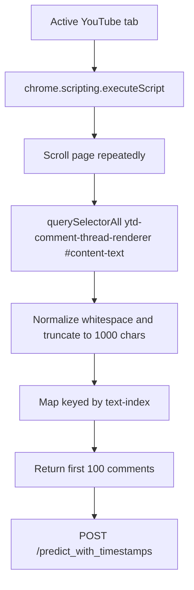

Line by line: the extension injects a function into the page, scrolls, selects comment nodes, sanitizes text, stores map entries, limits to 100 comments, and sends the resulting objects to Flask.

API requests: frontend then sends one prediction request and several analytics job requests.

Pagination: browser scrolling approximates loading more comments; true API pagination is not implemented.

Storage: comments live in JavaScript memory for the popup session.

Validation: frontend sanitizes; backend enforces non-empty list, max length, and timestamp shape.

Filtering: empty comments are removed; long comments are truncated.

Why designed this way: Chrome scripting can access already visible page content with no backend API key.

Alternatives: content script registered in manifest, MutationObserver, YouTube API pagination, or server-side scraping.

Advantages: fast demo.

Disadvantages: DOM selector fragility and inconsistent result count.

Interviewer may ask: "How do you dedupe comments?" Ideal answer: extension uses a Map with a text-index key, so exact global dedupe is limited; dataset curation utilities do stronger text dedupe offline.

Common mistake: saying comments are stored in a database.

Interview Summary: Runtime comment collection is in-memory browser scraping with sanitization and backend validation.

## SECTION 12 - Text Preprocessing Pipeline

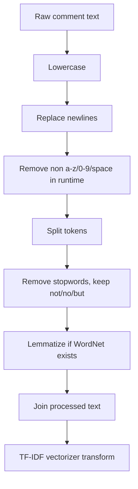

Line by line: comments are normalized, stripped of noise, tokenized with simple split, stopwords are removed, sentiment-bearing negation words are preserved, lemmatization is conditional, and final text is vectorized.

Cleaning: removes newline and non-alphanumeric noise.

Normalization/lowercasing: reduces feature sparsity.

Tokenization: simple whitespace split after regex cleanup.

Stopword removal: reduces frequent low-signal terms while preserving negations.

Stemming/lemmatization: lemmatization is used, not stemming; fallback exists if WordNet is unavailable.

Feature preparation: trained TF-IDF vectorizer converts processed text into sparse features.

Why every step exists: the model expects the same normalized vocabulary style used during training.

Alternatives: spaCy, Hugging Face tokenizers, character n-grams, sentence embeddings.

Advantages: lightweight and explainable.

Disadvantages: loses punctuation/emojis, weak handling of sarcasm/context, and depends on small training data.

Interviewer may ask: "How do you avoid failing if NLTK corpora are missing?" Ideal answer: runtime has fallback stopwords and conditionally skips WordNet lemmatization.

Common mistake: calling this deep learning or transformer NLP.

Interview Summary: Preprocessing is classic NLP cleanup feeding TF-IDF, with cached runtime processing and fallback NLTK behavior.

## SECTION 13 - Complete Sentiment Analysis Pipeline

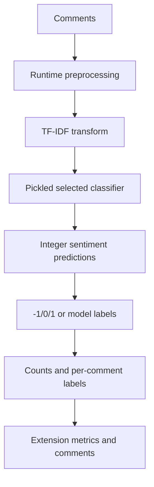

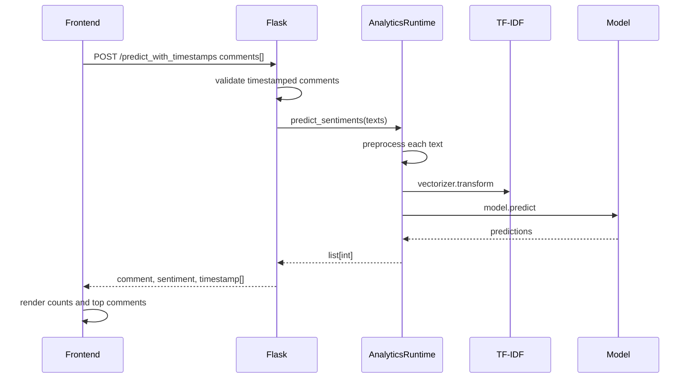

Line by line: comments are validated, preprocessed, vectorized, predicted, formatted with timestamps, and rendered. Aggregation is done in frontend for counters and in runtime for insight summaries.

Why designed this way: synchronous prediction is quick enough for the popup, while heavier visual analytics can be async.

Alternatives: batch all analytics into one endpoint, use a transformer sentiment service, or stream partial results.

Advantages: immediate first result and progressive analytics.

Disadvantages: multiple network calls and inconsistent label mapping risk because training labels include `0/1/2` while UI expects `-1/0/1`.

Interviewer may ask: "What is the biggest ML correctness concern?" Ideal answer: label semantics and small data quality; the UI treats `-1` as negative, but current reports show labels `0/1/2`, requiring careful mapping.

Common mistake: overstating accuracy.

Interview Summary: The sentiment path is synchronous TF-IDF inference followed by frontend aggregation and async supporting analytics.

## SECTION 14 - Machine Learning Pipeline

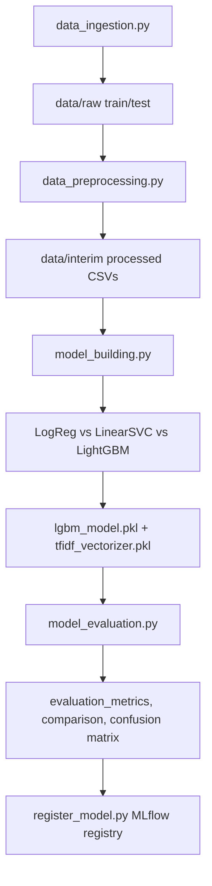

Line by line: ingestion standardizes data, preprocessing normalizes text, model building trains candidates and selects the best, artifacts are saved, evaluation writes reports and MLflow artifacts, registration uses MLflow model info.

Training: implemented in `src/model/model_building.py` with TF-IDF features and candidate models.

Model loading: `AnalyticsRuntime` loads pickled model/vectorizer at app startup.

Inference: preprocess -> vectorizer transform -> model predict.

Prediction output: route returns a list of objects with `comment`, `sentiment`, and `timestamp`.

If no training exists: not applicable; training scripts exist, plus notebooks show experimentation.

Why designed this way: DVC can reproduce pipeline stages and MLflow can log evaluation metadata.

Alternatives: scikit-learn Pipeline object, model registry deployment, feature store, transformer fine-tuning.

Advantages: reproducible classic ML workflow.

Disadvantages: model artifact naming always says `lgbm_model.pkl` even candidate selection could choose another model; current dataset is tiny.

Interviewer may ask: "How is model selection done?" Ideal answer: validation split ranks candidate models by macro F1, weighted F1, then accuracy.

Common mistake: saying LightGBM is always inherently best; in code it is selected by validation metrics.

Interview Summary: The ML pipeline uses DVC stages to create TF-IDF features, select a classifier, evaluate it, and expose pickled artifacts to Flask.

## SECTION 15 - Redis Architecture

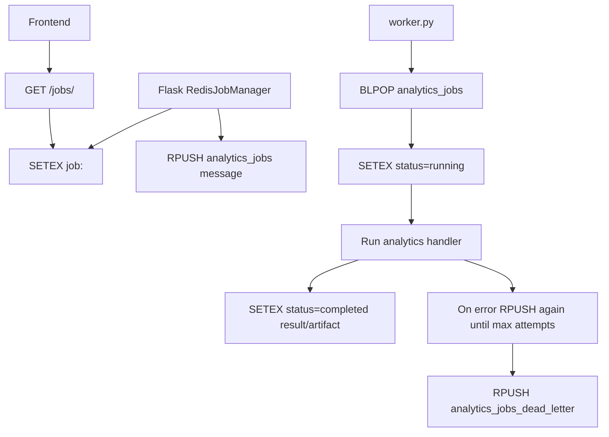

Line by line: Flask writes job metadata with TTL and pushes a message. Worker blocks on the queue, updates status, runs handler, stores result, retries on failure, and eventually dead-letters permanent failures. The frontend polls Flask, which reads Redis job state.

Redis: transient queue and job-state store.

Queues: primary list and dead-letter list.

Jobs: JSON messages with `job_id`, `job_type`, and payload.

Worker: Redis consumer in `worker.py`.

Result storage: Redis key stores JSON; byte artifacts are base64 encoded.

Retry logic: max attempts from environment; dead-letter after attempts exhausted.

Why designed this way: avoids needing a separate task framework while supporting a deployable worker.

Alternatives: Celery with Redis broker/backend, RQ, Dramatiq, SQS, Kafka.

Advantages: easy to reason about and test.

Disadvantages: no advanced scheduling, idempotency keys, visibility timeout, or worker heartbeats.

Interviewer may ask: "What happens if worker dies after BLPOP?" Ideal answer: with plain BLPOP, the message can be lost after pop unless job status remains recoverable; production should use reliable queue patterns or a mature task queue.

Common mistake: claiming Redis stores permanent analytics history.

Interview Summary: Redis is used as a transient job queue, result store, and dead-letter mechanism for analytics jobs.

## SECTION 16 - Queue Processing Flow

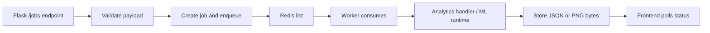

Line by line: job endpoints validate payloads, create records, enqueue work, worker runs analytics, and frontend polls until result or artifact URL is ready.

Why designed this way: separates request/response from heavier analytics generation.

Alternatives: websocket updates, server-sent events, one combined analytics endpoint.

Advantages: avoids blocking popup on topic/wordcloud/keyword computation.

Disadvantages: polling creates repeated requests and timeout complexity.

Interviewer may ask: "Which jobs are async?" Ideal answer: insights, topics, topic-sentiment, wordcloud, keyword-chart, and trend-graph have `/jobs/*` endpoints.

Common mistake: saying sentiment prediction itself is queued; main prediction endpoint is synchronous.

Interview Summary: The queue handles secondary analytics, while core sentiment prediction returns immediately.

## SECTION 17 - HTML to Flask to Redis to Worker Flow

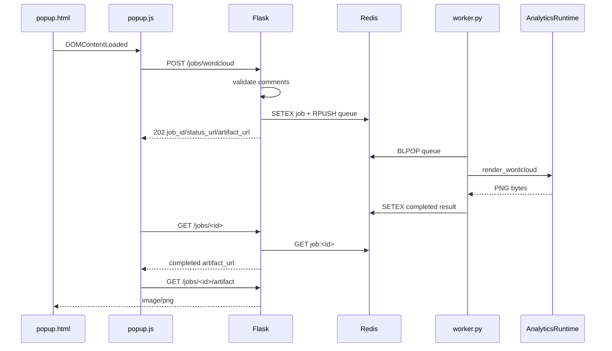

Line by line: HTML loads JS, JS creates a job, Flask enqueues it, the worker processes it, Redis stores result, JS polls status, then loads the artifact image into the popup.

Why designed this way: image generation is better as an artifact endpoint than huge inline JSON.

Alternatives: base64 image JSON, direct synchronous image endpoint, CDN/object storage.

Advantages: clean browser rendering through `img.src`.

Disadvantages: Redis holds binary artifacts in base64, which is not ideal for large files.

Interviewer may ask: "How would you store artifacts in production?" Ideal answer: store generated images in object storage and keep only metadata/status in Redis or DB.

Common mistake: assuming Flask streams worker output live.

Interview Summary: Frontend creates jobs, Flask enqueues, worker computes, Redis stores, and frontend retrieves status plus artifact.

## SECTION 18 - Dashboard Rendering Flow

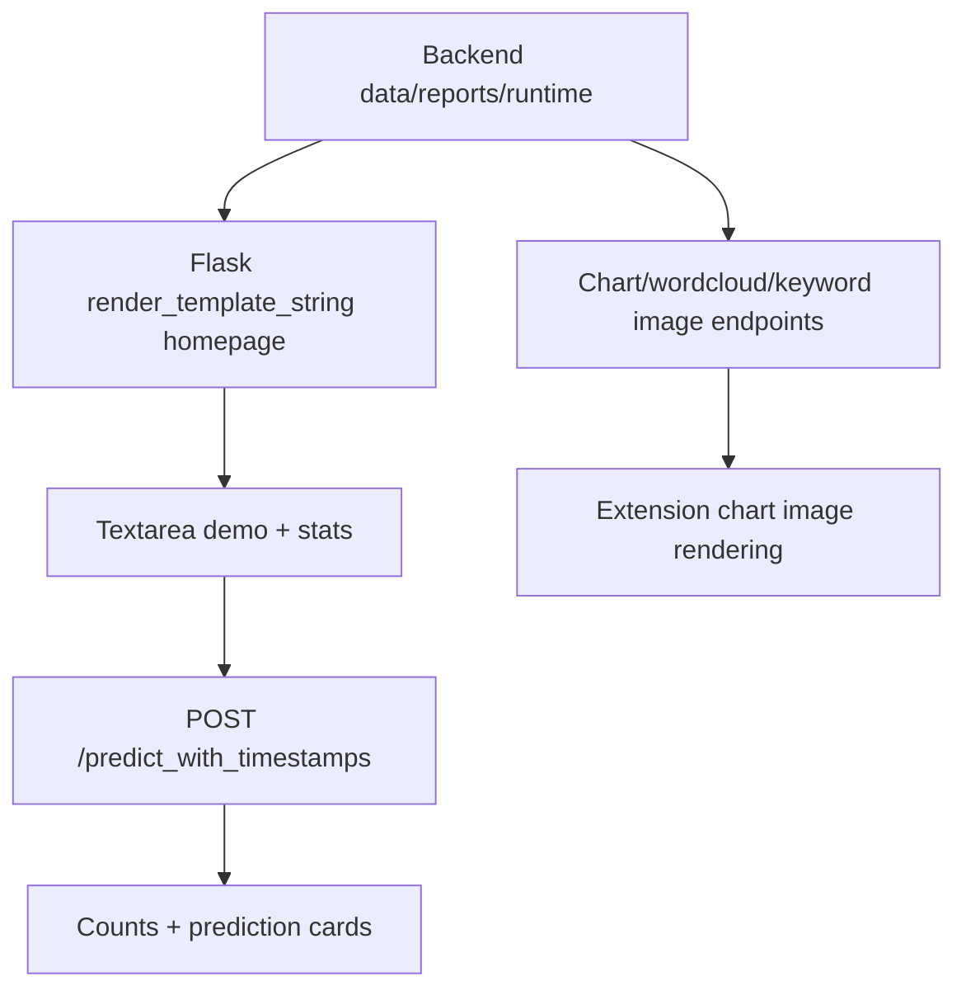

Line by line: Flask homepage renders server-side HTML from an inline template and calls live prediction from its demo script. Extension dashboard rendering is client-side and uses backend PNG endpoints or async artifact URLs.

Backend data: model-card and homepage read reports from `reports/model` and `reports/performance`.

Template rendering: homepage uses `render_template_string`, not files under `templates/`.

Charts: generated as PNGs using Matplotlib/WordCloud.

Statistics: extension computes counters from prediction response; homepage demo computes counters in inline JS.

Final dashboard: extension popup is the richer operational UI.

Why designed this way: homepage provides a public demo even without installing the extension.

Alternatives: dedicated Flask templates/static files, SPA dashboard, chart library in browser.

Advantages: minimal deployment assets.

Disadvantages: large inline template inside `app.py` and less maintainable CSS/JS.

Interviewer may ask: "Where are templates stored?" Ideal answer: there is no `templates/` folder; the homepage is an inline string in `app.py`.

Common mistake: describing a separate React dashboard.

Interview Summary: Dashboard rendering is mostly client-side in the extension, with a secondary inline Flask demo page.

## SECTION 19 - User Interaction Flow

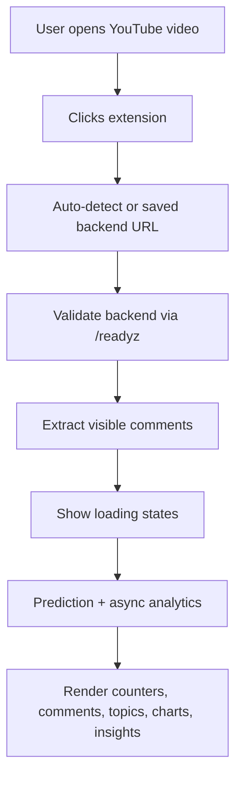

Line by line: actual flow starts from an active YouTube video, not a pasted URL. The popup validates backend reachability, extracts comments, shows progress, and renders final results.

Paste URL: not implemented in the extension. The prompt's "Paste URL" flow should be described as a possible future enhancement, not current behavior.

Validation: URL/backend validation occurs for API base URL; comment payload validation occurs backend-side.

Loading: messages include "Open a YouTube video", "Loading comments", "Scoring sentiment", and "Loading analytics".

Results: metrics, comments, chart images, word cloud, keyword chart, topics, topic sentiment, insights.

Why designed this way: it keeps the user inside the YouTube page.

Alternatives: web form where user pastes URL, server-side YouTube API fetch, or browser side panel.

Advantages: natural workflow for Chrome users.

Disadvantages: cannot analyze videos without opening them.

Interviewer may ask: "Where does user input happen?" Ideal answer: mostly implicit through the active tab; explicit input exists for backend URL and homepage demo comments.

Common mistake: describing a paste-URL product that is not coded.

Interview Summary: The implemented user journey is active-tab extension analysis, not URL-paste analysis.

## SECTION 20 - API Architecture

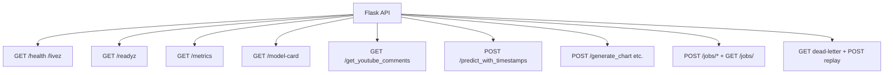

Line by line: routes are grouped by health/ops, model metadata, YouTube comments, synchronous inference/visuals, async jobs, and admin replay.

Endpoint summary:
- `GET /`: HTML demo homepage.
- `GET /health`, `/livez`: `{"status":"ok"}`.
- `GET /readyz`: dependency readiness and job backend.
- `GET /metrics`: Prometheus metrics.
- `GET /model-card`: deployment, artifacts, evaluation, reports, notes.
- `GET /get_youtube_comments?videoId=...`: first page of YouTube comments if API key exists.
- `POST /predict_with_timestamps`: timestamped comments -> per-comment sentiment.
- `POST /generate_chart`: sentiment counts -> PNG pie chart.
- `POST /generate_wordcloud`: comments -> PNG word cloud.
- `POST /extract_topics`: comments -> topic JSON.
- `POST /generate_insights`: comments -> local insight JSON.
- `POST /generate_trend_graph`: sentiment timestamp data -> PNG trend.
- `POST /generate_keyword_chart`: comments -> PNG bar chart.
- `POST /topic_sentiment`: timestamped comments -> topic sentiment JSON.
- `POST /jobs/insights`, `/jobs/topics`, `/jobs/topic-sentiment`, `/jobs/wordcloud`, `/jobs/keyword-chart`, `/jobs/trend-graph`: async jobs.
- `GET /jobs/<job_id>`: job status/result.
- `GET /jobs/<job_id>/artifact`: PNG artifact.
- `GET /admin/jobs/dead-letter`: Redis-only dead-letter list.
- `POST /admin/jobs/<job_id>/replay`: Redis-only replay.

Validation: `parse_json_body`, `validate_comments`, `validate_sentiment_counts`, `validate_sentiment_data`.

Errors: structured JSON with `message`, `status_code`, and `request_id`.

Why designed this way: small REST API with separate sync/async surfaces.

Alternatives: GraphQL, OpenAPI-generated schemas, single batch endpoint.

Advantages: clear endpoints and simple frontend fetches.

Disadvantages: many endpoint calls and no formal schema documentation.

Interviewer may ask: "What response code means queued?" Ideal answer: async creation and non-final job status return `202`; completed/failed job status returns `200`.

Common mistake: saying all analytics are asynchronous; sync endpoints also exist.

Interview Summary: The API is REST-style with health, inference, analytics, async job, artifact, and admin endpoints.

## SECTION 21 - Authentication Flow

```mermaid
flowchart TD
  Request["Incoming request"] --> CORS["CORS enabled"]
  CORS --> Validation["Payload validation"]
  Validation --> Route["Route handler"]
  Route --> Response["Response"]
  Auth["Authentication"] -. "Not implemented" .-> Route
```

Line by line: requests pass through CORS and validation, but no authentication or authorization check exists.

Why authentication was unnecessary: as a portfolio/demo app, it analyzes local user-visible comments and exposes a simple API. However, public deployment would need auth or at least rate limiting for abuse prevention.

If authentication existed: extension could send an API token or OAuth session token, Flask would validate it before route logic, and admin endpoints would require elevated privileges.

Alternatives: API keys, OAuth login, JWT, browser extension identity API, admin-only secrets.

Advantages of no auth: simple local demo and fewer onboarding steps.

Disadvantages: public endpoints can be abused; admin dead-letter endpoints are unprotected.

Interviewer may ask: "Is this safe for production?" Ideal answer: not as-is; add auth, rate limiting, CORS restrictions, and admin protection before production.

Common mistake: treating `YOUTUBE_API_KEY` as user authentication.

Interview Summary: There is no auth flow; production hardening should add API access control and protect admin endpoints.

## SECTION 22 - Database Architecture

```mermaid
erDiagram
  JOB_RECORD {
    string job_id
    string job_type
    string status
    datetime created_at
    datetime updated_at
    datetime completed_at
    string error
    int attempts
    int max_attempts
    bool dead_lettered
  }
  ARTIFACT {
    string job_id
    string content_type
    string artifact_filename
    bytes result_base64
  }
  JOB_RECORD ||--o| ARTIFACT : may_have
```

Line by line: this ER diagram represents the logical transient Redis job schema, not a relational database. A job may have an artifact if it produces PNG bytes.

Database exists: no application relational database exists.

Storage architecture:
- Redis keys store job records with TTL.
- Redis lists store primary and dead-letter queues.
- Pickle files store model/vectorizer artifacts.
- JSON reports store evaluation, model selection, performance, and data-quality outputs.
- MLflow can use local SQLite/file stores for experiment tracking.

Why designed this way: demo workloads do not need durable user history.

Alternatives: PostgreSQL for analyses/users, S3 for artifacts, Redis only for queues.

Advantages: low setup complexity.

Disadvantages: no durable analytics history or relational querying.

Interviewer may ask: "How would you add history?" Ideal answer: add an `analyses` table, `comments` table, `predictions` table, and object storage references for artifacts.

Common mistake: calling Redis a database replacement for persistent product data.

Interview Summary: The app has transient Redis job storage and file-based ML artifacts/reports, not a product database.

## SECTION 23 - Docker Architecture

```mermaid
flowchart TD
  Image["Dockerfile python:3.11-slim-bookworm"] --> Deps["pip install requirements"]
  Deps --> Code["COPY source"]
  Code --> Web["gunicorn app:app port 5000"]
  Compose["docker-compose.yml"] --> Redis["redis:7-alpine"]
  Compose --> WebSvc["web service"]
  Compose --> WorkerSvc["worker service python worker.py"]
  Redis --> WebSvc
  Redis --> WorkerSvc
  WebSvc --> Volume[".:/app volume"]
  WorkerSvc --> Volume
```

Line by line: Docker builds a Python image, installs dependencies, copies code, and runs Gunicorn. Compose adds Redis, web, and worker services with shared environment variables and volume mounts.

Container: Python 3.11 slim with build-essential and curl.

Network: Compose services communicate by service name `redis`.

Environment: `REDIS_URL`, queue names, max attempts, Python path, and `.env`.

Volumes: local repo mounted into `/app` for web and worker.

Dependencies: web and worker depend on Redis health.

Why designed this way: mirrors production-ish worker deployment locally.

Alternatives: multi-stage builds, no source volume in production, separate worker image, Kubernetes.

Advantages: reproducible stack with Redis.

Disadvantages: mounting repo into containers can mask image contents and is not ideal production style.

Interviewer may ask: "Why Gunicorn?" Ideal answer: Flask dev server is not production-grade; Gunicorn provides a WSGI server for container deployment.

Common mistake: saying Docker starts Celery; it starts `python worker.py`.

Interview Summary: Docker runs Flask/Gunicorn plus Redis plus a custom Python worker.

## SECTION 24 - Deployment Architecture

```mermaid
flowchart TD
  Browser["Browser / Extension"] --> Hosting["Render Web Service or Local Docker"]
  Hosting --> Flask["Flask Gunicorn app"]
  Flask --> Redis["Render KeyValue / Redis service"]
  Redis --> Worker["Render Worker / docker-compose worker"]
  Worker --> Model["Pickled model + vectorizer in image"]
  Model --> Flask
  Flask --> Browser
```

Line by line: browser calls the hosted Flask API. Flask uses Redis when available. Worker consumes Redis jobs. Model artifacts are included in the deployment image/repo. Responses return to browser.

Render: `render.yaml` declares keyvalue Redis, web service, and worker service.

Health: Render checks `/readyz`.

Environment: Render sets request limits, TTL, job attempts, queue names, Redis URL, log/debug settings.

Why designed this way: Render supports Docker web and worker services with managed Redis-like keyvalue.

Alternatives: AWS ECS, Heroku, Fly.io, Kubernetes, Cloud Run plus Memorystore.

Advantages: simple full-stack deployment.

Disadvantages: free-tier resource limits and cold starts can hurt ML latency.

Interviewer may ask: "How are model artifacts deployed?" Ideal answer: artifacts are committed/tracked and copied into the Docker image with source code.

Common mistake: saying the model is fetched from MLflow at runtime.

Interview Summary: Deployment is a Dockerized Flask web service plus Redis/keyvalue plus custom worker.

## SECTION 25 - Caching Architecture

```mermaid
flowchart TD
  Text["Comment text"] --> LRU["AnalyticsRuntime _preprocess_comment_cached maxsize=8192"]
  LRU --> Processed["Processed text reused"]
  Job["Job result"] --> RedisTTL["Redis SETEX job TTL"]
  RedisTTL --> Expire["Expires after JOB_TTL_SECONDS"]
  Local["Local jobs dict"] --> Cleanup["Cleanup expired jobs on access"]
```

Line by line: preprocessing has an in-process LRU cache. Redis job records expire via TTL. Local job manager cleans expired records. This is caching of computation and transient job state, not user data caching.

Cache strategy: reuse preprocessed text and expire job state.

Redis usage: job state and artifact payloads with TTL.

Expiration: `JOB_TTL_SECONDS`, default 3600 seconds.

Why designed this way: repeated comments and polling should not accumulate forever.

Alternatives: cache model predictions by normalized text, CDN images, object storage lifecycle rules.

Advantages: easy memory control and stale job cleanup.

Disadvantages: LRU is per process; Redis artifacts expire and are not durable.

Interviewer may ask: "Is Redis used as a prediction cache?" Ideal answer: no, it stores async job state/results; text preprocessing uses an in-process LRU cache.

Common mistake: describing Redis as a general cache for all API responses.

Interview Summary: Caching is limited to text preprocessing and expiring async job state.

## SECTION 26 - Error Handling Flow

```mermaid
flowchart TD
  Error["Error source"] --> API["API validation failure"]
  Error --> RedisFail["Redis unavailable"]
  Error --> WorkerFail["Worker handler failure"]
  Error --> ModelFail["Model artifact/runtime failure"]
  Error --> Timeout["Frontend job timeout"]
  API --> JSON["Structured error JSON"]
  RedisFail --> Fallback["Fallback to local job manager"]
  WorkerFail --> Retry["Retry until max attempts"]
  Retry --> Dead["Dead-letter queue"]
  ModelFail --> Ready["/readyz degraded or 503 runtime error"]
  Timeout --> UI["Popup error/loading message"]
```

Line by line: validation errors become structured JSON. Redis connection failure at startup falls back to local jobs. Worker failures retry then dead-letter. Model load failures mark readiness degraded and runtime endpoints fail. Frontend timeouts show user-facing errors.

API failure: error handlers wrap `ValidationError`, `JobNotReadyError`, and unexpected exceptions.

Redis failure: app attempts Redis ping; if unavailable, local executor is used.

Worker failure: exception captured, job requeued until max attempts, then dead-lettered.

Model failure: `MODEL_READY` gauge set to 0 and `ensure_runtime` raises 503.

Timeout: frontend `waitForJob` throws after 30 seconds.

Why designed this way: graceful degradation keeps local demos working without Redis.

Alternatives: fail-fast if Redis unavailable, circuit breakers, retry backoff, structured error codes.

Advantages: resilient demo and testable failure modes.

Disadvantages: fallback can hide production Redis issues; retries have no backoff.

Interviewer may ask: "What happens to failed jobs?" Ideal answer: local jobs are marked failed/dead-lettered in memory; Redis jobs are pushed to the dead-letter list.

Common mistake: claiming all failures are retried; validation and model readiness errors are not job retries.

Interview Summary: Errors are normalized for HTTP and retried/dead-lettered for async job failures.

## SECTION 27 - Performance Optimization

```mermaid
flowchart TD
  Perf["Performance"] --> Async["Async analytics jobs"]
  Perf --> Queue["Redis worker offload"]
  Perf --> Cache["LRU preprocessing cache"]
  Perf --> Lazy["Lazy imports for heavy libs"]
  Perf --> Limits["Max comments and max length"]
  Perf --> Parallel["ThreadPoolExecutor local jobs"]
  Perf --> Batch["Batch vectorizer transform"]
```

Line by line: performance comes from not blocking on secondary analytics, optionally moving work to workers, caching preprocessing, loading heavy libraries only when needed, constraining payload sizes, local thread parallelism, and vectorizing batches.

Async processing: `/jobs/*` endpoints.

Queue: Redis for multi-process web/worker mode.

Caching: preprocessing LRU.

Parallelism: local ThreadPoolExecutor and Gunicorn workers if configured.

Batch processing: prediction transforms list of comments in one vectorizer call.

Lazy loading: pandas, Matplotlib, and WordCloud imported inside helper functions.

Why designed this way: improves perceived UI responsiveness.

Alternatives: GPU inference, model server, precomputed embeddings, streaming results.

Advantages: simple and effective for small comment batches.

Disadvantages: ThreadPool may not scale for CPU-heavy Python workloads; Matplotlib image generation is expensive.

Interviewer may ask: "What measured performance exists?" Ideal answer: `reports/performance/load_test_report_optimized.json` records 50 requests, concurrency 10, p95 about 248.5 ms, zero failures on local test.

Common mistake: inventing production-scale benchmarks.

Interview Summary: Performance work is mainly async offload, bounded inputs, lazy loading, cached preprocessing, and batch TF-IDF inference.

## SECTION 28 - Scalability

```mermaid
flowchart TD
  Users100["100 users"] --> OneWeb["One web + local/Redis worker"]
  Users1000["1,000 users"] --> MultiWeb["Multiple Gunicorn/web replicas"]
  MultiWeb --> RedisScale["Managed Redis"]
  Users10000["10,000 users"] --> WorkerPool["Worker pool + object storage"]
  Users100000["100,000 users"] --> Platform["API gateway, autoscaling, durable queue, DB, CDN"]
```

Line by line: low usage can run on one web service. Medium usage needs multiple web replicas and Redis. Higher usage needs worker pools and artifact storage. Very high usage needs platform services, durable queues, database persistence, CDN, rate limits, and observability.

100 users: current Docker/Render architecture can be acceptable for demos.

1,000 users: scale Flask replicas behind load balancer; Redis centralizes job state.

10,000 users: split inference and analytics, add worker autoscaling, store artifacts in S3/GCS, add rate limiting.

100,000 users: add API gateway, autoscaling, durable queue like SQS/Kafka, database, object storage, centralized logs/traces, model-serving layer.

Why designed this way: current architecture has clear upgrade paths but is not yet high-scale.

Alternatives: serverless functions for charts, managed ML endpoint for inference.

Advantages: Redis worker model scales horizontally for job workloads.

Disadvantages: custom queue needs replacement or hardening at large scale.

Interviewer may ask: "What scales independently?" Ideal answer: web replicas and worker replicas can scale separately; Redis and model serving become shared bottlenecks.

Common mistake: saying just add more Flask workers solves all scaling issues.

Interview Summary: Scale web, worker, queue, artifacts, and persistence separately as traffic grows.

## SECTION 29 - Possible Bottlenecks

```mermaid
flowchart TD
  Bottlenecks["Bottlenecks"] --> YouTube["YouTube DOM/API limits"]
  Bottlenecks --> Frontend["Popup sequential analytics calls"]
  Bottlenecks --> Flask["Large app process + sync prediction"]
  Bottlenecks --> Redis["Single queue and large base64 artifacts"]
  Bottlenecks --> Worker["CPU-bound charts/topic clustering"]
  Bottlenecks --> ML["TF-IDF/model artifact memory and label quality"]
```

Line by line: YouTube collection can be slow/brittle. Frontend requests many analytics sequentially. Flask can be blocked by sync endpoints. Redis can become a queue/result bottleneck. Worker can be CPU-heavy. ML quality can bottleneck product value.

Why designed this way: the project optimizes for demonstration clarity first.

Alternatives: parallel frontend analytics calls, batch analytics endpoint, object storage, worker concurrency, better model/data.

Advantages: bottlenecks are easy to identify.

Disadvantages: several are user-visible under load.

Interviewer may ask: "What would fail first?" Ideal answer: YouTube comment extraction reliability and worker/Redis job throughput are likely first operational bottlenecks.

Common mistake: focusing only on model inference speed while ignoring chart generation and browser extraction.

Interview Summary: Bottlenecks are browser extraction, multi-call rendering, worker CPU, Redis artifacts, and prototype ML quality.

## SECTION 30 - Security Architecture

```mermaid
flowchart TD
  Security["Security Controls"] --> Validation["Input validation and size limits"]
  Security --> Secrets["YOUTUBE_API_KEY in environment"]
  Security --> CORS["CORS enabled broadly"]
  Security --> Logs["Structured logs avoid request bodies"]
  Security --> Missing["Missing auth/rate limiting/admin protection"]
```

Line by line: the app validates payloads and limits comment count/length. YouTube API key is read from environment. CORS is enabled. Logs include request metadata, not full payloads. Major production controls are missing.

Input validation: non-empty lists, max comments, max length, timestamp requirements, sentiment values.

API key protection: `.env` ignored; key loaded from env. `replacements.txt` contains a removed key marker.

Rate limiting: not implemented.

Environment variables: central config in `AppConfig`.

Secrets: no secret manager integration.

Why designed this way: adequate for local/demo, incomplete for public production.

Alternatives: Flask-Limiter, API gateway throttling, Vault/Render secrets, auth tokens.

Advantages: avoids hardcoding runtime API key in code.

Disadvantages: open endpoints can be abused.

Interviewer may ask: "What is the most urgent security fix?" Ideal answer: protect admin endpoints, restrict CORS, add rate limiting, and manage secrets through deployment provider.

Common mistake: saying Docker alone secures the app.

Interview Summary: Security is basic validation/env-secret handling; production needs auth, rate limits, and admin access control.

## SECTION 31 - Technology Decisions

```mermaid
flowchart LR
  Decision["Technology Decisions"] --> Flask["Flask: simple ML API"]
  Decision --> Redis["Redis: queue + transient state"]
  Decision --> Docker["Docker: reproducible deployment"]
  Decision --> HTMLCSSJS["HTML/CSS/JS: simple extension"]
  Decision --> Tailwind["Tailwind: not used"]
  Decision --> Model["TF-IDF + LightGBM/classic ML"]
```

Line by line: choices are Flask for HTTP, Redis for jobs, Docker for deployment, plain HTML/CSS/JS for extension, no Tailwind, and classic ML for sentiment.

Why Flask: lightweight, familiar, easy to serve ML artifacts.

Why Redis: simple queue and job state store; works with Docker Compose and Render keyvalue.

Why Docker: bundles Python dependencies, model artifacts, and Gunicorn server.

Why Tailwind: not applicable; it is not implemented.

Why HTML templates: Flask homepage uses inline HTML for a no-build public demo.

Why JavaScript: Chrome extension APIs require JS; vanilla JS avoids build tooling.

Why chosen ML model: `model_building.py` evaluates candidates and selected LightGBM in the committed report.

Alternatives and trade-offs:
- FastAPI: stronger typing/OpenAPI, but Flask is simpler.
- Celery/RQ: more robust queueing, but extra complexity.
- React/Tailwind: better frontend maintainability, but requires build pipeline.
- Transformer model: better NLP quality, but slower/heavier and more expensive.

Interviewer may ask: "Why not Tailwind?" Ideal answer: the current implementation uses custom CSS; Tailwind would be a future refactor, not a current technology.

Common mistake: listing every dependency as actually used; `keybert` and `celery` are installed but not used in code paths inspected.

Interview Summary: The stack prioritizes simple full-stack ML deployment with Flask, Redis, Docker, vanilla extension UI, and classic ML.

## SECTION 32 - Project Explanation

```mermaid
flowchart TD
  Short["30 sec"] --> Medium["2 min"]
  Medium --> Long["5 min"]
  Long --> Deep["10 min"]
```

30 second version: CommentPulse is a Chrome extension and Flask ML API that extracts visible YouTube comments, predicts sentiment with a TF-IDF classifier, and renders comment insights, topics, and charts.

2 minute version: The extension runs on an active YouTube tab, collects visible comments with Chrome scripting, sanitizes them, and calls Flask endpoints. The backend loads a pickled TF-IDF vectorizer and classifier, validates payloads, returns synchronous sentiment predictions, and offloads heavier analytics like topics, word clouds, and keyword charts to local or Redis-backed async jobs. Docker Compose can run Flask, Redis, and a worker. DVC and MLflow scripts reproduce ingestion, preprocessing, training, evaluation, and model metadata.

5 minute version: Start with the user flow, then the architecture: popup -> Flask -> validation -> runtime -> model or job queue -> result. Explain that core prediction is synchronous for fast feedback, while analytics are async to keep the UI responsive. Explain `AnalyticsRuntime` as the ML/analytics service: preprocessing, TF-IDF transform, prediction, KMeans topics, local insights, and image rendering. Explain deployment through Gunicorn Docker web plus Redis worker. Be honest that Tailwind/Celery/database/auth are not implemented, and that the model is prototype-grade because committed reports show tiny labeled data and low metrics.

10 minute version: Add low-level details: `AppConfig` reads env; `create_app` loads model artifacts and chooses Redis or local jobs; request hooks add request IDs and Prometheus metrics; validation functions enforce shape and size; `LocalJobManager` uses ThreadPoolExecutor; `RedisJobManager` stores jobs with SETEX and queues with RPUSH; `worker.py` uses BLPOP, retries, and dead letters. The ML pipeline starts from standardized CSV data, normalizes text with NLTK, trains TF-IDF candidate models, selects by validation metrics, evaluates with MLflow reports, and stores artifacts used by Flask. Discuss scaling: split web and worker, replace custom queue with managed queue, store artifacts in object storage, add auth/rate limits, and improve model data.

Why this explanation works: it starts with product value, then system flow, then implementation details, then limitations and scale path.

Interviewer may ask: "What part are you proud of?" Ideal answer: the end-to-end integration between browser extraction, Flask inference, async analytics, Docker deployment, and reproducible ML pipeline.

Common mistake: spending all time on ML and ignoring the user-facing extension.

Interview Summary: Explain CommentPulse as an end-to-end browser-to-ML analytics system, then be precise about what is implemented and what is future work.

## SECTION 33 - Interview Questions

```mermaid
flowchart TD
  Q["50 Interview Questions"] --> A["Ideal Answer"]
  Q --> W["Why asked"]
  Q --> M["Common Mistake"]
  Q --> B["Better Answer"]
```

1. What problem does CommentPulse solve? | Ideal: quick YouTube comment sentiment and audience insight analysis. | Why: tests product clarity. | Mistake: generic ML platform. | Better: mention Chrome extension plus Flask ML.
2. What is the primary frontend? | Ideal: Manifest V3 Chrome popup. | Why: frontend scope. | Mistake: Flask homepage. | Better: homepage is secondary demo.
3. Is Tailwind used? | Ideal: no, custom CSS. | Why: truthfulness. | Mistake: claim Tailwind. | Better: propose future Tailwind migration.
4. Is Celery used? | Ideal: dependency only, not code. | Why: queue accuracy. | Mistake: say Celery worker. | Better: custom Redis worker.
5. How are comments collected? | Ideal: browser script scrolls and queries YouTube DOM. | Why: integration. | Mistake: only YouTube API. | Better: API endpoint is auxiliary.
6. Does YouTube API pagination exist? | Ideal: no. | Why: edge cases. | Mistake: claim nextPageToken. | Better: first page only in endpoint.
7. What validates inputs? | Ideal: `validate_comments`, counts, sentiment data helpers. | Why: API safety. | Mistake: frontend only. | Better: backend enforces limits.
8. What is synchronous? | Ideal: prediction and some chart endpoints. | Why: latency. | Mistake: all queued. | Better: heavy extension analytics use jobs.
9. What is asynchronous? | Ideal: `/jobs/*` analytics. | Why: architecture. | Mistake: prediction. | Better: topics/insights/artifacts.
10. How does local async work? | Ideal: ThreadPoolExecutor. | Why: fallback. | Mistake: Redis always required. | Better: Redis optional.
11. How does Redis async work? | Ideal: SETEX job, RPUSH queue, BLPOP worker. | Why: distributed jobs. | Mistake: pub/sub. | Better: list queue.
12. How are artifacts stored? | Ideal: bytes in job result, base64 in Redis. | Why: storage. | Mistake: files/S3. | Better: object storage future.
13. What happens on worker failure? | Ideal: retry until max attempts then dead-letter. | Why: reliability. | Mistake: immediate loss. | Better: explain attempts.
14. What metrics exist? | Ideal: Prometheus HTTP, inference, external, job, queue metrics. | Why: observability. | Mistake: logs only. | Better: `/metrics`.
15. How are requests traced? | Ideal: X-Request-ID and JSON logs. | Why: debugging. | Mistake: no tracing. | Better: request-level correlation.
16. What model is loaded? | Ideal: pickled classifier and TF-IDF vectorizer. | Why: ML runtime. | Mistake: transformer. | Better: classic ML.
17. How is text preprocessed? | Ideal: lowercase, regex, stopwords, optional lemmatization. | Why: NLP. | Mistake: no preprocessing. | Better: runtime mirrors training style.
18. Why keep negation words? | Ideal: sentiment depends on not/no/but. | Why: NLP nuance. | Mistake: remove all stopwords. | Better: preserve sentiment-bearing terms.
19. What ML reports show quality? | Ideal: evaluation_metrics, model_selection, comparison. | Why: evidence. | Mistake: invent accuracy. | Better: cite prototype metrics.
20. How is best model selected? | Ideal: validation macro F1, weighted F1, accuracy. | Why: model design. | Mistake: hardcoded LightGBM. | Better: candidate selection.
21. What are current data limitations? | Ideal: tiny labeled data, low metrics. | Why: honesty. | Mistake: production-ready claims. | Better: prototype-grade.
22. What is DVC doing? | Ideal: tracks pipeline stages/deps/outs. | Why: MLOps. | Mistake: runtime dependency. | Better: training reproducibility.
23. What is MLflow doing? | Ideal: evaluation logging/registry metadata. | Why: MLOps. | Mistake: model serving. | Better: not runtime serving.
24. What does Docker run? | Ideal: Gunicorn Flask app. | Why: deploy. | Mistake: Flask dev server. | Better: `app:app`.
25. What does Compose add? | Ideal: Redis, web, worker. | Why: system design. | Mistake: web only. | Better: full async stack.
26. What does Render deploy? | Ideal: keyvalue Redis, web, worker. | Why: hosting. | Mistake: static site. | Better: Docker services.
27. Is there a database? | Ideal: no app DB. | Why: persistence. | Mistake: Redis as durable DB. | Better: transient storage.
28. Is there authentication? | Ideal: no. | Why: security. | Mistake: API key auth. | Better: YouTube key is external auth.
29. What is biggest security gap? | Ideal: open admin/API endpoints and no rate limiting. | Why: production readiness. | Mistake: none. | Better: add auth/rate limits.
30. What is biggest scaling gap? | Ideal: custom Redis queue and artifact storage. | Why: scaling. | Mistake: just add servers. | Better: durable queue/object store.
31. How does frontend know backend URL? | Ideal: saved Chrome storage or default candidates. | Why: UX. | Mistake: hardcoded only. | Better: auto-detect plus settings.
32. How does frontend handle job timeout? | Ideal: 30-second polling timeout. | Why: reliability. | Mistake: infinite wait. | Better: throws error.
33. How are charts rendered? | Ideal: backend Matplotlib/WordCloud PNG. | Why: visualization. | Mistake: Chart.js. | Better: image endpoints.
34. How are topics generated? | Ideal: TF-IDF plus KMeans. | Why: NLP. | Mistake: LLM. | Better: local classic clustering.
35. How are insights generated? | Ideal: local counts/themes/recommendations, not external AI. | Why: dependencies. | Mistake: OpenAI API. | Better: deterministic local summary.
36. What tests exist? | Ideal: Flask, jobs, Redis integration, dataset workflow. | Why: quality. | Mistake: no tests. | Better: note Redis gated by env.
37. What does CI run? | Ideal: unit app tests and Redis integration with service. | Why: automation. | Mistake: full DVC. | Better: unittest workflows.
38. What is `worker.py` lifecycle? | Ideal: infinite BLPOP loop. | Why: jobs. | Mistake: scheduled cron. | Better: long-running worker.
39. What happens if Redis unavailable? | Ideal: fallback local jobs. | Why: resilience. | Mistake: app fails. | Better: degraded but working.
40. What is readiness based on? | Ideal: model/vectorizer/runtime and backend info. | Why: deployment. | Mistake: same as health. | Better: health only liveness.
41. Why lazy import Matplotlib? | Ideal: avoid startup cost until charts needed. | Why: performance. | Mistake: no reason. | Better: lighter app startup.
42. What data does extension store? | Ideal: API base URL in Chrome local storage. | Why: privacy. | Mistake: comments stored permanently. | Better: comments in memory.
43. What are binary artifacts? | Ideal: model, vectorizer, confusion matrix image. | Why: repo understanding. | Mistake: source code. | Better: generated assets.
44. What do notebooks represent? | Ideal: experiments, not runtime. | Why: boundaries. | Mistake: production pipeline. | Better: historical exploration.
45. What does `setup.py` package? | Ideal: `src` package metadata, minimal install config. | Why: Python packaging. | Mistake: dependency source. | Better: requirements handles deps.
46. What is load test scope? | Ideal: local prediction endpoint benchmark. | Why: performance evidence. | Mistake: production benchmark. | Better: local report only.
47. What would you refactor first? | Ideal: split `app.py` and externalize templates/static. | Why: maintainability. | Mistake: rewrite everything. | Better: incremental modules.
48. What would improve model quality? | Ideal: more labeled data, label mapping, cross-validation, better NLP. | Why: ML maturity. | Mistake: tune only. | Better: data first.
49. What is the main trade-off? | Ideal: simple demo vs production hardening. | Why: architecture judgment. | Mistake: no trade-offs. | Better: name gaps.
50. How would you explain it in interviews? | Ideal: browser-to-Flask-to-ML-to-async analytics with honest limitations. | Why: communication. | Mistake: buzzwords. | Better: specific flows.

Interview Summary: These questions test whether you can explain the actual codebase, trade-offs, and production gaps without inventing features.

## SECTION 34 - Cross Questions

```mermaid
flowchart TD
  Cross["50 Difficult Follow-up Questions"] --> Scale["Scale"]
  Cross --> ML["ML correctness"]
  Cross --> Security["Security"]
  Cross --> Reliability["Reliability"]
  Cross --> Frontend["Frontend UX"]
```

1. How would you redesign the queue to avoid losing jobs after `BLPOP`?
2. How would you make YouTube comment collection resilient to DOM changes?
3. How would you implement YouTube API pagination and quota handling?
4. How would you map labels consistently between `0/1/2` training and `-1/0/1` UI?
5. How would you add user accounts without breaking the extension flow?
6. How would you protect dead-letter admin endpoints?
7. How would you prevent users from submitting 10,000 comments?
8. How would you support multiple videos in one dashboard?
9. How would you persist analysis history?
10. How would you replace Redis artifact storage with object storage?
11. How would you split `app.py` into maintainable modules?
12. How would you version model artifacts?
13. How would you roll back a bad model?
14. How would you compare model versions online?
15. How would you monitor sentiment drift?
16. How would you detect YouTube API failure separately from model failure?
17. How would you implement exponential backoff for jobs?
18. How would you handle duplicate job submissions?
19. How would you add idempotency keys?
20. How would you implement a single batch analytics endpoint?
21. How would you convert this to FastAPI?
22. How would you convert the extension to React?
23. How would you add Tailwind truthfully?
24. How would you make charts client-side instead of server-side?
25. How would you test popup UI behavior?
26. How would you run end-to-end tests against YouTube pages?
27. How would you avoid leaking API keys in logs or bundles?
28. How would you add rate limiting per IP or user?
29. How would you deploy this on Kubernetes?
30. How would you handle Redis failover?
31. How would you load models from MLflow registry at startup?
32. How would you reduce Docker image size?
33. How would you handle cold starts?
34. How would you add tracing across Flask and worker?
35. How would you expose job progress percentages?
36. How would you parallelize frontend analytics calls safely?
37. How would you cache prediction results?
38. How would you handle multilingual comments?
39. How would you handle emojis and sarcasm?
40. How would you handle toxic content moderation?
41. How would you build a human labeling workflow?
42. How would you evaluate class imbalance?
43. How would you validate model fairness?
44. How would you guard against prompt-injection-like text if using LLM summaries?
45. How would you make the worker horizontally scalable?
46. How would you ensure only one worker processes a job?
47. How would you prevent Redis memory pressure?
48. How would you design database tables for analysis history?
49. How would you generate a public shareable report?
50. How would you explain why this is production-adjacent but not production-complete?

Why these are asked: interviewers use them to test depth beyond the happy path.

Common mistake: answering every question with "add more servers" or "use Kubernetes" without explaining the bottleneck.

Interview Summary: Follow-ups focus on durability, correctness, security, scale, ML quality, and maintainability.

## SECTION 35 - Explain Every Important File

```mermaid
flowchart TD
  Files["Repository Files"] --> Runtime["Runtime serving"]
  Files --> Frontend["Chrome extension"]
  Files --> Pipeline["ML pipeline"]
  Files --> Infra["Infrastructure"]
  Files --> Tests["Tests"]
  Files --> Artifacts["Artifacts/reports/docs"]
```

Line by line: files group into runtime, frontend, pipeline, infrastructure, tests, and generated artifacts.

Runtime:
- `app.py`: main Flask app, app factory, config, logging, metrics, validation, routes, inline homepage, local/Redis job managers.
- `analytics_runtime.py`: loads model/vectorizer; preprocesses comments; predicts sentiment; generates topics, insights, charts, word clouds, keyword charts, trend graphs.
- `worker.py`: Redis blocking worker; updates job status; retries; dead-letters failures.
- `flask_api/main.py`: thin entrypoint importing `app`.

Frontend:
- `yt-chrome-plugin-frontend/manifest.json`: Manifest V3 metadata, permissions, host permissions.
- `yt-chrome-plugin-frontend/popup.html`: popup markup and custom CSS.
- `yt-chrome-plugin-frontend/popup.js`: initialization, backend discovery, comment extraction, API calls, job polling, rendering.

Data and ML pipeline:
- `src/data/data_ingestion.py`: loads local/remote CSV, standardizes schema, cleans data, splits train/test, writes quality report.
- `src/data/data_preprocessing.py`: downloads NLTK resources if missing, preprocesses text, writes interim CSVs and preprocessing report.
- `src/data/dataset_curation.py`: prepares labeling queues, model suggestions, pseudo-label bootstrap, review files, merges, audits.
- `src/model/model_building.py`: builds TF-IDF, trains candidates, selects best model, saves vectorizer/model/report.
- `src/model/model_evaluation.py`: loads artifacts, evaluates test data, writes metrics/comparison, logs MLflow artifacts.
- `src/model/register_model.py`: registers MLflow model from `experiment_info.json`.
- `src/model/promote_baseline.py`: promotes candidate metrics report to baseline if policy allows or force is used.
- `src/__init__.py`: package marker.

Infrastructure/config:
- `Dockerfile`: Python 3.11 slim image, dependency install, Gunicorn command.
- `docker-compose.yml`: Redis, web, and worker services.
- `render.yaml`: Render keyvalue, web, and worker deployment.
- `.github/workflows/ci.yml`: unit and Redis integration CI.
- `requirements.txt`: Python dependencies; includes some unused runtime dependencies like Celery and KeyBERT.
- `dvc.yaml`: DVC stages.
- `dvc.lock`: locked hashes/outs for DVC stages.
- `params.yaml`: ingestion, model, evaluation, and data-quality parameters.
- `.dockerignore`, `.gitignore`, `.dvcignore`, `.dvc/config`: ignore and DVC config files.
- `setup.py`, `youtube.egg-info/*`: minimal package metadata.
- `scripts/tasks.ps1`: local task runner for API, stack, worker, tests, curation, load test, baseline promotion.
- `scripts/load_test.py`: concurrent local prediction endpoint benchmark.

Tests:
- `tests/test_app.py`: Flask health/readiness/model-card/errors/jobs/retry/dead-letter behavior.
- `tests/test_redis_integration.py`: optional Redis worker integration tests gated by `RUN_REDIS_INTEGRATION=1`.
- `tests/test_ml_data_workflow.py`: dataset curation, bootstrap, audit, and baseline promotion tests.

Reports/artifacts:
- `reports/model/*.json`: selected model, evaluation metrics, baseline/comparison.
- `reports/model/confusion_matrix_test.png` and `confusion_matrix_Test Data.png`: confusion matrix images.
- `reports/data_quality/*.json`: ingestion, preprocessing, curation, merge, audit reports.
- `reports/performance/*.json`: load-test reports.
- `lgbm_model.pkl`, `tfidf_vectorizer.pkl`: runtime ML artifacts.
- `data/raw`, `data/interim`, `data/external`: tracked datasets and labeling queues.
- `data.json`: small sample comments payload.
- `*.log`: historical error logs.
- `replacements.txt`: removed API key marker.
- `notebooks/*.ipynb`: Colab experiments for EDA, baseline model, BoW/TF-IDF, max features, imbalance handling, multi-model HPT, LightGBM HPT, and stacking.
- `docs/interview-prep/*`: existing prep documentation.
- `README.md`, `LICENSE`: project description and license; README was not used as the only source.

Why this file layout was designed this way: it keeps serving code, ML scripts, extension files, tests, and infra visible in one portfolio repository.

Alternative file layout: package Flask code under `commentpulse/api`, move templates/static out of `app.py`, move notebooks to `experiments`, and store generated artifacts through DVC/MLflow rather than root.

Advantages: easy for interviewers to inspect end to end.

Disadvantages: production and experiment artifacts are mixed, and `app.py` is too broad.

Interviewer may ask: "Which file would you open first to debug a production issue?" Ideal answer: depends on issue; API route behavior in `app.py`, ML output in `analytics_runtime.py`, job failures in `worker.py`, frontend behavior in `popup.js`, deployment in `docker-compose.yml`/`render.yaml`.

Common mistake: treating every file as equally important. Runtime, frontend, worker, and pipeline files carry the main behavior.

Interview Summary: Know the role of each major file and separate runtime behavior from experiments, reports, and deployment metadata.

## Complete End-to-End Data Flow

```mermaid
flowchart TD
  Start["Open YouTube video"] --> Popup["Click extension"]
  Popup --> Ready["Probe /readyz"]
  Ready --> Inject["Inject extraction script"]
  Inject --> Comments["Visible comments + timestamps"]
  Comments --> Predict["POST /predict_with_timestamps"]
  Predict --> Preprocess["Preprocess and TF-IDF"]
  Preprocess --> Model["Model prediction"]
  Model --> Sentiments["Sentiment JSON"]
  Sentiments --> Counters["Render counters and top comments"]
  Comments --> Jobs["Submit async analytics jobs"]
  Jobs --> Worker["Local executor or Redis worker"]
  Worker --> Artifacts["Topics, insights, PNG artifacts"]
  Artifacts --> Render["Render final popup dashboard"]
```

Interview Summary: The system starts in the browser, uses Flask for validation and inference, queues heavier analytics, and renders a complete popup dashboard.

## Complete ML Pipeline Diagram

```mermaid
flowchart LR
  CSV["Local/remote CSV"] --> Ingest["Ingest + profile"]
  Ingest --> Split["Train/test split"]
  Split --> Normalize["NLTK preprocessing"]
  Normalize --> TFIDF["TF-IDF fit"]
  TFIDF --> Candidates["LogReg / LinearSVC / LightGBM"]
  Candidates --> Select["Select by validation metrics"]
  Select --> Save["Pickle model/vectorizer"]
  Save --> Evaluate["Test evaluation + MLflow"]
  Evaluate --> Runtime["Flask runtime loads artifacts"]
```

Interview Summary: Training is reproducible through DVC, while runtime uses committed pickled artifacts.

## API Call Sequence Diagram

```mermaid
sequenceDiagram
  participant FE as popup.js
  participant API as Flask
  participant J as Job Manager
  participant W as Worker/Runtime
  FE->>API: GET /readyz
  API-->>FE: ready/degraded
  FE->>API: POST /predict_with_timestamps
  API-->>FE: predictions
  FE->>API: POST /jobs/topics
  API->>J: submit job
  API-->>FE: 202 status_url
  W->>J: run job
  FE->>API: GET status_url
  API-->>FE: completed result
```

Interview Summary: The frontend first verifies readiness, gets synchronous predictions, then submits and polls analytics jobs.

## Worker Lifecycle Diagram

```mermaid
stateDiagram-v2
  [*] --> Start
  Start --> Wait: connect Redis and load runtime
  Wait --> Running: BLPOP receives job
  Running --> Completed: handler succeeds
  Running --> Retry: handler fails and attempts remain
  Retry --> Wait: requeue job
  Running --> DeadLetter: max attempts reached
  Completed --> Wait
  DeadLetter --> Wait
```

Interview Summary: The worker is a long-running Redis consumer with retry and dead-letter states.

## Redis Queue Lifecycle Diagram

```mermaid
stateDiagram-v2
  [*] --> Queued
  Queued --> Running
  Running --> Completed
  Running --> Queued: retry
  Running --> Failed
  Failed --> DeadLettered
  DeadLettered --> Queued: admin replay
  Completed --> Expired: TTL
  Failed --> Expired: TTL
```

Interview Summary: Redis job records move through queued, running, completed/failed, optional dead-letter, replay, and TTL expiry.

## Frontend Rendering Lifecycle Diagram

```mermaid
flowchart TD
  DOM["DOMContentLoaded"] --> Settings["Load settings"]
  Settings --> Backend["Resolve backend"]
  Backend --> Video["Extract video ID"]
  Video --> Comments["Extract comments"]
  Comments --> Predict["Fetch predictions"]
  Predict --> Stats["Render stats/comments"]
  Stats --> Analytics["Load charts/topics/insights"]
  Analytics --> Done["Hide loading"]
  Analytics --> Error["Render muted failure messages"]
```

Interview Summary: The popup renders progressively: backend, comments, predictions, then analytics.

## Resume Defense Addendum - Exact Resume Lines

This addendum prepares you to defend the exact resume entry below. Every claim is tied to code that exists in the repository.

```latex
\resumeProjectHeading
{\textbf{CommentPulse -- YouTube Comment Sentiment Platform} \hspace{6pt}
\href{https://github.com/D-393Patel/CommentPulse}{ GitHub }
\hspace{6pt} \href{https://commentpulse-v4zk.onrender.com/}{ Live }}{Jan 2026 -- Feb 2026}
\vspace{-6pt}
\begin{itemize}[leftmargin=0.25in]
\small{
\item \textbf{Tech:} Python, Flask, Redis, Docker, HTML5, CSS3, JavaScript, scikit-learn
\item Built a Chrome extension and Flask web app to analyze YouTube comments and display sentiment insights.
\item Designed APIs for sentiment prediction, topic analysis, word clouds, keyword charts, and dashboard results.
\item Implemented Redis-backed background jobs with polling, retries, job status tracking, and dead-letter handling.
\item Created a TF-IDF based sentiment pipeline using text preprocessing, model inference, and result aggregation.
\item Containerized the Flask API, Redis service, and worker process with Docker for reproducible deployment.
}
\end{itemize}
```

### Resume Architecture Diagram

```mermaid
flowchart TD
  Resume["Resume Claims"] --> Frontend["Chrome extension + HTML/CSS/JS"]
  Resume --> Backend["Flask APIs"]
  Resume --> Async["Redis-backed jobs + worker"]
  Resume --> ML["TF-IDF sentiment pipeline"]
  Resume --> Deploy["Docker + Compose + Render"]

  Frontend --> Popup["yt-chrome-plugin-frontend/popup.html + popup.js"]
  Backend --> App["app.py"]
  Async --> Worker["worker.py + RedisJobManager"]
  ML --> Runtime["analytics_runtime.py + src/model"]
  Deploy --> Docker["Dockerfile + docker-compose.yml + render.yaml"]
```

Line by line: every resume bullet maps to a concrete repo area. The Chrome extension is in `yt-chrome-plugin-frontend`. Flask APIs are in `app.py`. Redis jobs are split between `RedisJobManager` and `worker.py`. The TF-IDF pipeline is in `analytics_runtime.py` and `src/model`. Docker deployment is in `Dockerfile`, `docker-compose.yml`, and `render.yaml`.

Interview Summary: If an interviewer asks about any resume line, start by naming the exact file that proves it, then explain the flow.

### Bullet 1 Defense

Resume line: `Built a Chrome extension and Flask web app to analyze YouTube comments and display sentiment insights.`

```mermaid
sequenceDiagram
  participant User as User on YouTube
  participant Popup as Chrome Extension Popup
  participant Page as YouTube Page DOM
  participant API as Flask API
  participant Model as Sentiment Runtime
  User->>Popup: Opens extension
  Popup->>Page: Injects script with chrome.scripting
  Page-->>Popup: Visible comments
  Popup->>API: POST /predict_with_timestamps
  API->>Model: preprocess + predict
  Model-->>API: sentiment labels
  API-->>Popup: predictions
  Popup-->>User: counts, comments, charts, insights
```

Code evidence:

```javascript
// yt-chrome-plugin-frontend/popup.js
document.addEventListener("DOMContentLoaded", init);

async function init() {
  setupSettingsForm();
  await hydrateSavedApiBaseUrl();
  await resolveApiBaseUrl();
  const videoId = await getVideoId();
  comments = sanitizeComments(await fetchComments());
  predictions = normalizePredictions(await fetchPredictions(comments));
  renderStats();
  renderComments();
  await loadCharts();
  await loadWordCloud();
  await loadKeywordChart();
  await loadTopics();
  await loadTopicSentiment();
  await loadInsights();
}
```

```python
# app.py
@app.route("/")
def home() -> Response:
    return Response(render_template_string(...), mimetype="text/html")

@app.route("/predict_with_timestamps", methods=["POST"])
def predict_with_timestamps() -> Response:
    payload = parse_json_body()
    comments = validate_comments(payload.get("comments"), config, require_timestamps=True)
    texts = [comment["text"] for comment in comments]
    predictions = ensure_runtime().predict_sentiments(texts)
    return jsonify([...])
```

How to explain simply: "The extension is the main frontend. It runs on a YouTube video page, extracts visible comments, sends them to Flask, and renders sentiment counts plus analytics. The Flask homepage is a secondary web demo for the same backend."

Likely interviewer questions:
- Did you build a website or an extension? Ideal answer: both surfaces exist; the extension is the main user workflow, and Flask also serves an inline demo homepage.
- How are YouTube comments collected? Ideal answer: the extension injects JavaScript into the active tab and reads visible comment DOM nodes after scrolling.
- Is this using the YouTube Data API? Ideal answer: the app has a `/get_youtube_comments` endpoint, but the extension's primary flow scrapes visible comments from the page.
- Where is the UI code? Ideal answer: `popup.html` for markup/CSS and `popup.js` for behavior.

Common mistake: saying the app has a URL-paste workflow. It does not; the implemented extension flow uses the active YouTube tab.

Interview Summary: This bullet is safe because the repo really contains a Chrome extension, a Flask web app, comment analysis, and rendered sentiment insights.

### Bullet 2 Defense

Resume line: `Designed APIs for sentiment prediction, topic analysis, word clouds, keyword charts, and dashboard results.`

```mermaid
flowchart TD
  API["Flask APIs in app.py"] --> Predict["POST /predict_with_timestamps"]
  API --> Topic["POST /extract_topics and /jobs/topics"]
  API --> WordCloud["POST /generate_wordcloud and /jobs/wordcloud"]
  API --> Keyword["POST /generate_keyword_chart and /jobs/keyword-chart"]
  API --> Insights["POST /generate_insights and /jobs/insights"]
  API --> Dashboard["GET / and GET /model-card"]
```

Code evidence:

```python
# app.py
@app.route("/generate_wordcloud", methods=["POST"])
def generate_wordcloud() -> Response:
    payload = parse_json_body()
    comments = validate_comments(payload.get("comments"), config)
    image_bytes, content_type, _ = ensure_runtime().render_wordcloud(comments)
    return send_file(io.BytesIO(image_bytes), mimetype=content_type)

@app.route("/jobs/keyword-chart", methods=["POST"])
def create_keyword_chart_job() -> Response:
    payload = parse_json_body()
    comments = validate_comments(payload.get("comments"), config)
    return submit_artifact_job("keyword-chart", {"comments": comments})
```

```python
# analytics_runtime.py
def create_job_handlers(runtime: AnalyticsRuntime) -> dict[str, Any]:
    return {
        "insights": lambda payload: ({"insights": runtime.generate_local_insights(payload["comments"])}, None, None),
        "topics": lambda payload: ({"topics": runtime.extract_topics(payload["comments"])}, None, None),
        "wordcloud": lambda payload: runtime.render_wordcloud(payload["comments"]),
        "keyword-chart": lambda payload: runtime.render_keyword_chart(payload["comments"]),
    }
```

How to explain simply: "I exposed separate Flask endpoints for prediction and analytics. Prediction returns JSON immediately. Heavier analytics can run either synchronously or through `/jobs/*` endpoints that return a job ID."

Likely interviewer questions:
- Why separate endpoints? Ideal answer: prediction is lightweight and immediate; chart/topic generation can be heavier, so job endpoints keep the UI responsive.
- What does the word cloud endpoint return? Ideal answer: PNG bytes with `image/png`.
- What validates requests? Ideal answer: `parse_json_body`, `validate_comments`, `validate_sentiment_counts`, and `validate_sentiment_data`.
- Is there OpenAPI documentation? Ideal answer: no formal OpenAPI spec exists; the route contracts are implemented and tested directly.

Common mistake: claiming all dashboard charts are rendered in the browser. The chart images are generated by the backend.

Interview Summary: This bullet is backed by concrete Flask routes and runtime analytics methods.

### Bullet 3 Defense

Resume line: `Implemented Redis-backed background jobs with polling, retries, job status tracking, and dead-letter handling.`

```mermaid
stateDiagram-v2
  [*] --> Queued: Flask creates job
  Queued --> Running: Worker consumes
  Running --> Completed: Handler succeeds
  Running --> Queued: Handler fails, attempts remain
  Running --> Failed: Max attempts reached
  Failed --> DeadLettered: Push to dead-letter queue
  DeadLettered --> Queued: Admin replay
```

Code evidence:

```python
# app.py
class RedisJobManager:
    def submit(self, job_type: str, payload: dict[str, Any]) -> JobRecord:
        job = JobRecord(...)
        self._write_job(job)
        message = json.dumps({"job_id": job.job_id, "job_type": job_type, "payload": payload})
        self.client.rpush(self.queue_name, message)
        return job
```

```python
# worker.py
item = client.blpop(queue_name, timeout=5)
_, raw_message = item
message = json.loads(raw_message)

try:
    result, content_type, artifact_filename = handlers[job_type](payload)
    write_job(client, ttl_seconds, job_id, job_type, "completed", created_at, result=result, ...)
except Exception as exc:
    if attempts < max_job_attempts:
        write_job(client, ttl_seconds, job_id, job_type, "queued", created_at, error=str(exc), ...)
        client.rpush(queue_name, json.dumps(message))
    else:
        write_job(client, ttl_seconds, job_id, job_type, "failed", created_at, error=str(exc), dead_lettered=True)
        client.rpush(dead_letter_queue_name, json.dumps(message))
```

```javascript
// yt-chrome-plugin-frontend/popup.js
async function waitForJob(jobPath, payload) {
  const createRes = await fetch(`${apiBaseUrl}${jobPath}`, {...});
  const job = await createRes.json();
  while (Date.now() - startedAt < JOB_TIMEOUT_MS) {
    const statusRes = await fetch(`${apiBaseUrl}${job.status_url}`);
    const statusData = await statusRes.json();
    if (statusData.status === "completed") return statusData;
    if (statusData.status === "failed") throw new Error(statusData.error || "Background job failed");
    await sleep(JOB_POLL_MS);
  }
  throw new Error("Background job timed out");
}
```

How to explain simply: "Flask creates a job record and pushes work into a Redis list. The worker blocks on Redis, runs the analytics handler, stores the result, retries failures, and moves permanent failures to a dead-letter queue. The frontend polls the status URL."

Likely interviewer questions:
- Did you use Celery? Ideal answer: no. Celery is listed as a dependency, but the implemented queue is custom Redis lists plus `worker.py`.
- What Redis commands are used? Ideal answer: `RPUSH` to enqueue, `BLPOP` to consume, `SETEX` for expiring job state, `LRANGE`/`LREM` for dead-letter management.
- What happens if Redis is unavailable? Ideal answer: Flask falls back to `LocalJobManager` with `ThreadPoolExecutor`.
- What is the weakness of this queue? Ideal answer: plain `BLPOP` can lose a popped job if the worker crashes mid-processing; production should use a mature task queue or reliable queue pattern.

Common mistake: hiding queue limitations. A strong answer acknowledges them and proposes Celery/RQ/SQS as production alternatives.

Interview Summary: This bullet is one of the strongest because Redis jobs, polling, retries, job state, and dead-letter replay are all implemented.

### Bullet 4 Defense

Resume line: `Created a TF-IDF based sentiment pipeline using text preprocessing, model inference, and result aggregation.`

```mermaid
flowchart TD
  Raw["Raw comment"] --> Clean["Lowercase + regex cleanup"]
  Clean --> Stop["Stopword removal"]
  Stop --> Lemma["Optional lemmatization"]
  Lemma --> TFIDF["TF-IDF vectorizer"]
  TFIDF --> Model["Pickled classifier"]
  Model --> Predict["Sentiment labels"]
  Predict --> Aggregate["Counts, insights, topics"]
  Aggregate --> UI["Dashboard rendering"]
```

Code evidence:

```python
# analytics_runtime.py
@lru_cache(maxsize=8192)
def _preprocess_comment_cached(self, text: str) -> str:
    normalized = str(text).lower()
    normalized = NEWLINE_RE.sub(" ", normalized)
    normalized = NON_ALNUM_RE.sub("", normalized)
    words = [word for word in normalized.split() if word not in self.stop_words]
    if self.has_wordnet:
        words = [self.lemmatizer.lemmatize(word) for word in words]
    return " ".join(words)

def predict_sentiments(self, texts: list[str]) -> list[int]:
    processed = [self.preprocess_comment(text) for text in texts]
    matrix = self.vectorizer.transform(processed)
    predictions = self.model.predict(matrix)
    return [int(prediction) for prediction in predictions]
```

```python
# src/model/model_building.py
def apply_tfidf(train_data: pd.DataFrame, max_features: int, ngram_range: tuple) -> tuple:
    vectorizer = TfidfVectorizer(max_features=max_features, ngram_range=ngram_range)
    features = vectorizer.fit_transform(train_data["clean_comment"].values)
    labels = train_data["category"].values
    pickle.dump(vectorizer, file)
    return vectorizer, features, labels
```

How to explain simply: "The runtime preprocesses each comment, transforms it with the trained TF-IDF vectorizer, runs the saved classifier, and the UI aggregates predictions into counts and dashboards."

Likely interviewer questions:
- Why TF-IDF? Ideal answer: it is lightweight, explainable, fast for small text classification, and easy to deploy with scikit-learn.
- Is it a deep learning model? Ideal answer: no. It is classic NLP with TF-IDF features and a selected classifier.
- Where is training done? Ideal answer: `src/model/model_building.py`, controlled by `params.yaml` and DVC.
- How good is the model? Ideal answer: current committed reports show prototype-grade quality with a tiny labeled dataset, so the architecture is stronger than the current model quality.

Common mistake: overstating accuracy. Do not invent metrics.

Interview Summary: The ML bullet is accurate if explained as classic TF-IDF inference, not transformer AI or production-grade model quality.

### Bullet 5 Defense

Resume line: `Containerized the Flask API, Redis service, and worker process with Docker for reproducible deployment.`

```mermaid
flowchart TD
  Compose["docker-compose.yml"] --> Redis["redis:7-alpine"]
  Compose --> Web["web: gunicorn app:app"]
  Compose --> Worker["worker: python worker.py"]
  Redis --> Web
  Redis --> Worker
  Dockerfile["Dockerfile"] --> Image["Python 3.11 slim image"]
  Image --> Web
  Image --> Worker
```

Code evidence:

```dockerfile
# Dockerfile
FROM python:3.11-slim-bookworm
WORKDIR /app
COPY requirements.txt .
RUN pip install --no-cache-dir --upgrade pip setuptools wheel \
    && pip install --no-cache-dir --retries 10 --timeout 300 -r requirements.txt
COPY . .
EXPOSE 5000
CMD ["gunicorn", "--bind", "0.0.0.0:5000", "app:app"]
```

```yaml
# docker-compose.yml
services:
  redis:
    image: redis:7-alpine
  web:
    build: .
    command: gunicorn --bind 0.0.0.0:5000 app:app
    environment:
      - REDIS_URL=redis://redis:6379/0
  worker:
    build: .
    command: python worker.py
    environment:
      - REDIS_URL=redis://redis:6379/0
```

How to explain simply: "The same image runs both Flask and the worker. Docker Compose wires them with Redis, shared environment variables, health checks, and consistent dependencies."

Likely interviewer questions:
- Why Docker? Ideal answer: it packages Python dependencies, model artifacts, and runtime commands consistently across local and deployed environments.
- Why Gunicorn? Ideal answer: Flask's dev server is not meant for production; Gunicorn is a WSGI server.
- Is Redis inside the same container? Ideal answer: no. Redis is a separate service in Docker Compose.
- How does Render deploy it? Ideal answer: `render.yaml` defines a Docker web service, a worker service, and a keyvalue/Redis service.

Common mistake: saying Docker Compose is the same as production orchestration. It is a local multi-container setup and a useful production-like pattern.

Interview Summary: The Docker bullet is accurate because the repo has a Dockerfile, Compose stack, and Render deployment config.

### Exact Resume Q&A Table

```mermaid
flowchart LR
  Interviewer["Interviewer asks from resume"] --> Claim["Identify resume claim"]
  Claim --> File["Name exact file"]
  File --> Flow["Explain request/data flow"]
  Flow --> Limitation["State limitation honestly"]
  Limitation --> Improvement["Offer production improvement"]
```

Use this response pattern:
1. "That part is implemented in..."
2. "The flow is..."
3. "The main trade-off is..."
4. "In production I would improve it by..."

Questions and answers:

1. What exactly did you build?
   - Ideal answer: "I built a Chrome extension frontend and Flask backend that analyze visible YouTube comments, run sentiment inference, and display metrics, topics, word clouds, keyword charts, and insights."

2. Which part is frontend?
   - Ideal answer: "`popup.html` and `popup.js`; the UI is HTML/CSS/JavaScript inside a Chrome extension."

3. Which part is backend?
   - Ideal answer: "`app.py` provides Flask routes, validation, metrics, job managers, and the inline web demo."

4. Where is Redis used?
   - Ideal answer: "Redis stores transient job records and queues analytics work for `worker.py`."

5. What are the background jobs?
   - Ideal answer: "Insights, topics, topic sentiment, word cloud, keyword chart, and trend graph jobs."

6. How does polling work?
   - Ideal answer: "The frontend creates a job, receives `status_url`, then repeatedly calls it until the job is completed or failed."

7. How do retries work?
   - Ideal answer: "The worker increments attempts and requeues failed jobs until `MAX_JOB_ATTEMPTS`; then it dead-letters them."

8. What is dead-letter handling?
   - Ideal answer: "Permanent failures go to `analytics_jobs_dead_letter`, and admin endpoints can list and replay them in Redis mode."

9. What is the ML model?
   - Ideal answer: "A scikit-learn style TF-IDF vectorizer plus a selected classifier artifact saved as pickle."

10. Why mention scikit-learn?
    - Ideal answer: "The vectorizer and candidate models use scikit-learn APIs, and runtime inference calls `vectorizer.transform` and `model.predict`."

11. Is LightGBM also used?
    - Ideal answer: "Yes, LightGBM is one candidate and the committed model selection report selected `lightgbm`."

12. Why not list LightGBM in tech line?
    - Ideal answer: "You can list it if you want ML specificity; the current line stays simple with scikit-learn as the main interface."

13. How are comments extracted?
    - Ideal answer: "The extension injects a script into the active YouTube tab, scrolls, selects comment nodes, sanitizes text, and returns up to 100 comments."

14. What does the Flask web app do?
    - Ideal answer: "It serves a public demo homepage and the API endpoints used by the extension."

15. Are there templates?
    - Ideal answer: "No separate template files; the homepage is rendered with `render_template_string` inside `app.py`."

16. Is Tailwind used?
    - Ideal answer: "No. The resume does not claim Tailwind; styling is custom CSS."

17. Is JavaScript actually used?
    - Ideal answer: "Yes, `popup.js` drives the extension workflow and the homepage also has inline JavaScript."

18. Does this use a database?
    - Ideal answer: "No application database; Redis is transient job state, and files store reports/model artifacts."

19. Does the live link use the full Redis worker stack?
    - Ideal answer: "The repo supports both local executor and Redis worker mode. `/readyz` reports which backend is active in a deployment."

20. What would you improve first?
    - Ideal answer: "I would add auth/rate limiting, move artifacts to object storage, improve dataset size/label mapping, and replace custom queueing with Celery/RQ/SQS for production."

Interview Summary: For every resume question, point to the file, explain the flow, mention the limitation, and then give a production improvement.

### One-Minute Resume Walkthrough

```mermaid
flowchart TD
  Intro["CommentPulse"] --> UI["Chrome extension UI"]
  UI --> API["Flask APIs"]
  API --> ML["TF-IDF sentiment inference"]
  API --> Jobs["Redis background analytics"]
  Jobs --> Docker["Docker deployment"]
```

Use this answer:

"CommentPulse is a YouTube comment sentiment platform. I built a Chrome extension with HTML, CSS, and JavaScript that runs on an active YouTube video, extracts visible comments, and calls a Flask backend. The backend exposes APIs for sentiment prediction, topics, word clouds, keyword charts, insights, and dashboard data. Core sentiment prediction uses a TF-IDF based pipeline with text preprocessing and model inference. Heavier analytics run as background jobs using Redis and a worker process, with polling, retries, job status tracking, and dead-letter handling. I also containerized the Flask API, Redis, and worker with Docker so the stack can run consistently locally and in deployment."

Common follow-up after this answer: "What was the hardest part?" Best answer: "Coordinating asynchronous analytics with a simple frontend UX: the popup needs quick sentiment results first, then it polls for heavier analytics without freezing the user flow."

Interview Summary: This one-minute version covers every resume bullet without adding unprepared claims.

### Code Snippets To Memorize Lightly

```mermaid
flowchart TD
  Snippets["Know these snippets"] --> Frontend["waitForJob in popup.js"]
  Snippets --> API["predict_with_timestamps in app.py"]
  Snippets --> Redis["RedisJobManager.submit in app.py"]
  Snippets --> Worker["retry/dead-letter in worker.py"]
  Snippets --> ML["predict_sentiments in analytics_runtime.py"]
  Snippets --> Docker["docker-compose services"]
```

Do not memorize full code. Memorize what each snippet proves:
- `waitForJob`: proves frontend polling.
- `predict_with_timestamps`: proves Flask prediction API.
- `RedisJobManager.submit`: proves Redis job creation.
- `worker.py` retry block: proves retries and dead-letter handling.
- `predict_sentiments`: proves TF-IDF inference.
- `docker-compose.yml`: proves API, Redis, and worker containers.

Interview Summary: You do not need to recite code; you need to connect resume claims to implementation files confidently.

### What Not To Say In Interviews

```mermaid
flowchart TD
  Avoid["Avoid these claims"] --> Tailwind["Do not say Tailwind is used"]
  Avoid --> Celery["Do not say Celery is implemented"]
  Avoid --> Auth["Do not say auth exists"]
  Avoid --> DB["Do not say there is a product database"]
  Avoid --> Pagination["Do not say YouTube API pagination is implemented"]
  Avoid --> Accuracy["Do not invent ML accuracy"]
```

Safer wording:
- Instead of "Celery queue", say "custom Redis-backed queue and worker."
- Instead of "database", say "Redis transient job state and file-based model/report artifacts."
- Instead of "YouTube API pagination", say "extension collects visible page comments; the backend has a first-page YouTube API endpoint."
- Instead of "production-ready model", say "prototype-grade classic ML pipeline with a clear path to improve data and evaluation."

Interview Summary: Your resume is strong because it is specific. Keep your answers specific and truthful.
