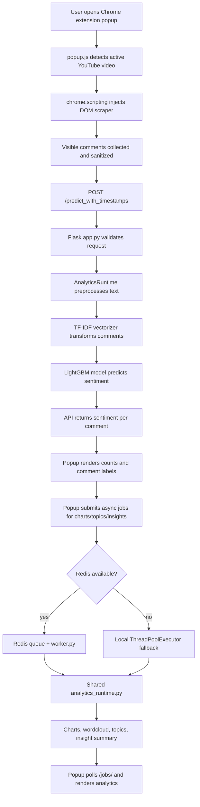
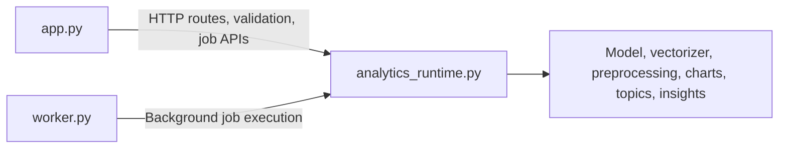
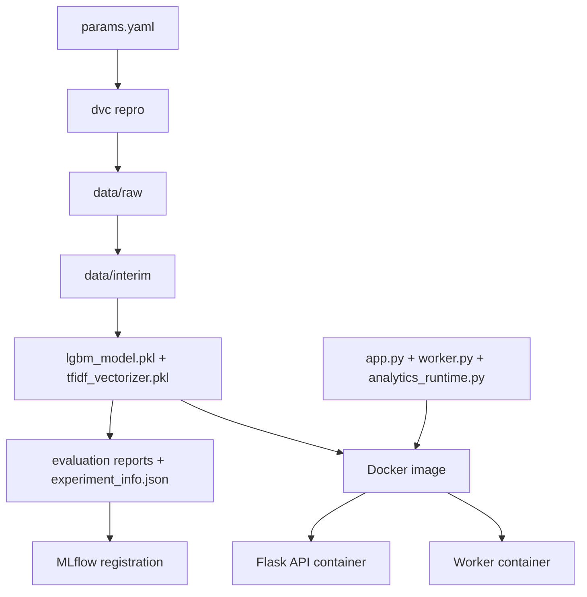
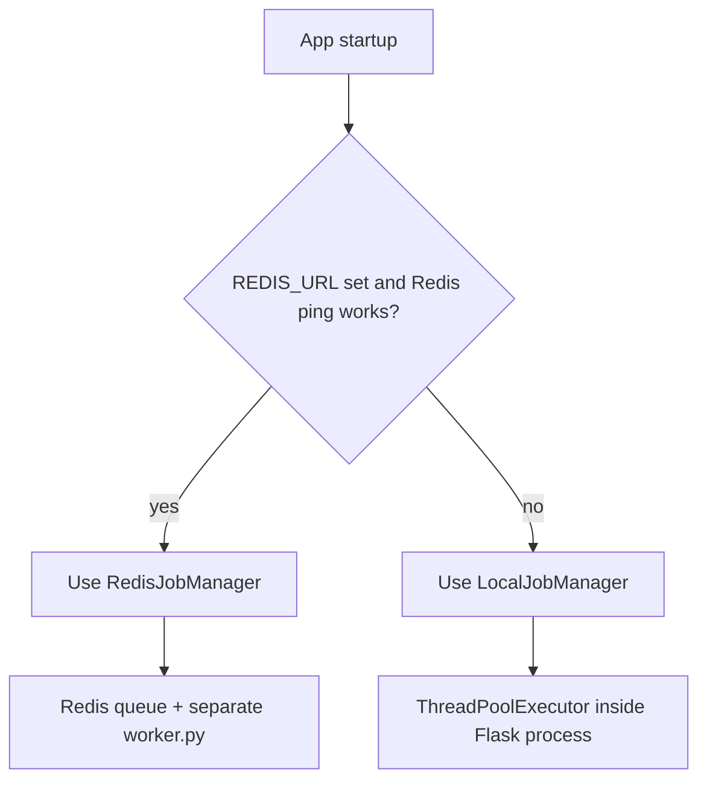
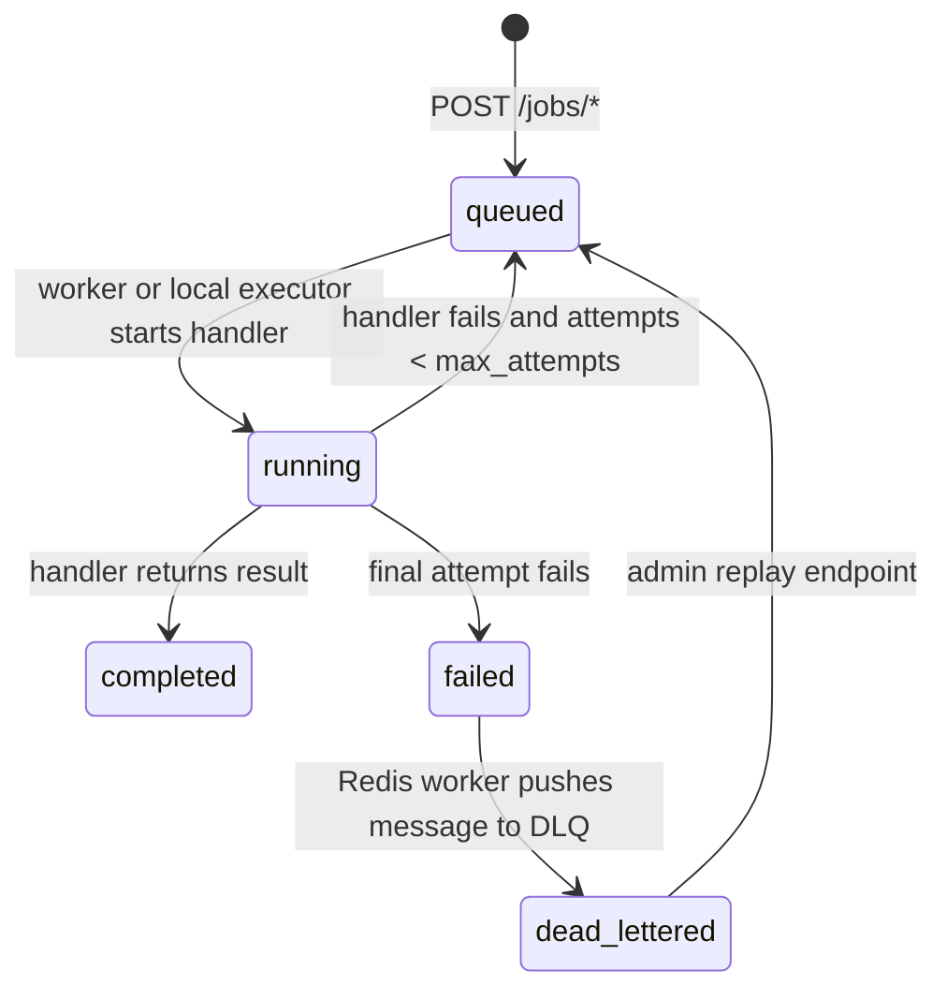

# Section 1: Project Walkthrough

This section explains CommentPulse end to end, in the style of an interview walkthrough. It focuses on architecture, model choice, runtime separation, DVC, Docker, Chrome extension behavior, Redis fallback, job lifecycle, artifacts, and project trade-offs.

## 1. Walk Me Through The End-To-End Architecture Of CommentPulse

If I were walking an interviewer through CommentPulse, I would describe it like this:



The Chrome extension does not run the ML model locally. It collects comments from the current YouTube page, sends them to the Flask backend, and renders the response. The backend owns validation, preprocessing, model inference, analytics, job state, metrics, and background execution.

The core prediction endpoint behaves conceptually like this:

```python
@app.route("/predict_with_timestamps", methods=["POST"])
def predict_with_timestamps():
    # 1. Parse the incoming JSON request body.
    payload = parse_json_body()

    # 2. Validate that each comment has text and a timestamp.
    comments = validate_comments(
        payload.get("comments"),
        config,
        require_timestamps=True,
    )

    # 3. Extract only the raw text for model inference.
    texts = [comment["text"] for comment in comments]

    # 4. Use the shared analytics runtime to preprocess and predict.
    predictions = ensure_runtime().predict_sentiments(texts)

    # 5. Return sentiment values aligned with the original comments.
    return jsonify(
        [
            {
                "comment": text,
                "sentiment": sentiment,
                "timestamp": comment["timestamp"],
            }
            for text, sentiment, comment in zip(texts, predictions, comments)
        ]
    )
```

The important point is separation of responsibility:

- The extension captures and displays.
- `app.py` exposes HTTP APIs and validates requests.
- `analytics_runtime.py` owns ML and analytics behavior.
- `worker.py` handles background queue processing when Redis is enabled.

## 2. Why Did You Choose LightGBM Over Logistic Regression, Random Forest, Or XGBoost?

I would answer this carefully. LightGBM was chosen because the project pipeline compares candidate models and selected LightGBM in the current training run. The model selection report shows `selected_model: lightgbm`.

Compared with other classifiers:

- Logistic Regression is a strong, fast TF-IDF baseline, but it learns mostly linear decision boundaries.
- Random Forest is usually not ideal for high-dimensional sparse text features because TF-IDF creates many mostly-zero columns.
- XGBoost is powerful, but it can be heavier to train and deploy.
- LightGBM gives gradient-boosted tree performance with efficient training and good support for class weighting.

The honest interview framing is:

> In this version, LightGBM is the selected baseline according to the validation metrics produced by the DVC pipeline. I would not claim it is universally best. As the YouTube-labeled dataset grows, I would keep comparing it against linear models, SVMs, XGBoost, and possibly transformer-based models.

The current training code also handles small datasets by relaxing some LightGBM constraints:

```python
def build_lgbm_config(learning_rate, max_depth, n_estimators, training_rows):
    # Base multiclass LightGBM configuration.
    config = {
        "objective": "multiclass",
        "num_class": 3,
        "metric": "multi_logloss",
        "class_weight": "balanced",
        "learning_rate": learning_rate,
        "max_depth": max_depth,
        "n_estimators": n_estimators,
        "n_jobs": 1,
    }

    # Very small datasets need softer leaf/bin constraints.
    if training_rows < 100:
        config.update(
            {
                "min_data_in_leaf": 1,
                "min_data_in_bin": 1,
                "num_leaves": min(15, max(4, training_rows)),
            }
        )

    return config
```

## 3. What Is The Role Of analytics_runtime.py Versus worker.py Versus app.py?



`app.py` is the web API. It defines Flask routes, CORS, request validation, health checks, readiness checks, metrics, sync inference endpoints, async job submission, and the choice between Redis-backed jobs and local fallback jobs.

`analytics_runtime.py` is the shared ML and analytics engine. It loads `lgbm_model.pkl` and `tfidf_vectorizer.pkl`, preprocesses comments, predicts sentiment, extracts topics, creates local insight summaries, and renders charts.

`worker.py` is the background Redis consumer. It waits for jobs, marks them running, executes the correct analytics handler, writes results back to Redis, retries failures, and dead-letters permanently failed jobs.

This separation prevents the project from duplicating analytics code in both the API and worker.

## 4. What Is The Purpose Of flask_api/main.py When app.py Already Exists?

`flask_api/main.py` is a thin entrypoint wrapper:

```python
from app import app


if __name__ == "__main__":
    config = app.config["APP_CONFIG"]
    app.run(host=config.host, port=config.port, debug=config.debug)
```

`app.py` is the actual application module. It creates the Flask app, routes, job managers, runtime, and metrics. `flask_api/main.py` exists for deployment environments that expect a package-style entrypoint, such as `flask_api.main:app`.

The wrapper avoids duplicating application logic.

## 5. How Do dvc.yaml And Dockerfile Relate?

`dvc.yaml` is for reproducible ML training. It answers:

> How do I rebuild the dataset, model, vectorizer, evaluation reports, and model registration metadata?

`Dockerfile` is for runtime packaging. It answers:

> How do I run the trained Flask API and worker consistently in a container?



Use DVC when training data, preprocessing, model parameters, or evaluation logic changes. Use Docker when deploying or running the service stack.

## 6. Why Does The Chrome Extension Scrape Comments With chrome.scripting Instead Of The YouTube Data API?

The extension uses `chrome.scripting` because it can read visible comments from the current YouTube page without requiring:

- a YouTube API key
- OAuth
- quota management
- exposing secrets in the extension
- a backend call to Google for basic comment collection

Benefits:

- It captures what the user is currently viewing.
- It avoids YouTube API quota limits.
- It works for local demos without API credentials.
- It keeps the extension workflow simple.

Trade-offs:

- It only captures comments loaded in the DOM.
- YouTube DOM changes can break selectors.
- It may miss replies or unloaded comments.
- Current timestamps are collection timestamps, not necessarily original YouTube publish timestamps.

The backend still has a YouTube API route, but that path requires `YOUTUBE_API_KEY`.

## 7. What Happens When Redis Is Not Running?

At startup, `app.py` checks whether Redis is configured and reachable. If Redis is healthy, it uses `RedisJobManager`. If Redis is missing or unavailable, it falls back to `LocalJobManager`.



Local fallback is useful for development and tests because async endpoints still work without infrastructure.

Limitations:

- Job state lives only in memory.
- Job state is lost on process restart.
- It does not scale across multiple web containers.
- Admin dead-letter endpoints return `409` because they require Redis.
- Long analytics jobs compete for resources with the Flask app.

## 8. Explain The Job Lifecycle: queued To running To completed/failed To dead-lettered



Lifecycle explanation:

- `queued`: created by `POST /jobs/*`.
- `running`: a local executor or Redis worker begins processing.
- `completed`: the handler returns successfully and stores result/artifact.
- `queued` again: a retry is scheduled after a failure before max attempts.
- `failed`: the final attempt fails.
- `dead_lettered`: Redis worker records the permanently failed job in the dead-letter queue.

In Redis mode, the worker writes job metadata back to Redis and pushes the original message to `analytics_jobs_dead_letter` on final failure.

## 9. What Are The Five DVC Pipeline Stages And Artifacts?

The stages in `dvc.yaml` are:

1. `data_ingestion`
   - Produces `data/raw`
   - Produces `reports/data_quality/ingestion_report.json`

2. `data_preprocessing`
   - Produces `data/interim`
   - Produces `reports/data_quality/preprocessing_report.json`

3. `model_building`
   - Produces `lgbm_model.pkl`
   - Produces `tfidf_vectorizer.pkl`
   - Produces `reports/model/model_selection.json`

4. `model_evaluation`
   - Produces `experiment_info.json`
   - Produces `reports/model/evaluation_metrics.json`
   - Produces `reports/model/confusion_matrix_test.png`
   - Produces `reports/model/model_comparison.json`

5. `model_registration`
   - Registers the model using MLflow and `experiment_info.json`
   - Has no explicit DVC `outs` because the side effect is MLflow registry state

## 10. Why Are lgbm_model.pkl And tfidf_vectorizer.pkl In The Repo Root?

They are in the root because the runtime expects fixed artifact paths:

```python
model_path = BASE_DIR / "lgbm_model.pkl"
vectorizer_path = BASE_DIR / "tfidf_vectorizer.pkl"
```

That makes local startup and Docker packaging simple. If the repo is copied into the image, the API can load the artifacts immediately.

Risks:

- Pickle files are binary and increase git history size.
- Pickle can execute code if loaded from an untrusted source.
- Artifact lineage can drift from the DVC experiment that produced it.
- Model and vectorizer versions can become incompatible.
- Runtime label conventions must stay consistent with training label mappings.

Better production design:

- Store artifacts under `models/` or a DVC remote.
- Track model metadata, label mapping, schema, and dependency versions.
- Load promoted models from MLflow or an artifact registry.
- Validate artifact compatibility at startup.
- Avoid loading pickle files from untrusted locations.

## 11. Why Were Paid LLM APIs Avoided For Local-Only Insight Summaries?

The README describes local-only insight summaries because the app generates insights using local logic:

- sentiment counts
- percentages
- TF-IDF top terms
- topic extraction
- simple recommendation templates

Reasons to avoid paid LLM APIs:

- No external API cost.
- No vendor dependency.
- No comment data sent to third parties.
- Works offline and in local demos.
- Easier to test because output is deterministic.
- No LLM API key needed in deployment.

Trade-offs:

- Summaries are less fluent.
- Semantic understanding is weaker.
- Sarcasm and deep context are difficult.
- Topic names are keyword-based.
- Recommendations are rule-based.

Good interview framing:

> For this version, local analytics gave privacy, cost control, reproducibility, and simpler deployment. If the product needed richer narrative summaries, I would add an optional LLM layer behind a feature flag.

## 12. What Does params.yaml Control, And Which Pipeline Stages Depend On It?

`params.yaml` is the experiment control panel.

It controls:

- dataset name
- local data path
- remote fallback URL
- text column
- label column
- label mapping
- train/test split size
- random seed
- TF-IDF max features
- TF-IDF n-gram range
- candidate model list
- LightGBM hyperparameters
- promotion thresholds
- data quality thresholds

Stages depending on it:

- `data_ingestion` depends on source path, URL, columns, label mapping, split size, and random seed.
- `model_building` depends on TF-IDF settings, candidate models, and LightGBM parameters.
- `model_evaluation` uses promotion thresholds in the evaluation/comparison logic.

The concise interviewer summary is:

> CommentPulse separates training, serving, and background analytics. DVC owns reproducible model building, Docker owns deployment, Flask owns HTTP behavior, `analytics_runtime.py` owns ML and analytics, and Redis plus `worker.py` owns reliable background execution.
