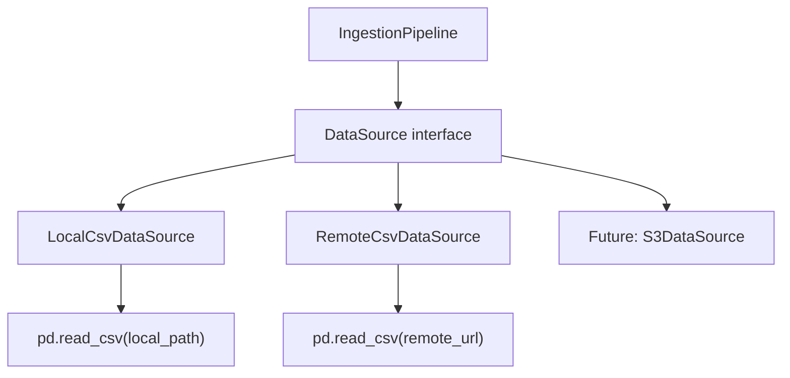
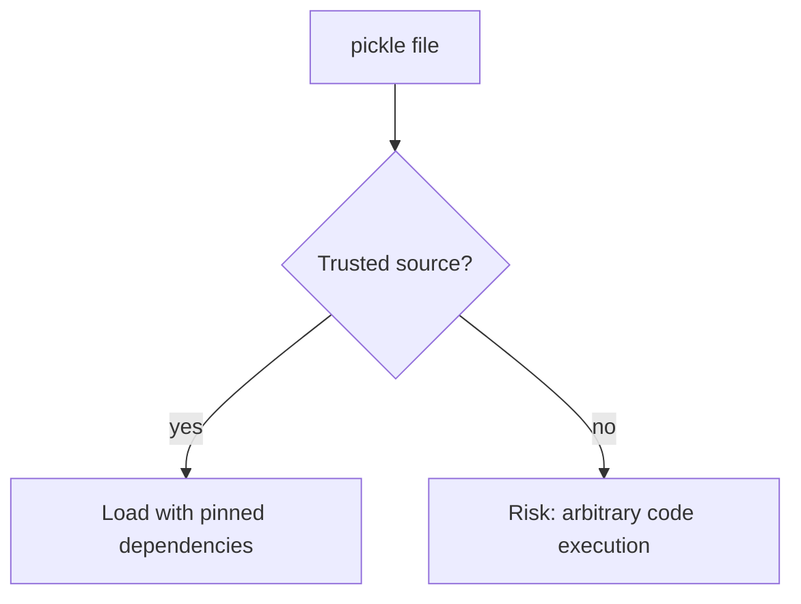
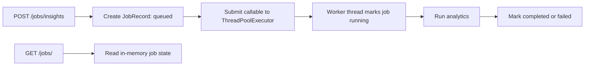
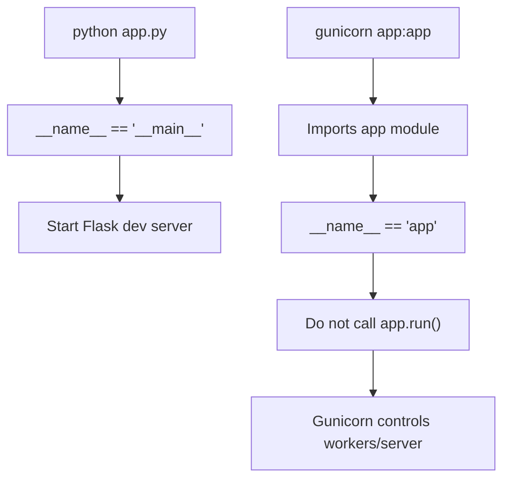

# Section 2: Python, OOP, Packaging, And Flask Fundamentals

This section covers Python and Flask interview questions using CommentPulse examples. It focuses on OOP design, packaging, serialization, concurrency, imports, Flask routing, process entrypoints, structured logging, and decorators.

## 1. How Would You Design data_ingestion.py So The Data Source Is Swappable?

Right now `data_ingestion.py` uses `pandas.read_csv()` directly. That works because pandas can read both local CSV paths and remote URLs, but from an OOP design perspective I would make the data source swappable using the **Strategy Pattern**.

The caller should depend on an abstraction, not on whether the data is coming from a local CSV, remote URL, S3 bucket, or database.



The OOP principles involved are:

- **Polymorphism**: each data source exposes the same `load()` method.
- **Dependency Inversion**: the pipeline depends on a `DataSource` abstraction.
- **Open/Closed Principle**: new sources can be added without modifying the pipeline.

Example:

```python
from abc import ABC, abstractmethod
from pathlib import Path
import pandas as pd


class DataSource(ABC):
    """Abstract contract for anything that can load a DataFrame."""

    @abstractmethod
    def load(self) -> pd.DataFrame:
        """Return raw input data as a pandas DataFrame."""
        raise NotImplementedError


class LocalCsvDataSource(DataSource):
    """Loads data from a local CSV file."""

    def __init__(self, path: str | Path):
        self.path = Path(path)

    def load(self) -> pd.DataFrame:
        # Local source-specific validation belongs here.
        if not self.path.exists():
            raise FileNotFoundError(f"Local data file not found: {self.path}")

        return pd.read_csv(self.path)


class RemoteCsvDataSource(DataSource):
    """Loads data from a remote CSV URL."""

    def __init__(self, url: str):
        self.url = url

    def load(self) -> pd.DataFrame:
        # Remote-specific retry/timeout handling could be added here.
        return pd.read_csv(self.url)


class IngestionPipeline:
    """Pipeline depends only on the DataSource abstraction."""

    def __init__(self, source: DataSource):
        self.source = source

    def run(self) -> pd.DataFrame:
        # This code does not care whether the source is local or remote.
        df = self.source.load()
        return df
```

Caller code stays stable:

```python
source = LocalCsvDataSource("data/external/youtube_comments_labeled.csv")
# or:
source = RemoteCsvDataSource("https://example.com/comments.csv")

pipeline = IngestionPipeline(source)
df = pipeline.run()
```

Interview answer:

> I would use the Strategy Pattern. The ingestion pipeline would depend on a `DataSource` interface with a `load()` method. Local CSV and remote URL loading would be separate implementations. This applies polymorphism and dependency inversion, and it keeps the caller unchanged when the source changes.

## 2. What Is The Difference Between A Python Module And A Python Package?

A **module** is a single Python file.

Example:

```text
src/data/data_ingestion.py
```

That file can be imported as a module:

```python
from src.data.data_ingestion import load_params
```

A **package** is a directory that groups modules. Traditionally, a package contains an `__init__.py` file.

Example:

```text
src/
  __init__.py
  data/
    data_ingestion.py
  model/
    model_building.py
```

In this repository, `src/__init__.py` exists, so `src` is a Python package.

`setup.py` contains:

```python
from setuptools import find_packages, setup

setup(
    name="youtube",
    version="0.0.0",
    packages=find_packages(),
    install_requires=[],
)
```

`find_packages()` searches for Python packages, usually directories containing `__init__.py`. Installing the project with:

```powershell
pip install -e .
```

makes the discovered package importable in the environment.

Important nuance for this repo:

- `src/__init__.py` exists.
- `src/data/__init__.py` and `src/model/__init__.py` are not currently present.

For clean packaging, I would either add empty `__init__.py` files to `src/data` and `src/model`, or intentionally switch to namespace package discovery with `find_namespace_packages()`.

## 3. Why Is There A youtube.egg-info Directory?

`youtube.egg-info/` is generated by Python packaging tools, usually after:

```powershell
pip install -e .
```

or:

```powershell
python setup.py egg_info
```

It stores package metadata such as:

```text
PKG-INFO
SOURCES.txt
top_level.txt
dependency_links.txt
```

It means the project has been installed or prepared as a Python package named `youtube`.

Should it be committed? Usually, no. It is generated metadata and should normally be ignored.

Recommended `.gitignore` entries:

```gitignore
*.egg-info/
build/
dist/
```

Interview answer:

> `youtube.egg-info` is packaging metadata generated by setuptools. It helps Python packaging tools understand the installed project, but it is not source code. In most application repositories I would add `*.egg-info/` to `.gitignore`.

## 4. Pickle Security And Versioning Risks

CommentPulse loads the model and vectorizer with pickle:

```python
with model_path.open("rb") as model_file:
    self.model = pickle.load(model_file)

with vectorizer_path.open("rb") as vectorizer_file:
    self.vectorizer = pickle.load(vectorizer_file)
```

Pickle is convenient, but it has two major production risks.

### Security Risk

`pickle.load()` can execute arbitrary code during deserialization. If an attacker can replace `lgbm_model.pkl` or `tfidf_vectorizer.pkl`, loading that file could run malicious Python code.



### Versioning Risk

Pickle depends on:

- Python version
- scikit-learn version
- LightGBM version
- class/module paths
- internal object layout

A model pickled in one environment may fail or behave differently in another.

Alternatives:

- `joblib`: common for scikit-learn objects, but still pickle-based.
- `skops`: safer persistence for scikit-learn style models.
- ONNX: portable inference format, though preprocessing may require extra work.
- LightGBM native format: `model.booster_.save_model("model.txt")`.
- MLflow model format: tracks artifacts, environment, signature, and metadata.
- JSON metadata plus reconstructed vectorizer vocabulary/config.

Good interview answer:

> Pickle is acceptable for trusted internal prototypes, but for production I would use signed and versioned artifacts, pinned dependencies, startup compatibility checks, and ideally MLflow or a safer model serialization format.

## 5. How Could concurrent.futures Or asyncio Be Used For Local Async Fallback?

CommentPulse already uses `concurrent.futures.ThreadPoolExecutor` in the local fallback path. The idea is that the API returns a job ID immediately while the expensive analytics work runs in the background.



Simplified `ThreadPoolExecutor` version:

```python
from concurrent.futures import ThreadPoolExecutor
from uuid import uuid4


class LocalJobManager:
    """In-memory async job manager for local development."""

    def __init__(self):
        self.executor = ThreadPoolExecutor(max_workers=4)
        self.jobs = {}

    def submit(self, job_type, payload):
        job_id = str(uuid4())

        self.jobs[job_id] = {
            "status": "queued",
            "result": None,
            "error": None,
        }

        # Run the work in a background thread.
        self.executor.submit(self._run_job, job_id, job_type, payload)

        return job_id

    def _run_job(self, job_id, job_type, payload):
        try:
            self.jobs[job_id]["status"] = "running"

            # Expensive analytics logic runs here.
            result = run_analytics(job_type, payload)

            self.jobs[job_id]["status"] = "completed"
            self.jobs[job_id]["result"] = result

        except Exception as exc:
            self.jobs[job_id]["status"] = "failed"
            self.jobs[job_id]["error"] = str(exc)
```

An `asyncio` version would schedule coroutines:

```python
import asyncio
from uuid import uuid4


class AsyncLocalJobManager:
    """Asyncio-style job manager for async frameworks."""

    def __init__(self):
        self.jobs = {}

    async def submit(self, job_type, payload):
        job_id = str(uuid4())

        self.jobs[job_id] = {
            "status": "queued",
            "result": None,
        }

        # Schedule coroutine in the background.
        asyncio.create_task(self._run_job(job_id, job_type, payload))

        return job_id

    async def _run_job(self, job_id, job_type, payload):
        self.jobs[job_id]["status"] = "running"

        # Good fit for async I/O work.
        result = await run_analytics_async(job_type, payload)

        self.jobs[job_id]["status"] = "completed"
        self.jobs[job_id]["result"] = result
```

For Flask, `ThreadPoolExecutor` is usually simpler because Flask is traditionally WSGI/synchronous. `asyncio` fits more naturally with FastAPI, Quart, or a fully async service.

## 6. What Is The Purpose Of __init__.py?

`__init__.py` tells Python that a directory should be treated as a package in classic Python packaging.

Ideal explicit structure:

```text
src/
  __init__.py
  data/
    __init__.py
    data_ingestion.py
  model/
    __init__.py
    model_building.py
```

Then imports are clear:

```python
from src.data.data_ingestion import load_data
from src.model.model_building import build_candidate_models
```

`__init__.py` can be empty, or it can re-export selected functions:

```python
# src/data/__init__.py

from .data_ingestion import load_data, standardize_dataset_schema
```

Then callers can do:

```python
from src.data import load_data
```

In this repo, `src/data` and `src/model` currently do not have `__init__.py`. Python 3 can support namespace-style packages, but for this project I would prefer explicit `__init__.py` files because they make packaging and import behavior clearer.

## 7. Flask GET Versus POST

In Flask, route methods define which HTTP verbs an endpoint accepts.

`GET` is used to retrieve data:

```python
@app.route("/health", methods=["GET"])
def health():
    return {"status": "ok"}
```

`POST` is used when the client sends data to be processed:

```python
@app.route("/predict_with_timestamps", methods=["POST"])
def predict():
    payload = request.get_json()
    return run_prediction(payload)
```

In CommentPulse:

- `/health`, `/livez`, `/readyz`, and `/jobs/<job_id>` use GET-style retrieval.
- `/predict_with_timestamps` uses POST because it receives comment data in the request body.
- `/jobs/insights` uses POST because it creates a background job.

If a route supports only `POST` and the client sends `GET`, Flask returns:

```text
405 Method Not Allowed
```

It also includes an `Allow` header listing supported methods.

Interview answer:

> GET is for safe retrieval. POST is for submitting data or creating work. Flask enforces the route's allowed methods and returns 405 when the method is unsupported.

## 8. What Does if __name__ == "__main__" Prevent?

When Python runs a file directly:

```powershell
python app.py
```

the file gets:

```python
__name__ == "__main__"
```

When another module imports it:

```python
from app import app
```

the file gets:

```python
__name__ == "app"
```

So this guard:

```python
if __name__ == "__main__":
    app.run()
```

means:

> Start the Flask development server only when this file is executed directly, not when it is imported.



This matters because Gunicorn, tests, and wrapper modules should be able to import `app` without accidentally starting a second server.

## 9. Advantages Of Structured JSON Logging

Plain-text logs are readable to humans. JSON logs are readable to machines.

Example structured log:

```json
{
  "timestamp": "2026-06-22T10:00:00Z",
  "level": "INFO",
  "request_id": "abc-123",
  "path": "/predict_with_timestamps",
  "status_code": 200,
  "duration_ms": 47.2
}
```

Advantages in a production ML service:

- Easier search in ELK, Datadog, Loki, CloudWatch, or similar tools.
- Consistent fields across services.
- Filtering by `request_id`, `path`, `status_code`, or `job_id`.
- Better dashboards and alerts.
- Easier debugging of slow inference requests.
- Better visibility into async job failures.
- More reliable audit trails than unstructured print statements.

For CommentPulse, JSON logs are useful because the service needs to track API latency, model readiness, async job status, queue behavior, and failures.

## 10. Python Decorator To Time Flask Endpoints

A decorator wraps a route function and adds reusable behavior around it. For timing, the wrapper records the start time, calls the endpoint, then logs elapsed time.

```python
import logging
import time
from functools import wraps
from flask import g, request


logger = logging.getLogger("youtube_sentiment_api")


def log_latency(endpoint_name=None):
    """Decorator factory that logs how long a Flask endpoint takes."""

    def decorator(func):
        @wraps(func)
        def wrapper(*args, **kwargs):
            # Use a monotonic high-resolution clock for duration measurement.
            start = time.perf_counter()

            try:
                # Run the actual Flask route handler.
                return func(*args, **kwargs)

            finally:
                # finally ensures latency is logged even if the endpoint raises.
                duration_ms = round((time.perf_counter() - start) * 1000, 2)

                logger.info(
                    "endpoint_latency",
                    extra={
                        "endpoint": endpoint_name or func.__name__,
                        "method": request.method,
                        "path": request.path,
                        "duration_ms": duration_ms,
                        "request_id": getattr(g, "request_id", None),
                    },
                )

        return wrapper

    return decorator
```

Usage:

```python
@app.route("/predict_with_timestamps", methods=["POST"])
@log_latency("predict_with_timestamps")
def predict_with_timestamps():
    payload = parse_json_body()

    comments = validate_comments(
        payload.get("comments"),
        config,
        require_timestamps=True,
    )

    texts = [comment["text"] for comment in comments]
    predictions = ensure_runtime().predict_sentiments(texts)

    return jsonify(
        [
            {
                "comment": text,
                "sentiment": sentiment,
                "timestamp": comment["timestamp"],
            }
            for text, sentiment, comment in zip(texts, predictions, comments)
        ]
    )
```

CommentPulse already has an `@app.after_request` hook that measures latency globally. A decorator is useful when I want endpoint-specific timing around selected functions.
