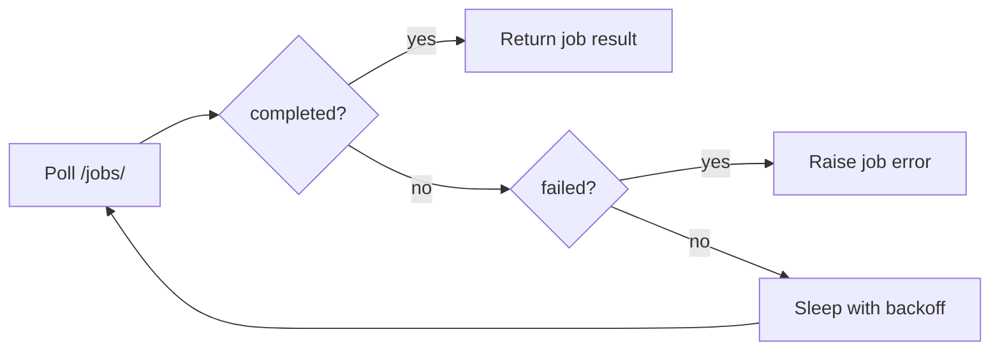
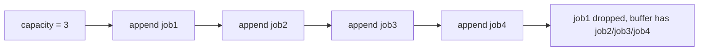
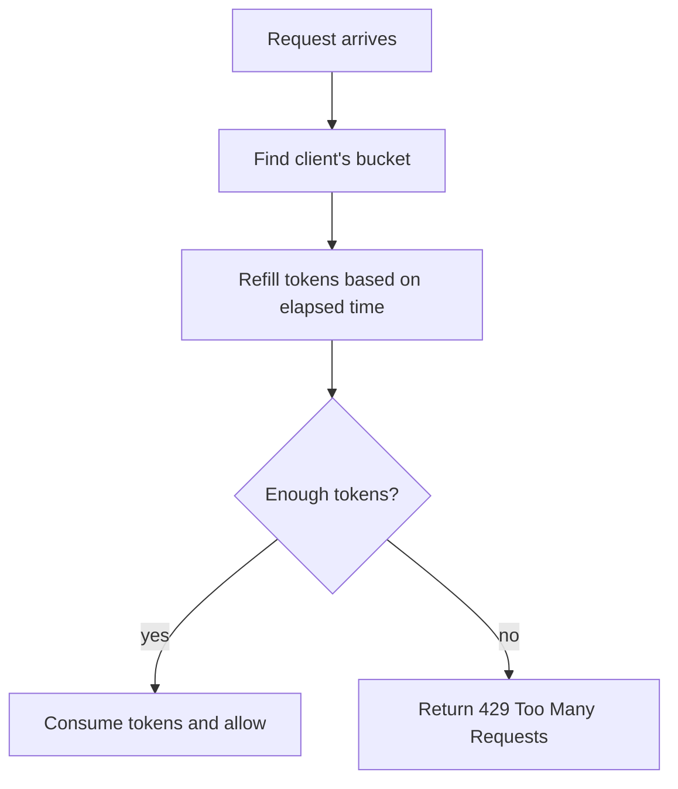
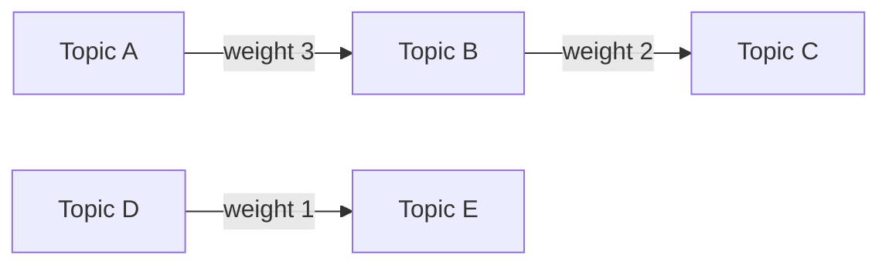
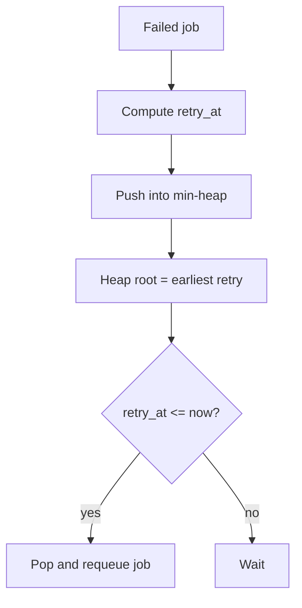
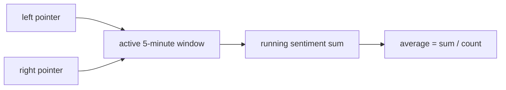

# Section 3: Data Structures And Algorithms

This section explains common data-structure and algorithm questions using CommentPulse examples. It focuses on job polling, heaps, queues, circular buffers, sorting, rate limiting, near-duplicate detection, graphs, retry scheduling, hash maps, string scanning, and sliding-window sentiment trends.

## 1. Exponential Backoff Polling For GET /jobs/<job_id>

The Chrome extension polls `GET /jobs/<job_id>` to check whether an async analytics job has completed. Instead of polling every fixed number of milliseconds forever, I would use **exponential backoff** with:

- maximum retries
- maximum total timeout
- capped delay
- immediate stop on `completed` or `failed`



Example:

```python
import time
import requests


def poll_job_status(base_url, job_id, max_retries=6, timeout_seconds=30):
    """Poll GET /jobs/<job_id> using exponential backoff."""

    started_at = time.monotonic()
    delay = 0.5
    max_delay = 5.0

    for attempt in range(max_retries):
        # Stop if total timeout is exceeded.
        if time.monotonic() - started_at > timeout_seconds:
            raise TimeoutError("Polling timed out")

        response = requests.get(f"{base_url}/jobs/{job_id}", timeout=5)
        response.raise_for_status()
        job = response.json()

        if job["status"] == "completed":
            return job

        if job["status"] == "failed":
            raise RuntimeError(job.get("error", "Job failed"))

        # queued/running: wait longer each time.
        time.sleep(delay)
        delay = min(delay * 2, max_delay)

    raise TimeoutError("Max polling retries exceeded")
```

Time complexity depends on retry count:

```text
O(r), where r = max_retries
```

## 2. Top-K Lowest-Confidence Labeling Queue Items

If I have 10,000 comments and need the top `K` lowest-confidence ones, I would use a **heap**.

Python has `heapq.nsmallest()`, which keeps the best `K` candidates efficiently.

```python
import heapq


def top_k_low_confidence(comments, k):
    """
    Return K comments with the lowest model confidence.

    comments example:
    [
        {"comment_text": "Great video", "confidence": 0.42},
        {"comment_text": "Not sure about this", "confidence": 0.21},
    ]
    """

    return heapq.nsmallest(k, comments, key=lambda item: item["confidence"])
```

Complexity:

```text
O(n log k) time
O(k) space
```

This is better than sorting all comments when `k` is much smaller than `n`, because full sorting costs `O(n log n)`.

## 3. Fixed-Size Circular Buffer For Dead-Letter Jobs

A bounded dead-letter store can be implemented as a **circular buffer**. When it becomes full, the oldest entry is overwritten.



Implementation:

```python
class CircularBuffer:
    """Fixed-size buffer that drops the oldest item when full."""

    def __init__(self, capacity):
        if capacity <= 0:
            raise ValueError("capacity must be positive")

        self.capacity = capacity
        self.buffer = [None] * capacity
        self.start = 0
        self.size = 0

    def append(self, item):
        """Add item in O(1), overwriting the oldest item when full."""

        if self.size < self.capacity:
            # Write after the newest item.
            index = (self.start + self.size) % self.capacity
            self.buffer[index] = item
            self.size += 1
        else:
            # Buffer is full. Overwrite oldest and move start forward.
            self.buffer[self.start] = item
            self.start = (self.start + 1) % self.capacity

    def items(self):
        """Return items from oldest to newest."""

        result = []

        for i in range(self.size):
            index = (self.start + i) % self.capacity
            result.append(self.buffer[index])

        return result
```

Complexity:

```text
append: O(1)
items: O(n)
space: O(capacity)
```

## 4. Top-N Most Frequent Comments In O(n log k)

Given:

```python
["Great video", "Terrible audio", "Great video", "Okay"]
```

Use:

- a hash map to count frequencies
- a min-heap of size `k`

```python
from collections import Counter
import heapq


def top_n_frequent_comments(comments, k):
    """Return top-k most frequent comments in O(n log k)."""

    counts = Counter(comments)
    heap = []

    for comment, count in counts.items():
        # Keep the least frequent of the current top-k at the root.
        heapq.heappush(heap, (count, comment))

        if len(heap) > k:
            heapq.heappop(heap)

    # Heap is not sorted descending, so sort only k items.
    return sorted(heap, reverse=True)


comments = ["Great video", "Terrible audio", "Great video", "Okay"]
print(top_n_frequent_comments(comments, 2))
```

Complexity:

```text
Counting: O(n)
Heap maintenance: O(u log k), where u = unique comments
Total: O(n log k) in the common explanation
```

## 5. Sort Comments By ISO Timestamp Without Built-In sort

If I cannot use Python's built-in `sort()` or `sorted()`, I would implement **merge sort**. It is stable and guarantees `O(n log n)` time.

For ISO 8601 timestamps in the same normalized format, lexicographic comparison matches chronological order.

```python
def merge(left, right):
    """Merge two timestamp-sorted comment lists."""

    result = []
    i = 0
    j = 0

    while i < len(left) and j < len(right):
        if left[i]["timestamp"] <= right[j]["timestamp"]:
            result.append(left[i])
            i += 1
        else:
            result.append(right[j])
            j += 1

    result.extend(left[i:])
    result.extend(right[j:])
    return result


def merge_sort_comments_by_timestamp(comments):
    """Stable O(n log n) timestamp sort without built-in sorting."""

    if len(comments) <= 1:
        return comments

    mid = len(comments) // 2
    left = merge_sort_comments_by_timestamp(comments[:mid])
    right = merge_sort_comments_by_timestamp(comments[mid:])

    return merge(left, right)
```

Why merge sort?

- stable
- predictable `O(n log n)`
- related to efficiently merging timestamp streams for trend graphs

## 6. Rate Limiter For /predict_with_timestamps

`MAX_COMMENTS_PER_REQUEST` limits the payload size. A rate limiter limits request volume over time.

For CommentPulse, I would use a **token bucket** per client IP or API key.



Token bucket implementation:

```python
import time


class TokenBucket:
    """Simple token bucket rate limiter."""

    def __init__(self, capacity, refill_rate_per_second):
        self.capacity = capacity
        self.tokens = capacity
        self.refill_rate = refill_rate_per_second
        self.last_refill = time.monotonic()

    def allow(self, cost=1):
        """Return True if enough tokens exist, otherwise False."""

        now = time.monotonic()
        elapsed = now - self.last_refill

        # Refill tokens according to elapsed time.
        self.tokens = min(
            self.capacity,
            self.tokens + elapsed * self.refill_rate,
        )
        self.last_refill = now

        if self.tokens >= cost:
            self.tokens -= cost
            return True

        return False
```

For comment-aware limiting, the request cost can be the number of comments:

```python
cost = len(comments)

if not bucket.allow(cost=cost):
    return {"error": "rate limit exceeded"}, 429
```

## 7. Near-Duplicate Comments With Jaccard Similarity

Exact deduplication catches repeated strings like:

```text
Great video
Great video
```

Near-duplicate detection catches similar strings:

```text
Great video!
great video
```

Use character n-grams and Jaccard similarity:

```text
Jaccard(A, B) = |A intersection B| / |A union B|
```

Implementation:

```python
def char_ngrams(text, n=3):
    """Convert text into character n-grams."""

    normalized = text.lower().strip()
    normalized = " ".join(normalized.split())

    if len(normalized) < n:
        return {normalized}

    return {
        normalized[i:i + n]
        for i in range(len(normalized) - n + 1)
    }


def jaccard_similarity(a, b):
    """Compute Jaccard similarity between two sets."""

    if not a and not b:
        return 1.0

    return len(a & b) / len(a | b)


def find_near_duplicates(comments, threshold=0.8, n=3):
    """Naive O(n^2) near-duplicate detection."""

    signatures = [char_ngrams(comment, n) for comment in comments]
    duplicates = []

    for i in range(len(comments)):
        for j in range(i + 1, len(comments)):
            score = jaccard_similarity(signatures[i], signatures[j])

            if score >= threshold:
                duplicates.append((comments[i], comments[j], score))

    return duplicates
```

For very large datasets, I would use MinHash or locality-sensitive hashing to avoid comparing every pair.

## 8. Topic Graph And Most Connected Topic Cluster

Each topic can be modeled as a graph node. If two topics share comments, keywords, or clustered terms, add a weighted edge.



Algorithms:

- BFS/DFS for connected components
- weighted community detection, such as Louvain, for stronger topic communities
- maximum spanning tree if we care about strongest links

Basic connected component implementation:

```python
from collections import defaultdict, deque


class TopicGraph:
    """Undirected weighted graph for topic relationships."""

    def __init__(self):
        self.graph = defaultdict(dict)

    def add_edge(self, topic_a, topic_b, weight):
        self.graph[topic_a][topic_b] = weight
        self.graph[topic_b][topic_a] = weight

    def connected_components(self):
        """Find connected topic groups using BFS."""

        visited = set()
        components = []

        for node in self.graph:
            if node in visited:
                continue

            queue = deque([node])
            visited.add(node)
            component = []

            while queue:
                current = queue.popleft()
                component.append(current)

                for neighbor in self.graph[current]:
                    if neighbor not in visited:
                        visited.add(neighbor)
                        queue.append(neighbor)

            components.append(component)

        return components
```

If the interviewer asks for the "most connected cluster," clarify the definition:

- largest number of nodes: largest connected component
- strongest relationship: component with largest total edge weight
- best community structure: Louvain or similar community detection

## 9. Retry Queue Using A Min-Heap

The worker retries failed jobs. A min-heap is a natural data structure when the earliest retry time should be processed first.



Implementation:

```python
import heapq
import time
from dataclasses import dataclass, field


@dataclass(order=True)
class RetryItem:
    retry_at: float
    job_id: str = field(compare=False)
    payload: dict = field(compare=False)
    attempts: int = field(compare=False)


class RetryQueue:
    """Min-heap retry queue ordered by retry_at."""

    def __init__(self):
        self.heap = []

    def schedule(self, job_id, payload, attempts, delay_seconds):
        retry_at = time.time() + delay_seconds

        heapq.heappush(
            self.heap,
            RetryItem(retry_at, job_id, payload, attempts),
        )

    def pop_ready(self):
        """Return all jobs whose retry time has arrived."""

        ready = []
        now = time.time()

        while self.heap and self.heap[0].retry_at <= now:
            ready.append(heapq.heappop(self.heap))

        return ready
```

Complexity:

```text
schedule: O(log n)
pop ready job: O(log n)
peek next retry: O(1)
```

## 10. Merge Two Sorted Timestamp Lists In O(m + n)

This is the merge step from merge sort. If two lists are already sorted, we can merge them in linear time.

```python
def merge_timestamps(a, b):
    """Merge two sorted timestamp lists in O(m + n)."""

    i = 0
    j = 0
    merged = []

    while i < len(a) and j < len(b):
        if a[i] <= b[j]:
            merged.append(a[i])
            i += 1
        else:
            merged.append(b[j])
            j += 1

    merged.extend(a[i:])
    merged.extend(b[j:])

    return merged
```

Relation to trend graph generation:

> If CommentPulse collects timestamped sentiment predictions in multiple batches, each batch can be sorted independently and then merged efficiently before computing sentiment trends.

## 11. Backend Data Structure For job_id To job_state Lookup

For `GET /jobs/<job_id>`, the backend needs fast job lookup. The right data structure is a hash map:

```text
job_id -> job_state
```

Average lookup:

```text
O(1)
```

Local in-memory version:

```python
import time


class JobStore:
    """Dictionary-backed job store with TTL cleanup."""

    def __init__(self, ttl_seconds):
        self.ttl_seconds = ttl_seconds
        self.jobs = {}

    def put(self, job_id, state):
        self.jobs[job_id] = {
            "state": state,
            "updated_at": time.time(),
        }

    def get(self, job_id):
        record = self.jobs.get(job_id)

        if record is None:
            return None

        if time.time() - record["updated_at"] > self.ttl_seconds:
            del self.jobs[job_id]
            return None

        return record["state"]

    def cleanup(self):
        now = time.time()

        expired = [
            job_id
            for job_id, record in self.jobs.items()
            if now - record["updated_at"] > self.ttl_seconds
        ]

        for job_id in expired:
            del self.jobs[job_id]
```

In Redis, the equivalent is:

```text
SETEX job:<job_id> ttl payload
GET job:<job_id>
```

## 12. Longest Alphanumeric Substring Of A Comment

This is a string scanning problem. We track the current alphanumeric run and the best run seen so far.

```python
def longest_alphanumeric_substring(comment):
    """Return the longest contiguous substring containing only letters/digits."""

    best_start = 0
    best_len = 0

    current_start = 0
    current_len = 0

    for i, char in enumerate(comment):
        if char.isalnum():
            # Starting a new alphanumeric segment.
            if current_len == 0:
                current_start = i

            current_len += 1

            if current_len > best_len:
                best_start = current_start
                best_len = current_len
        else:
            # Non-alphanumeric character ends the current segment.
            current_len = 0

    return comment[best_start:best_start + best_len]


print(longest_alphanumeric_substring("Wow!!!GreatVideo2026 :)"))
# GreatVideo2026
```

Complexity:

```text
O(n) time
O(1) extra space
```

## 13. Sliding-Window Sentiment Trend

Given timestamped predictions, compute average sentiment for every 5-minute window. If the data is sorted by timestamp, use a **two-pointer sliding window**.



Implementation:

```python
from datetime import datetime, timedelta


def parse_ts(ts):
    """Parse ISO timestamp and handle UTC Z suffix."""

    return datetime.fromisoformat(ts.replace("Z", "+00:00"))


def sliding_window_sentiment(predictions, window_minutes=5):
    """
    Compute average sentiment for each rolling 5-minute window.

    predictions example:
    [
        {"timestamp": "2026-06-22T10:00:00Z", "sentiment": 1},
        {"timestamp": "2026-06-22T10:01:00Z", "sentiment": -1},
    ]
    """

    parsed = [
        {
            "timestamp": parse_ts(item["timestamp"]),
            "sentiment": item["sentiment"],
        }
        for item in predictions
    ]

    window = timedelta(minutes=window_minutes)
    left = 0
    running_sum = 0
    result = []

    for right in range(len(parsed)):
        running_sum += parsed[right]["sentiment"]

        # Remove predictions older than the current 5-minute window.
        while parsed[right]["timestamp"] - parsed[left]["timestamp"] > window:
            running_sum -= parsed[left]["sentiment"]
            left += 1

        count = right - left + 1
        average = running_sum / count

        result.append(
            {
                "window_end": parsed[right]["timestamp"].isoformat(),
                "average_sentiment": average,
                "count": count,
            }
        )

    return result
```

Complexity:

```text
O(n) time
O(n) output space
```

Each prediction enters the window once and leaves the window once. This is much more efficient than recomputing every window from scratch.

## Final Interview Summary

For CommentPulse, the data-structure choices are practical:

- hash map for `job_id -> job_state`
- Redis list or queue for pending jobs
- min-heap for delayed retries
- circular buffer for bounded dead-letter storage
- heap for top-K review prioritization
- graph for topic relationships
- sliding window for sentiment trends
- merge logic for timestamp streams

The key is to connect each algorithm to an actual product need instead of explaining it in isolation.
