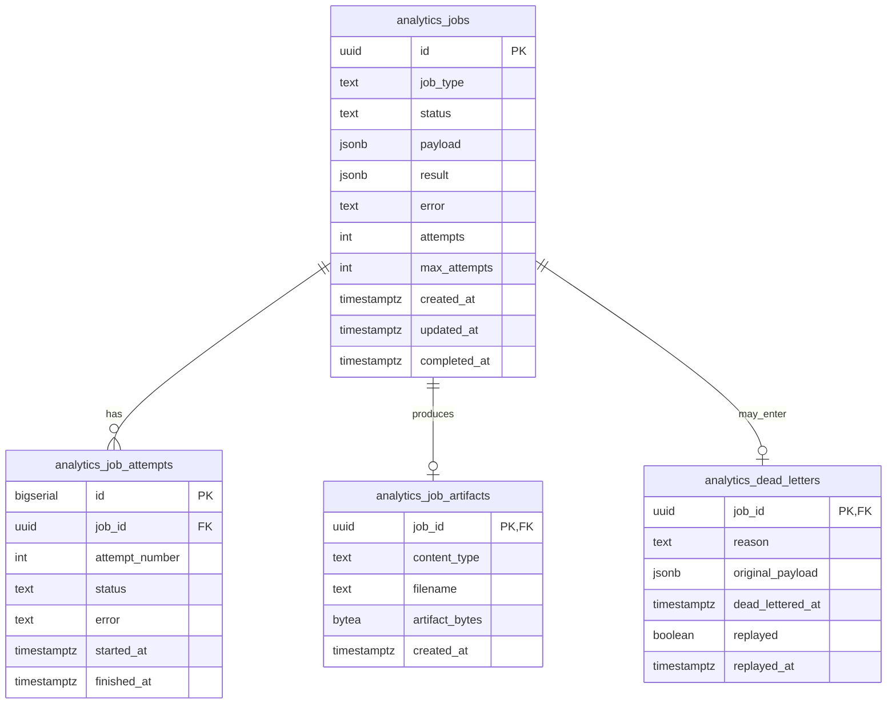
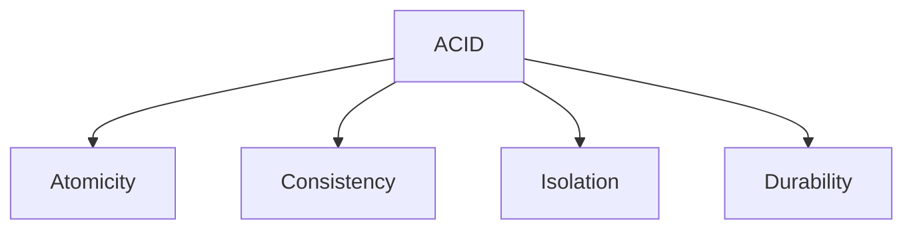
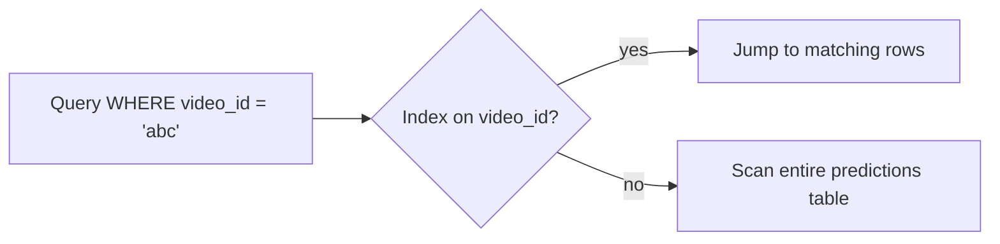
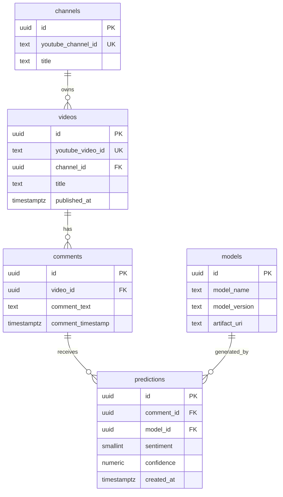

# Section 4: Databases, SQL, PostgreSQL, And Redis

This section explains database and SQL interview questions using CommentPulse examples. It covers relational schema design, PostgreSQL queries, ACID transactions, joins, indexes, normalization, Redis data structures, N+1 queries, dead-letter transactions, and `WHERE` versus `HAVING`.

## 1. PostgreSQL Schema For Persisting Job Metadata

CommentPulse currently stores job state in memory or Redis. If I wanted durable job metadata in PostgreSQL, I would separate:

- job metadata
- job attempts
- downloadable artifacts
- dead-letter records



Example schema:

```sql
CREATE TABLE analytics_jobs (
    id UUID PRIMARY KEY,
    job_type TEXT NOT NULL,
    status TEXT NOT NULL CHECK (
        status IN ('queued', 'running', 'completed', 'failed', 'dead_lettered')
    ),
    payload JSONB NOT NULL,
    result JSONB,
    error TEXT,
    attempts INTEGER NOT NULL DEFAULT 0,
    max_attempts INTEGER NOT NULL DEFAULT 3,
    created_at TIMESTAMPTZ NOT NULL DEFAULT now(),
    updated_at TIMESTAMPTZ NOT NULL DEFAULT now(),
    completed_at TIMESTAMPTZ
);

CREATE TABLE analytics_job_attempts (
    id BIGSERIAL PRIMARY KEY,
    job_id UUID NOT NULL REFERENCES analytics_jobs(id) ON DELETE CASCADE,
    attempt_number INTEGER NOT NULL,
    status TEXT NOT NULL,
    error TEXT,
    started_at TIMESTAMPTZ NOT NULL DEFAULT now(),
    finished_at TIMESTAMPTZ
);

CREATE TABLE analytics_job_artifacts (
    job_id UUID PRIMARY KEY REFERENCES analytics_jobs(id) ON DELETE CASCADE,
    content_type TEXT NOT NULL,
    filename TEXT,
    artifact_bytes BYTEA NOT NULL,
    created_at TIMESTAMPTZ NOT NULL DEFAULT now()
);

CREATE TABLE analytics_dead_letters (
    job_id UUID PRIMARY KEY REFERENCES analytics_jobs(id) ON DELETE CASCADE,
    reason TEXT NOT NULL,
    original_payload JSONB NOT NULL,
    dead_lettered_at TIMESTAMPTZ NOT NULL DEFAULT now(),
    replayed BOOLEAN NOT NULL DEFAULT false,
    replayed_at TIMESTAMPTZ
);
```

Interview explanation:

> I would keep the main job table focused on the current state, store each execution attempt separately for auditability, store binary artifacts separately, and use a dead-letter table for permanently failed jobs.

## 2. SQL Query: Top 3 Sentiment Labels Per Video

Given a `predictions` table:

```text
predictions(id, video_id, comment_text, sentiment, created_at)
```

To find the top 3 most common sentiment labels per video, use aggregation and a window function.

```sql
WITH sentiment_counts AS (
    SELECT
        video_id,
        sentiment,
        COUNT(*) AS sentiment_count
    FROM predictions
    GROUP BY video_id, sentiment
),
ranked AS (
    SELECT
        video_id,
        sentiment,
        sentiment_count,
        DENSE_RANK() OVER (
            PARTITION BY video_id
            ORDER BY sentiment_count DESC
        ) AS rank_in_video
    FROM sentiment_counts
)
SELECT
    video_id,
    sentiment,
    sentiment_count
FROM ranked
WHERE rank_in_video <= 3
ORDER BY video_id, rank_in_video, sentiment;
```

I would use `DENSE_RANK()` if ties should be included. If the interviewer wants exactly three rows per video, I would use `ROW_NUMBER()` instead.

## 3. ACID Properties In CommentPulse

ACID describes guarantees provided by database transactions.



### Atomicity

Atomicity means all-or-nothing.

In CommentPulse, if a worker moves a job to final failure, two things may need to happen:

1. update job status to `dead_lettered`
2. insert a row into the dead-letter table

If atomicity is violated, the system might mark the job as failed but never record it in the dead-letter table.

### Consistency

Consistency means the database moves from one valid state to another.

Example rules:

- job status must be one of `queued`, `running`, `completed`, `failed`, `dead_lettered`
- attempts should not exceed `max_attempts` without final failure
- a dead-letter record must reference an existing job

Constraints and foreign keys enforce these rules.

### Isolation

Isolation means concurrent transactions should not corrupt each other.

In CommentPulse, two workers should not process the same queued job at the same time. PostgreSQL can help with:

```sql
SELECT *
FROM analytics_jobs
WHERE status = 'queued'
ORDER BY created_at
FOR UPDATE SKIP LOCKED
LIMIT 1;
```

This locks the selected job row and allows other workers to skip it.

### Durability

Durability means committed data survives crashes.

If a worker commits a completed job result, that result should still exist after the service restarts.

## 4. INNER JOIN, LEFT JOIN, FULL OUTER JOIN

Assume:

```text
videos(id, title, channel_id, published_at)
predictions(id, video_id, comment_text, sentiment, created_at)
```

### INNER JOIN

Returns only matching rows from both tables.

```sql
SELECT *
FROM videos v
INNER JOIN predictions p
    ON p.video_id = v.id;
```

### LEFT JOIN

Returns all rows from the left table and matching rows from the right table. If there is no match, right-side columns are `NULL`.

```sql
SELECT *
FROM videos v
LEFT JOIN predictions p
    ON p.video_id = v.id;
```

### FULL OUTER JOIN

Returns all rows from both tables, matched where possible.

```sql
SELECT *
FROM videos v
FULL OUTER JOIN predictions p
    ON p.video_id = v.id;
```

To find all video IDs that have predictions but no corresponding metadata row:

```sql
SELECT DISTINCT
    p.video_id
FROM predictions p
LEFT JOIN videos v
    ON v.id = p.video_id
WHERE v.id IS NULL;
```

This is an anti-join pattern.

## 5. Database Indexing

An index is a data structure, commonly a B-tree, that helps the database find rows without scanning the whole table.



For the `predictions` table, I would index:

```sql
CREATE INDEX idx_predictions_video_id
ON predictions(video_id);
```

Why first? Because most analytics are grouped or filtered by video.

Then:

```sql
CREATE INDEX idx_predictions_video_created_at
ON predictions(video_id, created_at);
```

Why? Trend graphs usually need predictions for one video ordered by time.

Possible additional indexes:

```sql
CREATE INDEX idx_predictions_video_sentiment
ON predictions(video_id, sentiment);
```

Useful for sentiment distribution per video.

For exact duplicate prevention:

```sql
CREATE UNIQUE INDEX idx_predictions_video_comment_unique
ON predictions(video_id, comment_text);
```

For fuzzy search or near-duplicate detection, I would consider PostgreSQL `pg_trgm` indexes.

## 6. Normalization And 3NF Schema

Normalization reduces duplication and prevents anomalies.

Third Normal Form means:

- each table represents one subject
- non-key columns depend on the key
- non-key columns do not depend on other non-key columns

3NF-style CommentPulse schema:



Anomalies prevented:

- **Update anomaly**: channel title is stored once, not repeated on every prediction.
- **Insert anomaly**: a video can be stored before comments are collected.
- **Delete anomaly**: deleting predictions does not delete video metadata.

Interview answer:

> I would normalize channels, videos, comments, models, and predictions into separate tables. Predictions depend on comments and models, comments depend on videos, and videos depend on channels. This avoids duplicated metadata and keeps updates consistent.

## 7. Redis LIST, SET, SORTED SET, And HASH

Redis supports multiple data structures.

### LIST

Ordered sequence of values. Good for queues.

```text
RPUSH analytics_jobs job_payload
BLPOP analytics_jobs
```

Best for CommentPulse's primary job queue because workers need blocking FIFO-style consumption.

### SET

Unordered unique values. Good for membership checks.

```text
SADD seen_comment_ids abc123
SISMEMBER seen_comment_ids abc123
```

Useful for dedupe-like checks.

### SORTED SET

Unique values ordered by a numeric score. Good for priority queues and delayed retries.

```text
ZADD retry_jobs 1710000000 job_id
ZRANGEBYSCORE retry_jobs -inf now
```

Useful if retry time is the score.

### HASH

Field-value map. Good for object-like records.

```text
HSET job:123 status running attempts 1
HGETALL job:123
```

For job metadata, either Redis hashes or JSON strings with TTL can work. CommentPulse uses JSON values with `SETEX`.

Summary:

```text
Primary queue: LIST
Delayed retry queue: SORTED SET
Job metadata: HASH or SETEX JSON
Dedupe sets: SET
```

## 8. N+1 Query Problem

The N+1 query problem happens when code runs one query to get a list and then one extra query for each item.

Bad pattern:

```python
jobs = db.query("SELECT id FROM analytics_jobs LIMIT 100")

for job in jobs:
    attempts = db.query(
        "SELECT * FROM analytics_job_attempts WHERE job_id = %s",
        [job["id"]],
    )
```

This produces:

```text
1 query for jobs + 100 queries for attempts = 101 queries
```

In CommentPulse, this could happen in an admin dashboard that lists jobs and fetches attempts or artifacts one job at a time.

Fix with a join:

```sql
SELECT
    j.id,
    j.job_type,
    j.status,
    j.attempts,
    a.attempt_number,
    a.error
FROM analytics_jobs j
LEFT JOIN analytics_job_attempts a
    ON a.job_id = j.id
WHERE j.status IN ('failed', 'dead_lettered')
ORDER BY j.updated_at DESC;
```

Or fix with batch loading:

```sql
SELECT *
FROM analytics_job_attempts
WHERE job_id = ANY(:job_ids);
```

For `GET /jobs/<job_id>`, N+1 is less likely because each polling request fetches one job. It becomes a problem in list endpoints or dashboards.

## 9. Transaction For Moving A Job To Dead-Letter

A transaction groups multiple SQL statements so they commit together or roll back together.

Pseudo-SQL for final failure:

```sql
BEGIN;

-- Lock the job row so another worker cannot update it concurrently.
SELECT id, attempts, max_attempts
FROM analytics_jobs
WHERE id = :job_id
FOR UPDATE;

-- Mark the job as dead-lettered.
UPDATE analytics_jobs
SET
    status = 'dead_lettered',
    error = :error,
    attempts = attempts + 1,
    updated_at = now(),
    completed_at = now()
WHERE id = :job_id;

-- Record the failed attempt for auditability.
INSERT INTO analytics_job_attempts (
    job_id,
    attempt_number,
    status,
    error,
    started_at,
    finished_at
)
VALUES (
    :job_id,
    :attempt_number,
    'failed',
    :error,
    :started_at,
    now()
);

-- Store dead-letter details.
INSERT INTO analytics_dead_letters (
    job_id,
    reason,
    original_payload,
    dead_lettered_at
)
VALUES (
    :job_id,
    :error,
    :payload,
    now()
);

COMMIT;
```

If any statement fails:

```sql
ROLLBACK;
```

This preserves atomicity.

## 10. WHERE Versus HAVING

`WHERE` filters rows before grouping.

`HAVING` filters groups after aggregation.

Example:

```sql
SELECT
    video_id,
    AVG(sentiment) AS avg_sentiment
FROM predictions
WHERE created_at >= now() - interval '30 days'
GROUP BY video_id
HAVING AVG(sentiment) < 0
ORDER BY avg_sentiment ASC;
```

Explanation:

- `WHERE` keeps only recent prediction rows.
- `GROUP BY` groups rows by video.
- `AVG(sentiment)` computes average sentiment per video.
- `HAVING AVG(sentiment) < 0` keeps only mostly negative videos.

If sentiment values are `-1`, `0`, and `1`, an average below `0` means the video is leaning negative.

## Final Interview Summary

For CommentPulse, relational storage would improve durability and auditability, while Redis remains a strong choice for fast queue operations.

Key mapping:

- PostgreSQL stores durable job metadata, predictions, videos, comments, and model versions.
- Redis lists handle fast queue consumption.
- Redis sorted sets handle delayed retries.
- SQL transactions protect job state transitions.
- Indexes support video-level analytics and trend graph queries.
- Normalization prevents duplicated metadata and update anomalies.
