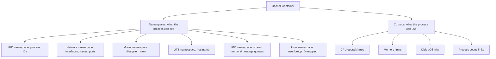
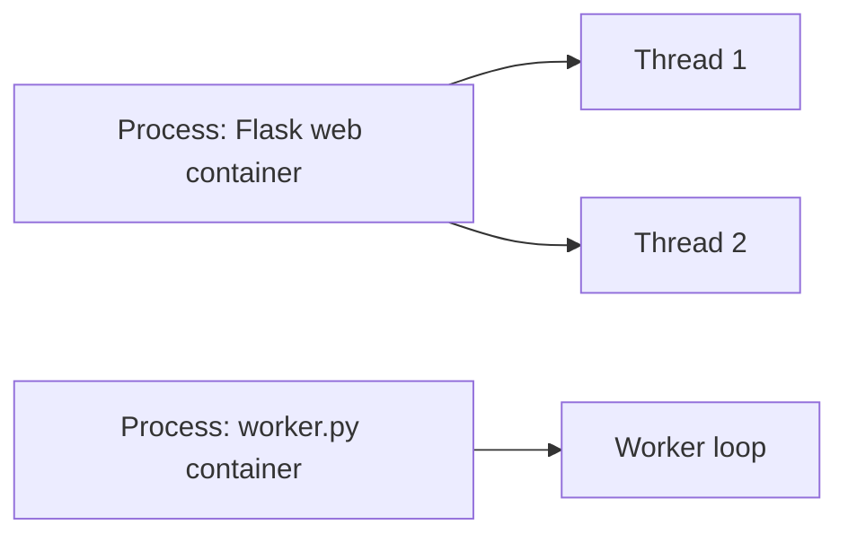
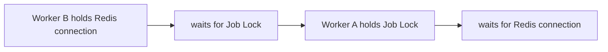
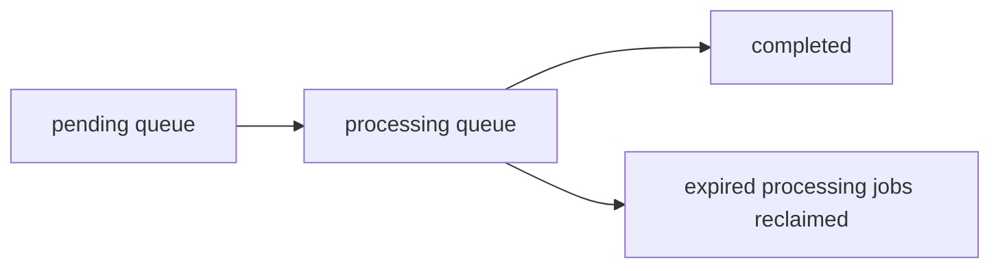
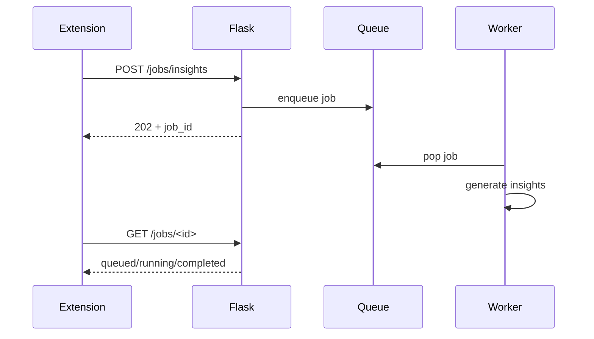
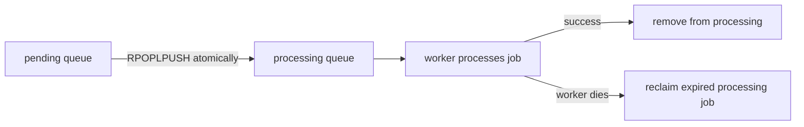
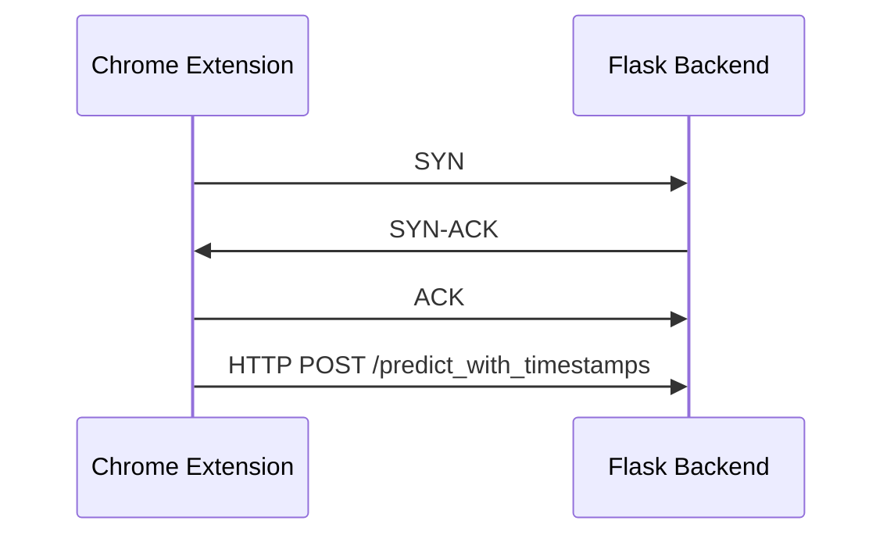
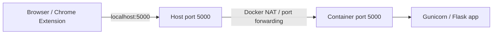

# Section 5: Operating Systems And Networking

This section covers operating systems and networking questions commonly asked in tech round interviews. The explanations are tied to CommentPulse, especially its Flask API, Docker deployment, Redis worker, async job flow, readiness checks, and Chrome extension requests.

## 1. Docker Namespaces And Cgroups

The Flask app runs inside a Docker container. A container is not a full virtual machine. It is a Linux process with isolation provided mainly by **namespaces** and resource controls provided by **cgroups**.



Namespaces isolate what the container can see:

- PID namespace: container sees its own process tree.
- Network namespace: container has its own network interfaces and routes.
- Mount namespace: container sees its own filesystem.
- UTS namespace: container can have its own hostname.
- IPC namespace: isolates inter-process communication.
- User namespace: maps users/groups between container and host.

Cgroups limit what the container can use:

- CPU
- memory
- disk I/O
- process count

Interview answer:

> Docker uses namespaces for isolation and cgroups for resource control. CommentPulse's Flask container sees its own filesystem, process IDs, and network stack, while Docker can cap its CPU and memory usage.

## 2. Process Versus Thread

A **process** has its own memory space. A **thread** runs inside a process and shares memory with other threads in that process.



Threads:

- share memory
- are cheaper to create
- need synchronization for shared state
- can be affected by Python's GIL for CPU-bound work

Processes:

- have separate memory
- provide crash isolation
- can be scaled independently
- are easier to manage operationally in containers

In CommentPulse, `worker.py` runs as a separate process in Docker Compose rather than just a thread inside `app.py`.

Why?

- Long-running jobs should not block the Flask API.
- Worker crashes should not crash the API process.
- Workers can be scaled independently.
- The web process and worker process can have separate lifecycle management.

Example scaling idea:

```powershell
docker compose up --scale worker=3
```

Interview answer:

> A thread would be simpler, but a separate worker process gives better isolation, independent scaling, and operational reliability. The API can stay responsive while workers handle expensive analytics jobs.

## 3. What Is A Deadlock?

A deadlock happens when two or more tasks wait forever for each other.

Classic deadlock conditions:

1. Mutual exclusion
2. Hold and wait
3. No preemption
4. Circular wait

Example:



Can the CommentPulse job queue deadlock?

The basic Redis `BLPOP` queue consumption is atomic and does not deadlock by itself. However, deadlock-like stalls can happen around job processing.

Scenario:

- A worker marks a job as `running`.
- The worker starts generating a heavy artifact.
- The task hangs forever due to unbounded computation or a blocked dependency.
- The job never becomes `completed` or `failed`.
- The extension keeps polling and never receives a final state.

Prevention:

- set execution timeouts
- use job leases or visibility timeouts
- record worker heartbeats
- retry jobs stuck in `running` too long
- avoid holding locks while doing slow work
- keep Redis/DB critical sections short

Robust queue pattern:



## 4. SIGTERM Versus SIGKILL

`SIGTERM` is a polite request to terminate. The process can catch it, clean up, and exit gracefully.

`SIGKILL` is forceful termination. The process cannot catch, ignore, or clean up after it.

When Docker stops a container, it sends:

```text
SIGTERM first
```

Then, after a grace period, Docker sends:

```text
SIGKILL
```

Why this matters for CommentPulse:

- Flask should stop accepting new requests.
- The worker should finish or safely requeue the current job.
- A job should not be left stuck in `running`.
- logs and metrics should flush before exit.

Example signal handling:

```python
import signal
import sys


shutdown_requested = False


def handle_sigterm(signum, frame):
    """Mark the process for graceful shutdown."""

    global shutdown_requested
    shutdown_requested = True


signal.signal(signal.SIGTERM, handle_sigterm)

while not shutdown_requested:
    # Worker loop reads and processes jobs.
    process_next_job()

# Cleanup before exit.
sys.exit(0)
```

Interview answer:

> Docker sends SIGTERM first so the app can gracefully stop. If it does not exit within the grace period, Docker sends SIGKILL. A worker should handle SIGTERM so it can finish or safely requeue in-progress jobs.

## 5. Synchronous Versus Asynchronous I/O

Synchronous I/O blocks the caller until the work finishes.

```text
Request -> run analytics -> wait -> return result
```

Asynchronous behavior returns quickly and finishes the work in the background.

```text
Request -> enqueue job -> return job_id -> client polls later
```

In CommentPulse:

```text
POST /jobs/insights
```

does not wait for insight generation. It creates a job and returns `202 Accepted`.



The endpoint is non-blocking from the client perspective because the expensive work is delegated to a local executor or Redis worker.

## 6. Readiness Versus Liveness

In Kubernetes:

- **Liveness** asks: "Is this process alive, or should Kubernetes restart it?"
- **Readiness** asks: "Can this pod receive traffic right now?"

CommentPulse has endpoints such as:

```text
GET /health
GET /livez
GET /readyz
```

Liveness can be simple:

```json
{"status": "ok"}
```

Readiness should check dependencies:

- model loaded
- vectorizer loaded
- async executor available
- Redis healthy if Redis mode is expected
- required configuration available

CommentPulse would be not ready if:

- `lgbm_model.pkl` is missing
- `tfidf_vectorizer.pkl` is missing
- model loading failed
- Redis is required but unreachable
- configuration is invalid

Interview answer:

> Liveness determines whether the container should be restarted. Readiness determines whether it should receive traffic. CommentPulse can be alive but not ready if the Flask process is running but the model artifacts failed to load.

## 7. Race Conditions And Atomic Redis Queue Operations

A race condition happens when correctness depends on timing between concurrent operations.

Bad queue example:

```python
# Not atomic: two workers could read the same job before either removes it.
job = redis.lindex("jobs", 0)
redis.lrem("jobs", 1, job)
```

Race scenario:

```text
Worker A reads job_1
Worker B reads job_1
Worker A removes job_1
Worker B also processes job_1
```

Redis commands like `BLPOP` are atomic, so only one worker receives a popped item.

The question mentions `RPOPLPUSH`, which is even safer for reliable queues:

```text
RPOPLPUSH pending processing
```

It atomically moves a job from a pending queue to a processing queue.



Interview answer:

> A naive read-then-delete queue can race. Redis atomic pop/move commands prevent two workers from taking the same job. `RPOPLPUSH` also supports recovery because the job remains visible in a processing queue until acknowledged.

## 8. TCP Three-Way Handshake

Before HTTP data is sent over TCP, the client and server establish a connection using the three-way handshake.



TCP handles reliable delivery:

- packet ordering
- retransmission
- duplicate detection
- flow control
- congestion control

HTTP sits above TCP. The Chrome extension sends an HTTP request, but TCP provides the reliable byte stream.

If the backend is down:

- connection may be refused if the port is closed
- request may time out if packets are dropped
- DNS or tunnel resolution may fail
- browser `fetch()` rejects with a network error
- no HTTP status code may be returned because no HTTP response exists

Interview answer:

> TCP handles reliability. HTTP uses TCP underneath. If the Flask backend is down, the request may fail at the connection layer before an HTTP status code is ever produced.

## 9. HTTP Status Codes For CommentPulse Scenarios

HTTP status codes describe the result of a request.

Mapping CommentPulse scenarios:

| Scenario | Status Code | Reason |
|---|---:|---|
| Job not found | `404 Not Found` | The requested job ID does not exist |
| Validation error | `400 Bad Request` | The client sent invalid input |
| Job queued | `202 Accepted` | Work was accepted but not completed yet |
| Model not loaded | `503 Service Unavailable` | Required ML dependency is unavailable |
| Admin endpoint in non-Redis mode | `409 Conflict` | Request conflicts with current backend mode |
| Job artifact requested before completion | `409 Conflict` | Job exists but is not ready |
| Successful prediction | `200 OK` | Request completed successfully |
| Unexpected server error | `500 Internal Server Error` | Unhandled backend failure |

Good interview phrasing:

> I would use `202` for async job creation because the request is accepted but processing continues in the background. I would use `503` when the model is not loaded because the service is temporarily unable to serve inference.

## 10. Docker Port Mapping And NAT

In `docker-compose.yml`, a port mapping like:

```yaml
ports:
  - "5000:5000"
```

means:

```text
HOST_PORT:CONTAINER_PORT
```

So:

```text
5000:5000
```

means:

- host machine listens on port `5000`
- traffic is forwarded to container port `5000`



Docker uses network address translation and port-forwarding rules to route traffic from the host into the container's network namespace.

If the mapping were:

```yaml
ports:
  - "8080:5000"
```

then the user would call:

```text
http://localhost:8080
```

but Flask would still listen inside the container on:

```text
0.0.0.0:5000
```

Important distinction:

- `EXPOSE 5000` in the Dockerfile documents the intended container port.
- `ports: "5000:5000"` in Compose actually publishes it to the host.

## Final Interview Summary

For CommentPulse, OS and networking concepts show up directly in production behavior:

- Docker namespaces isolate what the Flask and worker containers can see.
- Cgroups limit resource usage.
- Separate worker processes improve reliability and scaling.
- Signals matter for graceful shutdown.
- Redis atomic operations prevent queue races.
- Readiness protects traffic routing when the model is unavailable.
- TCP handles reliable transport for extension-to-backend HTTP requests.
- Docker port mapping exposes the Flask service from container to host.
