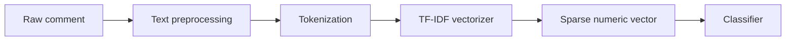
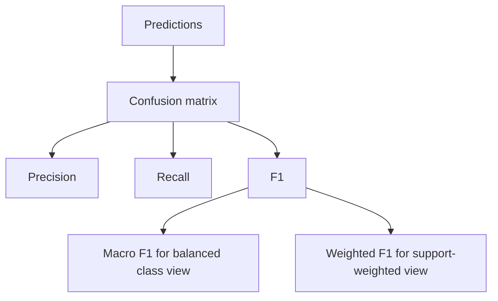
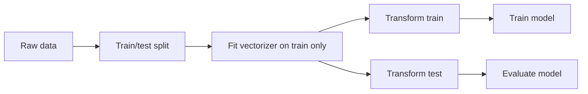
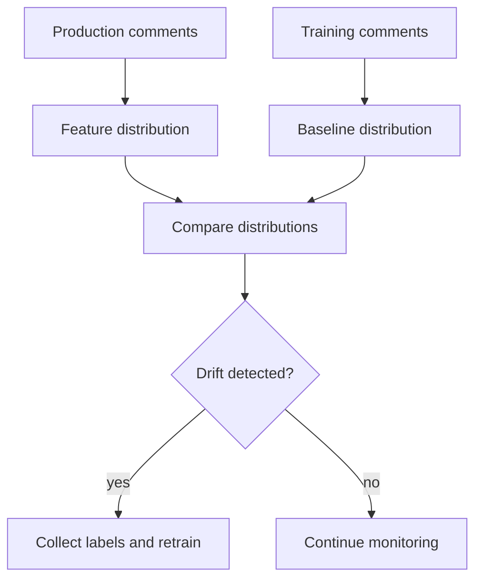
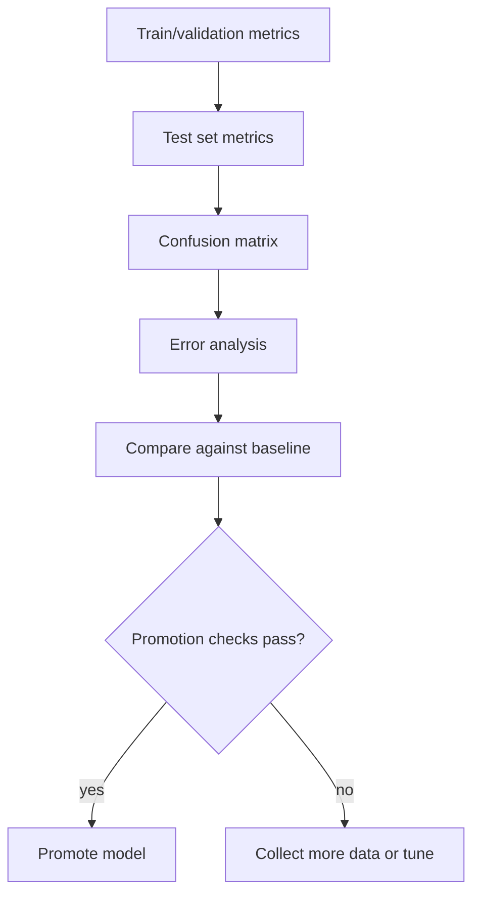

# Section 6: Machine Learning And NLP

This section covers likely ML and NLP interview questions for CommentPulse. It focuses on sentiment modeling, TF-IDF, evaluation metrics, class imbalance, data leakage, preprocessing, model drift, confidence scores, and how to improve the current model.

## 1. Why Use TF-IDF For Comment Sentiment Analysis?

TF-IDF converts text into numeric features by measuring how important a word or phrase is in a document relative to the whole corpus.



Interview answer:

> TF-IDF is a strong classical NLP baseline. It is simple, fast, explainable, and works well when the dataset is not large enough to justify fine-tuning a transformer. For CommentPulse, it also keeps inference lightweight for a Flask API.

Example:

```python
from sklearn.feature_extraction.text import TfidfVectorizer


comments = [
    "great video great explanation",
    "terrible audio quality",
]

vectorizer = TfidfVectorizer(ngram_range=(1, 2), max_features=1000)
matrix = vectorizer.fit_transform(comments)

print(matrix.shape)
print(vectorizer.get_feature_names_out()[:10])
```

TF-IDF advantages:

- fast training and inference
- low infrastructure cost
- interpretable features
- works well with linear models and tree-based models

Limitations:

- weak semantic understanding
- cannot understand sarcasm deeply
- vocabulary-dependent
- struggles with unseen slang or context-heavy comments

## 2. What Is The Difference Between Bag Of Words And TF-IDF?

Bag of Words counts token frequency. TF-IDF scales token counts by how rare the token is across the corpus.

```text
Bag of Words:
important word = word appears many times in this comment

TF-IDF:
important word = word appears in this comment and is not too common everywhere
```

Example:

```python
from sklearn.feature_extraction.text import CountVectorizer, TfidfVectorizer


texts = [
    "great video",
    "great explanation",
    "bad audio",
]

bow = CountVectorizer().fit_transform(texts)
tfidf = TfidfVectorizer().fit_transform(texts)
```

Interview framing:

> Bag of Words treats frequent terms as important even if they are common everywhere. TF-IDF reduces the weight of common terms and increases the weight of more distinctive terms. That is why TF-IDF is often a better baseline for sentiment classification.

## 3. Why Keep Negation Words During Preprocessing?

In sentiment analysis, words like `not`, `no`, and `but` are important.

Examples:

```text
good              -> positive
not good          -> negative
bad               -> negative
not bad           -> possibly positive or neutral
good but slow     -> mixed
```

If preprocessing removes negation words, sentiment can flip incorrectly.

```python
STOP_WORDS_TO_KEEP = {"not", "no", "but", "however"}


def remove_stopwords(tokens, stop_words):
    """Remove stopwords but preserve sentiment-changing words."""

    return [
        token
        for token in tokens
        if token not in stop_words or token in STOP_WORDS_TO_KEEP
    ]
```

Interview answer:

> For sentiment analysis, I avoid blindly removing all stopwords because negation words carry sentiment. Removing `not` from `not good` would change the meaning to `good`, which creates label noise.

## 4. Which Metrics Matter For Sentiment Classification?

Accuracy alone can be misleading when classes are imbalanced. Comment sentiment often has more neutral or positive comments than negative ones.

Important metrics:

- precision
- recall
- F1 score
- macro F1
- weighted F1
- confusion matrix



Interview answer:

> I would prioritize macro F1 because it treats each class equally. That matters when negative comments are fewer but important. I would also inspect per-class recall because missing negative sentiment can be costly for creator feedback.

## 5. What Is A Confusion Matrix?

A confusion matrix shows where the classifier is right and wrong.

For three sentiment classes:

```text
                 Predicted
Actual       Negative Neutral Positive
Negative        20       4        1
Neutral          5      40        8
Positive         1       7       60
```

It helps answer:

- Are negative comments being predicted as neutral?
- Are positive and neutral comments confused?
- Is the model biased toward one class?

Interview answer:

> I use the confusion matrix to debug class-level behavior. If the model predicts everything as neutral, accuracy might look acceptable on an imbalanced dataset, but the confusion matrix exposes the failure.

## 6. How Would You Handle Class Imbalance?

Class imbalance occurs when one sentiment class appears much more often than another.

Strategies:

- class weights
- oversampling minority classes
- undersampling majority classes
- collecting more labeled minority examples
- threshold tuning
- using macro F1 for selection

Example with class weights:

```python
from sklearn.linear_model import LogisticRegression


model = LogisticRegression(
    class_weight="balanced",
    max_iter=2000,
)
```

LightGBM also supports class weighting.

Interview answer:

> I would first measure class distribution, then use class weights and macro F1. If the dataset is small, I would prioritize collecting more human-labeled examples for underrepresented classes rather than relying only on resampling.

## 7. What Is Data Leakage?

Data leakage happens when training uses information that would not be available at prediction time.

CommentPulse examples:

- fitting TF-IDF on train plus test data
- deduplicated comments appearing in both train and test splits
- using future labels or evaluation data during preprocessing
- tuning hyperparameters on the test set repeatedly

Correct flow:



Interview answer:

> The vectorizer must be fit only on training data. The test set should simulate unseen production comments. If test vocabulary influences training, evaluation metrics become overly optimistic.

## 8. How Would You Add Prediction Confidence?

If the model supports probabilities, use `predict_proba()`. Confidence can be the maximum predicted probability.

```python
def predict_with_confidence(model, vectorizer, texts):
    """Return label and confidence for each text."""

    matrix = vectorizer.transform(texts)
    probabilities = model.predict_proba(matrix)
    labels = model.classes_[probabilities.argmax(axis=1)]
    confidences = probabilities.max(axis=1)

    return [
        {
            "sentiment": int(label),
            "confidence": float(confidence),
        }
        for label, confidence in zip(labels, confidences)
    ]
```

Uses:

- prioritize low-confidence comments for labeling
- show uncertainty in the UI
- monitor model quality
- route uncertain cases to human review

Interview answer:

> Confidence scores are useful for active learning. I would send low-confidence examples to the labeling queue because those examples are likely to improve the model the most.

## 9. How Would You Detect Model Drift?

Model drift means production data or model performance changes over time.

Types:

- data drift: incoming comments differ from training comments
- concept drift: meaning or labels change over time
- performance drift: accuracy/F1 drops on labeled production samples



Metrics:

- vocabulary out-of-vocabulary rate
- sentiment distribution changes
- comment length distribution
- embedding/TF-IDF feature distribution
- periodic human-labeled evaluation set

Interview answer:

> I would monitor input distribution and prediction distribution. But the strongest signal is performance on fresh labeled data, so I would periodically sample production comments for human labeling.

## 10. How Would You Improve CommentPulse With Transformers?

Current pipeline:

```text
preprocess text -> TF-IDF -> LightGBM
```

Transformer-based option:

```text
raw text -> tokenizer -> BERT/DistilBERT -> classification head
```

Benefits:

- better semantic understanding
- handles context better
- stronger on sarcasm and nuanced language
- less dependent on exact vocabulary

Trade-offs:

- slower inference
- larger model artifacts
- more memory/CPU/GPU requirements
- harder deployment
- more labeled data needed for fine-tuning

Interview answer:

> I would keep TF-IDF plus LightGBM as a fast baseline, then compare against a smaller transformer like DistilBERT. I would only ship the transformer if the accuracy gain justified the added latency and infrastructure cost.

## 11. How Would You Evaluate The Model Before Deployment?

I would use a staged evaluation process:



Checklist:

- macro F1 improves or does not regress
- per-class recall does not regress badly
- confusion matrix is acceptable
- no obvious data leakage
- model loads correctly in the Flask API
- sample production comments look reasonable

Interview answer:

> I would not deploy only because one metric improved. I would compare against the current baseline, inspect class-level behavior, run error analysis, and verify that the artifact loads correctly in the runtime environment.

## Final Interview Summary

For CommentPulse, the ML story is:

- TF-IDF plus LightGBM is a strong lightweight baseline.
- Macro F1 and confusion matrix matter more than accuracy alone.
- Negation handling is important for sentiment.
- Data leakage must be avoided by fitting preprocessing only on training data.
- Confidence scores support active learning.
- Drift monitoring and human-labeled feedback close the loop.
- Transformers are a possible next step if quality gains justify cost.
