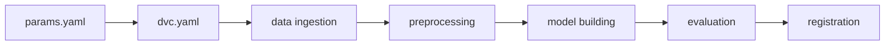
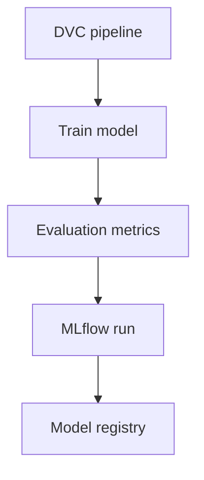
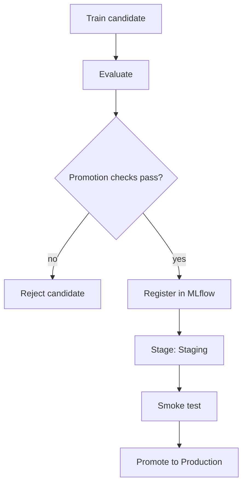
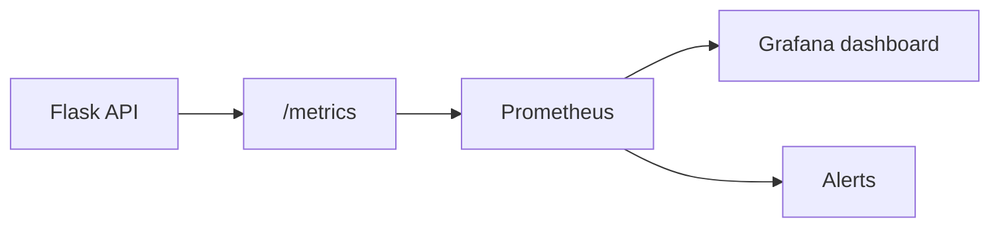
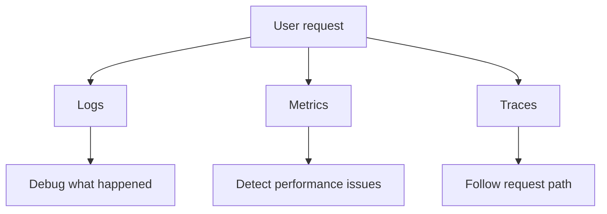
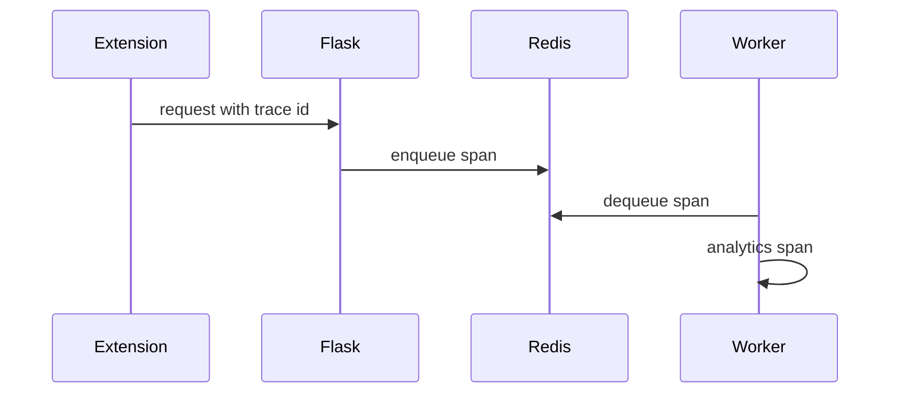
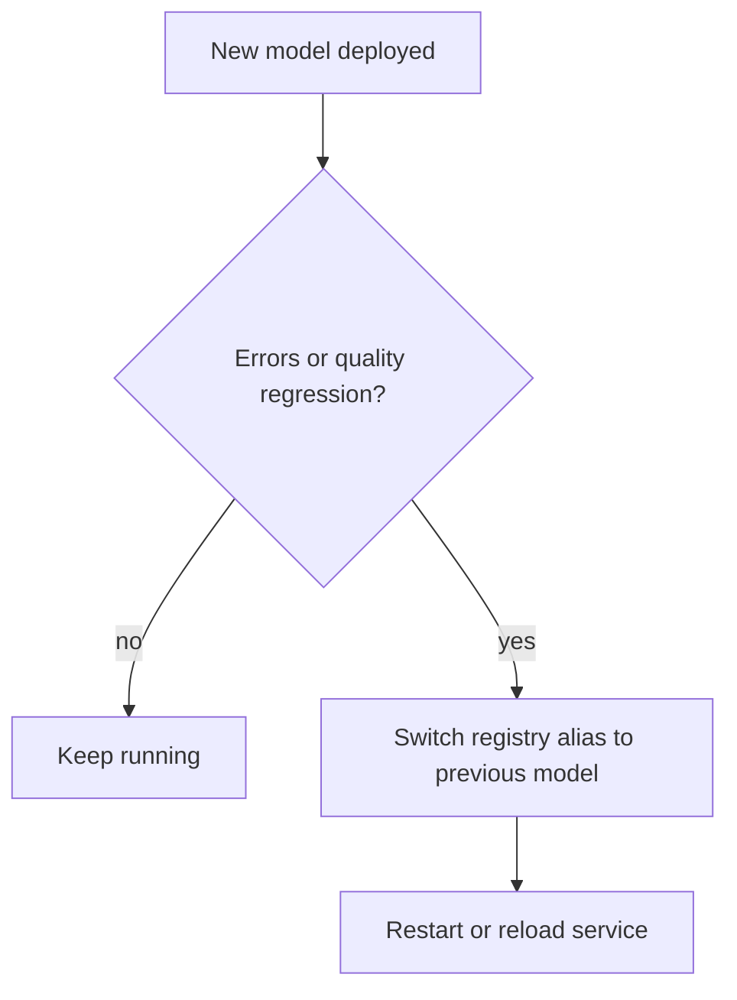
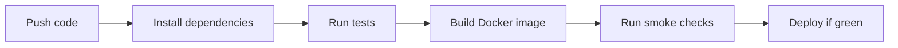
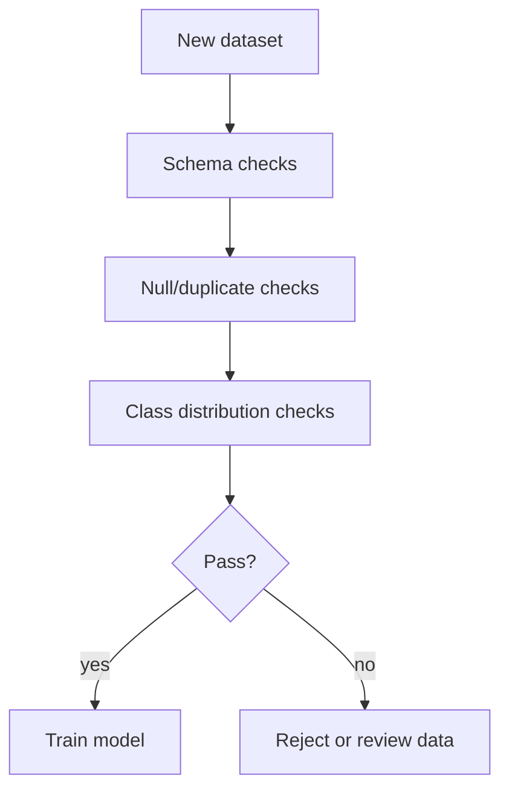

# Section 7: MLOps, DevOps, And Observability

This section covers likely MLOps and DevOps interview questions for CommentPulse. It focuses on DVC, MLflow, Docker, CI/CD, monitoring, metrics, model registry design, rollback, reproducibility, and production readiness.

## 1. What Problem Does DVC Solve?

DVC gives version control for ML pipelines and large artifacts.

Git is good for code. DVC is better for:

- datasets
- model artifacts
- pipeline dependencies
- reproducible training stages
- experiment outputs



Interview answer:

> DVC lets me define the ML pipeline as stages with inputs, parameters, and outputs. If data, code, or params change, DVC knows which stages must be reproduced.

## 2. How Does DVC Know What To Rerun?

DVC tracks:

- command
- dependencies
- parameters
- outputs
- checksums in `dvc.lock`

If a dependency changes, DVC invalidates downstream stages.

Example:

```text
params.yaml changes max_features
        ↓
model_building must rerun
        ↓
model_evaluation must rerun
        ↓
model_registration may rerun
```

Interview answer:

> DVC compares checksums of dependencies and parameter values. It reruns only the stages whose inputs changed and any downstream stages that depend on their outputs.

## 3. Why Use MLflow Alongside DVC?

DVC and MLflow solve different problems.

| Tool | Main Purpose |
|---|---|
| DVC | Pipeline and artifact reproducibility |
| MLflow | Experiment tracking and model registry |



Interview answer:

> DVC tells me how an artifact was produced. MLflow tells me which experiments were run, what metrics they produced, and which model version is promoted.

## 4. How Would You Design A Model Registry Workflow?

A production workflow:



Promotion checks:

- macro F1 does not regress
- class-level recall does not regress
- model artifact loads successfully
- prediction schema is compatible
- inference latency is acceptable

Interview answer:

> I would never blindly overwrite production models. I would register every candidate, compare metrics against the baseline, stage it, run smoke tests, and only then promote it.

## 5. What Metrics Should CommentPulse Expose?

The Flask API already exposes Prometheus-style metrics. Useful production metrics include:

API metrics:

- request count
- request latency
- error rate
- status code distribution

ML metrics:

- inference latency
- number of comments per request
- model loaded status
- prediction distribution

Queue metrics:

- queued jobs
- running jobs
- completed jobs
- failed jobs
- retry count
- dead-letter count



Interview answer:

> For an ML service, I monitor both software health and model behavior. A low HTTP error rate is not enough if the model is drifting or predicting only one class.

## 6. What Is Observability?

Observability is the ability to understand internal system behavior from external signals.

The three classic pillars:

- logs
- metrics
- traces

For CommentPulse:

- logs show request IDs, job IDs, failures
- metrics show latency and queue depth
- traces would show extension request -> Flask -> Redis -> worker



Interview answer:

> Observability means I can answer why the system behaved a certain way. For CommentPulse, I want to know whether a slow insight request was caused by Flask, Redis, the worker, or the analytics code.

## 7. How Would You Add Distributed Tracing?

I would add OpenTelemetry.



Implementation idea:

```python
from opentelemetry import trace


tracer = trace.get_tracer(__name__)


def create_insights_job():
    with tracer.start_as_current_span("create_insights_job"):
        # validate request
        # enqueue job
        # return job id
        pass
```

Interview answer:

> Tracing would let me follow a job from the HTTP request to Redis enqueueing to worker execution. This is especially useful for async systems where logs alone can be hard to connect.

## 8. How Would You Roll Back A Bad Model?

Rollback plan:

1. keep previous model artifacts
2. keep model version metadata
3. monitor production metrics
4. promote previous version if new version fails
5. restart or hot-reload service



Interview answer:

> I would never deploy a model without a rollback path. The service should know which model version it is serving, and previous artifacts should remain available.

## 9. What Should CI/CD Test For CommentPulse?

CI should test:

- unit tests
- API route tests
- validation behavior
- model artifact loading
- DVC pipeline smoke test
- Docker build
- linting/formatting
- security scans



Interview answer:

> CI/CD should protect both code quality and ML runtime behavior. For this project, I would include tests that load the vectorizer/model and perform a sample prediction.

## 10. How Would You Make Docker Builds Reproducible?

Recommendations:

- pin Python base image
- pin dependency versions
- use lock files
- avoid unpinned latest tags
- copy requirements before source for caching
- keep model artifacts versioned

Example:

```dockerfile
FROM python:3.11-slim-bookworm

WORKDIR /app
COPY requirements.txt .
RUN pip install --no-cache-dir -r requirements.txt

COPY . .
CMD ["gunicorn", "--bind", "0.0.0.0:5000", "app:app"]
```

Interview answer:

> Reproducibility means the same source should produce the same runtime behavior. I would pin dependencies and base images, version model artifacts, and run a smoke prediction after building the image.

## 11. How Would You Monitor Data Quality?

Data quality checks:

- missing comments
- empty labels
- duplicate comments
- class imbalance
- comment length outliers
- invalid label values
- source schema changes



Interview answer:

> Data quality is model quality. A perfect training script cannot fix bad labels, duplicates, or schema drift. I would block training if basic quality thresholds fail.

## Final Interview Summary

For CommentPulse:

- DVC gives reproducible training.
- MLflow tracks experiments and model versions.
- Docker packages the API and worker.
- Prometheus metrics expose system health.
- structured logs help debug requests and jobs.
- CI/CD should test both software and model artifacts.
- rollback and monitoring are required for production ML.
