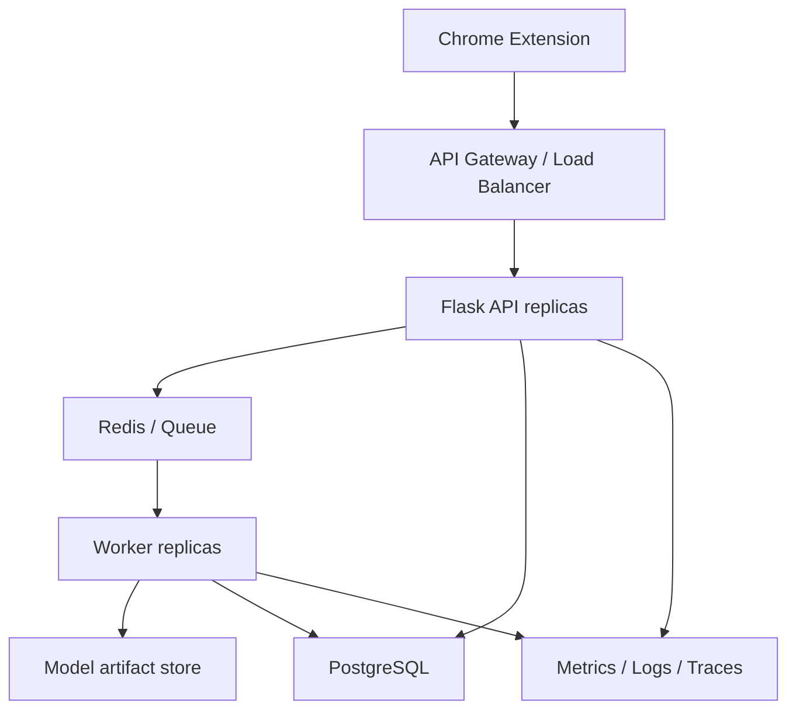
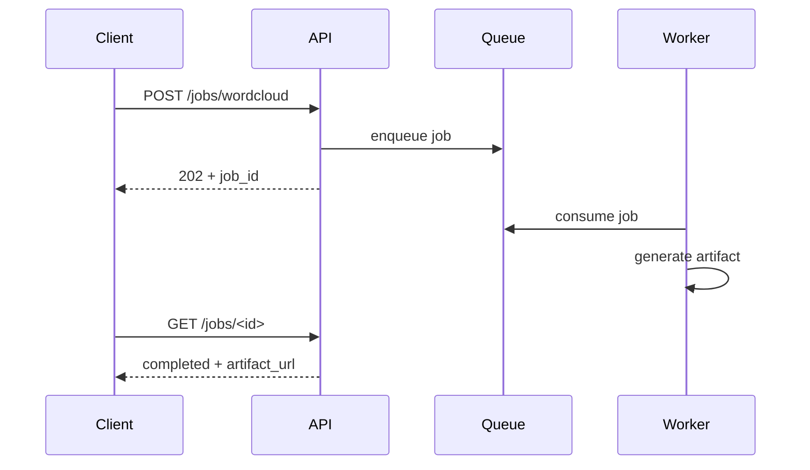
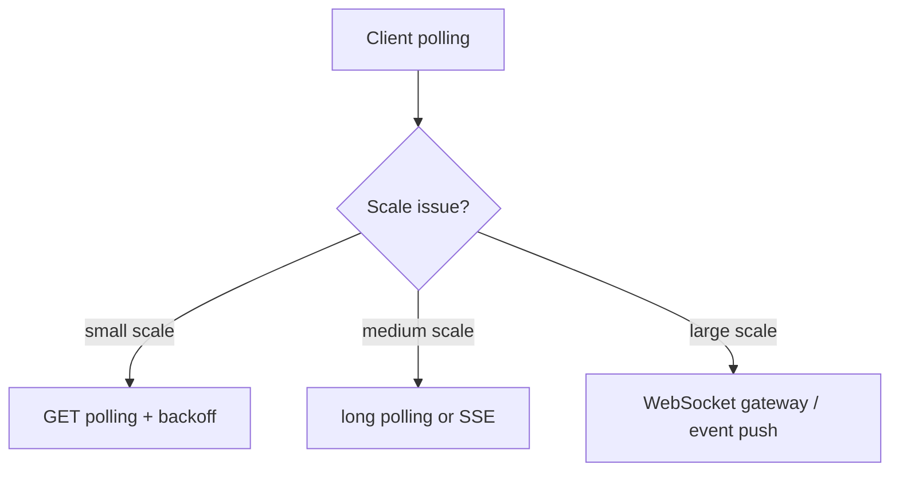
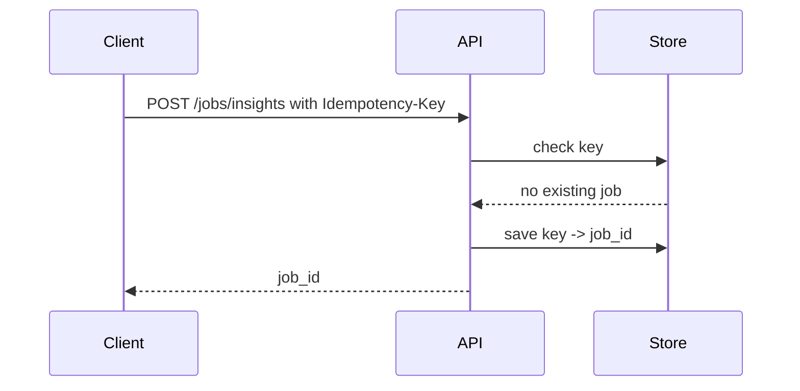
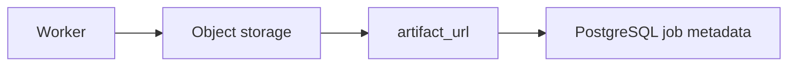
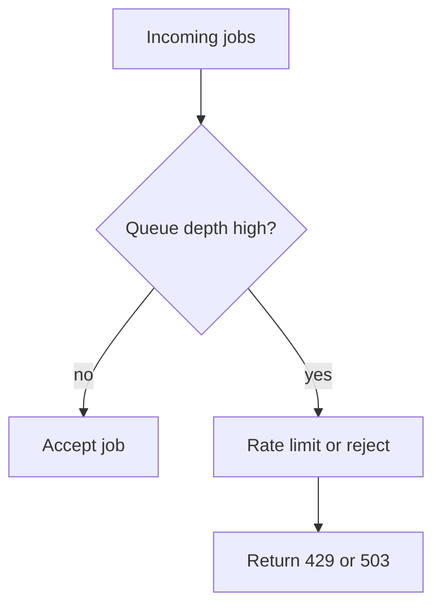
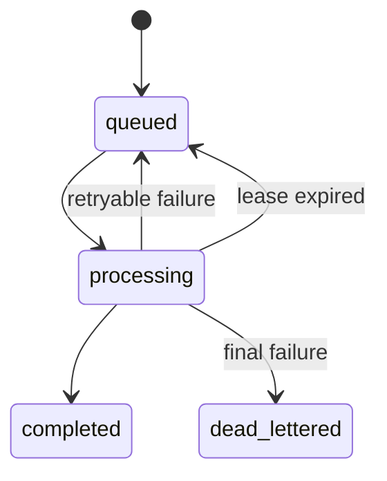
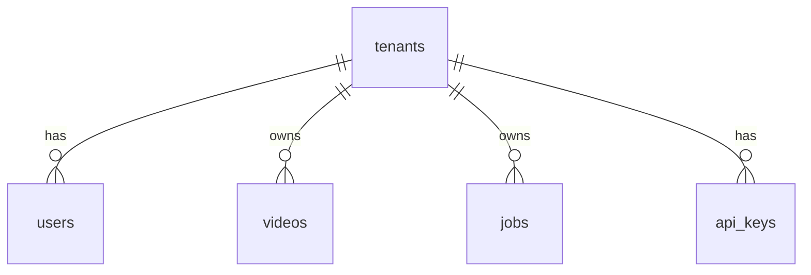
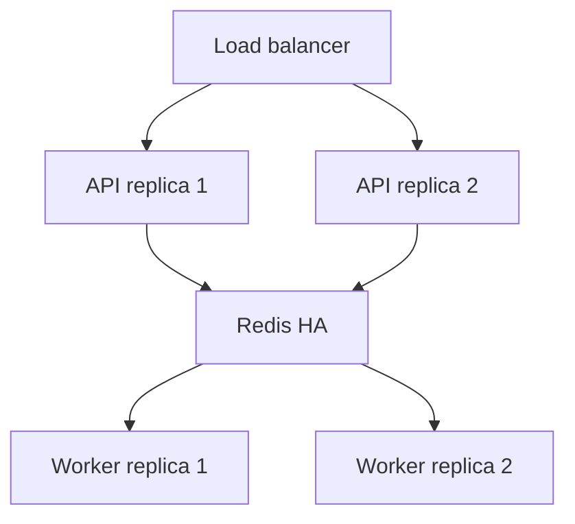

# Section 8: System Design And Scalability

This section covers system design questions for CommentPulse. It focuses on API design, async architecture, scaling, caching, queues, storage, rate limiting, reliability, multi-tenant design, and trade-offs.

## 1. Design CommentPulse At Production Scale

At small scale, one Flask app and one worker are enough. At production scale, I would separate components:



Key components:

- load balancer
- stateless API replicas
- Redis queue
- worker replicas
- PostgreSQL for durable metadata
- model artifact store
- monitoring stack

Interview answer:

> I would keep the API stateless and move job state into Redis or PostgreSQL. That lets me scale API containers and worker containers independently.

## 2. Why Use Async Jobs For Analytics?

Some tasks are too slow for a synchronous request:

- wordcloud generation
- topic clustering
- trend graph generation
- local insight summaries

Async design:



Interview answer:

> Async jobs protect API latency. The user gets a job ID quickly, and expensive analytics run in the background.

## 3. How Would You Scale Read Traffic For Job Polling?

The Chrome extension polls `GET /jobs/<job_id>`. At scale, polling can become heavy.

Options:

- Redis cache for job state
- exponential backoff
- long polling
- Server-Sent Events
- WebSockets
- push notifications



Interview answer:

> I would start with polling plus exponential backoff. If polling load grows, I would move to SSE or WebSockets so the backend pushes completion events.

## 4. How Would You Cache Predictions?

Many users may analyze the same video or repeated comments.

Cache key options:

- hash of comment text
- video ID plus comment hash
- model version plus comment hash

Important: include model version in the cache key.

```text
prediction:{model_version}:{sha256(comment_text)}
```

Example:

```python
import hashlib


def prediction_cache_key(model_version, comment_text):
    normalized = " ".join(comment_text.lower().split())
    digest = hashlib.sha256(normalized.encode("utf-8")).hexdigest()
    return f"prediction:{model_version}:{digest}"
```

Interview answer:

> I would include the model version in the cache key. Otherwise, after a model upgrade, the service could return stale predictions from an older model.

## 5. How Would You Design API Idempotency?

If a client retries `POST /jobs/insights`, it might create duplicate jobs.

Solution: idempotency keys.



Pseudo-code:

```python
def create_job(payload, idempotency_key):
    existing = idempotency_store.get(idempotency_key)

    if existing:
        return existing

    job = jobs.submit("insights", payload)
    idempotency_store.put(idempotency_key, job.job_id)
    return job
```

Interview answer:

> Idempotency protects against duplicate job creation when clients retry after timeouts.

## 6. How Would You Store Generated Artifacts?

Options:

- Redis for small temporary artifacts
- PostgreSQL `bytea` for durable but modest-sized artifacts
- object storage such as S3/GCS for scalable artifacts

Production design:



Interview answer:

> I would store large chart images and wordcloud artifacts in object storage and keep only metadata and URLs in the database. This avoids bloating Redis or PostgreSQL.

## 7. How Would You Handle Backpressure?

Backpressure prevents the system from accepting more work than it can process.

Signals:

- queue depth too high
- worker CPU high
- job latency rising
- Redis memory pressure

Actions:

- return `429 Too Many Requests`
- reduce max comments per request
- autoscale workers
- shed low-priority jobs
- pause expensive analytics



Interview answer:

> Backpressure protects the service from collapse. It is better to reject or delay new work than accept everything and time out all users.

## 8. How Would You Make The Worker Fault-Tolerant?

Worker failure scenarios:

- container crash
- timeout during job
- Redis connection loss
- model artifact loading failure

Fault-tolerant design:

- job leases
- processing queue
- retries with backoff
- dead-letter queue
- idempotent handlers
- graceful shutdown



Interview answer:

> The worker should not lose jobs on crash. I would use a processing queue or lease mechanism so stuck jobs can be reclaimed.

## 9. How Would You Design Multi-Tenant CommentPulse?

If multiple users or teams use CommentPulse, add tenant isolation.

Schema additions:

- `tenant_id`
- user table
- API key table
- quotas table



Access control:

- every query filters by `tenant_id`
- API keys map to tenant
- rate limits are per tenant
- artifacts are stored under tenant-specific prefixes

Interview answer:

> Multi-tenancy requires tenant-aware storage, access control, quotas, and careful filtering so one tenant cannot access another tenant's jobs or predictions.

## 10. How Would You Choose Between Redis Queue And Kafka?

Redis queue is good for:

- simple background jobs
- low operational complexity
- fast enqueue/dequeue
- small to medium scale

Kafka is good for:

- high-throughput event streaming
- replayable event logs
- multiple consumers
- long retention
- analytics pipelines

Interview answer:

> For CommentPulse's background analytics jobs, Redis is enough. If the product grew into a large event-streaming platform with replayable comment events and multiple downstream consumers, Kafka would become more attractive.

## 11. How Would You Design For High Availability?

High availability improvements:

- multiple API replicas
- multiple worker replicas
- managed Redis with persistence/replication
- PostgreSQL primary plus replicas
- health checks
- readiness checks
- autoscaling
- deployment rollbacks



Interview answer:

> I would remove single points of failure. The API should be stateless and replicated, workers should be horizontally scalable, and Redis/PostgreSQL should run in managed or replicated modes.

## Final Interview Summary

For CommentPulse system design:

- keep APIs stateless
- use queues for expensive work
- store durable metadata in PostgreSQL
- store temporary queue state in Redis
- cache with model-version-aware keys
- use backpressure under load
- design workers to recover from crashes
- scale API and worker layers independently
