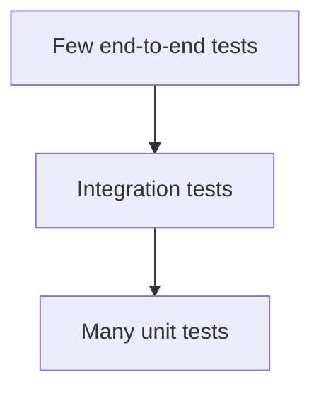
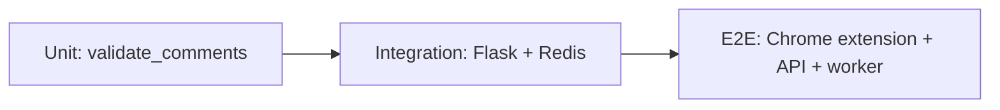
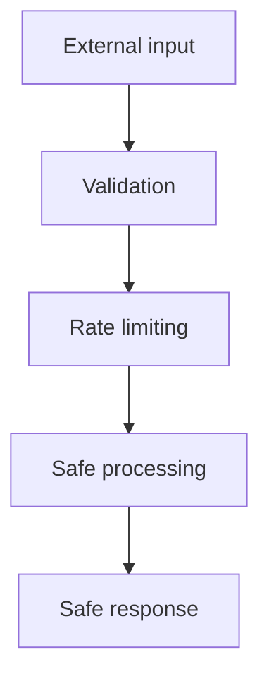
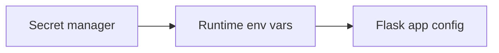
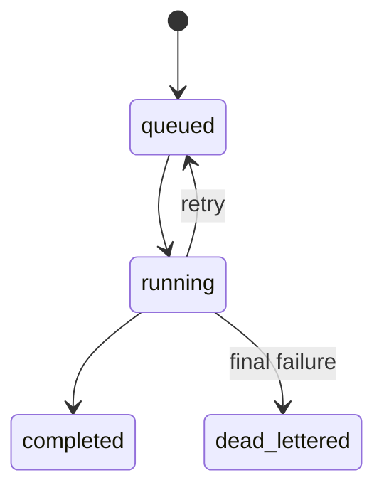

# Section 9: Testing, Security, And Code Quality

This section covers likely testing, security, and quality questions for CommentPulse. It includes unit tests, integration tests, API tests, model tests, security risks, secrets management, input validation, CORS, dependency scanning, and secure deployment.

## 1. What Testing Strategy Would You Use?

I would use a test pyramid.



For CommentPulse:

- unit tests for preprocessing and validation
- unit tests for analytics runtime helpers
- API tests for Flask routes
- integration tests for Redis job flow
- smoke tests for model loading
- Docker smoke tests

Interview answer:

> I would test small pure functions heavily, then add integration tests around the risky boundaries: Flask routes, Redis jobs, and model artifact loading.

## 2. How Would You Test /predict_with_timestamps?

Test cases:

- valid comments return predictions
- missing comments returns 400
- empty list returns 400
- too many comments returns 400
- missing timestamp returns 400 when timestamps are required
- model not loaded returns 503

Example Flask test:

```python
def test_predict_with_timestamps_success(client):
    """Endpoint should return one prediction per valid input comment."""

    response = client.post(
        "/predict_with_timestamps",
        json={
            "comments": [
                {
                    "text": "Great video",
                    "timestamp": "2026-06-22T10:00:00Z",
                }
            ]
        },
    )

    assert response.status_code == 200
    data = response.get_json()
    assert len(data) == 1
    assert "sentiment" in data[0]
```

Interview answer:

> I would test both the happy path and validation failures because API contracts are where production bugs often surface.

## 3. How Would You Mock The ML Model In Tests?

Loading real model artifacts can make tests slow and brittle. For route tests, use a fake runtime.

```python
class FakeRuntime:
    """Small test double for the analytics runtime."""

    def predict_sentiments(self, texts):
        return [1 for _ in texts]


def test_prediction_with_fake_runtime(app):
    app.config["RUNTIME"] = FakeRuntime()
```

Interview answer:

> I would separate model correctness tests from API contract tests. API tests can use a fake runtime, while a smaller smoke test verifies that real artifacts load and can predict.

## 4. What Is The Difference Between Unit, Integration, And End-To-End Tests?

Unit tests:

- test one function/class
- fast
- no network/database

Integration tests:

- test multiple components together
- may use Redis, database, filesystem

End-to-end tests:

- test the full user flow
- extension or browser to backend to worker



Interview answer:

> Unit tests tell me logic is correct. Integration tests tell me components work together. End-to-end tests tell me the real user workflow works.

## 5. What Security Risks Exist In CommentPulse?

Security risks:

- pickle deserialization
- untrusted comment input
- CORS misconfiguration
- exposed API keys
- dependency vulnerabilities
- denial of service from huge payloads
- unsafe file/artifact serving
- prompt injection if LLMs are added later



Interview answer:

> The biggest risks are untrusted input, pickle artifacts, and denial of service. I would validate payloads, cap request sizes, rate limit clients, pin dependencies, and only load trusted signed model artifacts.

## 6. Why Is Pickle A Security Risk?

Pickle can execute code during loading.

Bad situation:

```text
attacker replaces lgbm_model.pkl
        ↓
service starts
        ↓
pickle.load() executes malicious payload
```

Mitigations:

- load only trusted artifacts
- restrict write access to artifact paths
- sign artifacts
- store checksums
- use safer formats when possible
- pin dependency versions

Interview answer:

> Pickle is not safe for untrusted data. In production, model artifacts should come from a trusted registry or signed artifact store.

## 7. How Would You Manage Secrets?

Secrets:

- YouTube API key
- Redis URL if it contains credentials
- database password
- cloud credentials

Do not commit secrets to git.

Use:

- environment variables
- Docker secrets
- Kubernetes secrets
- cloud secret managers



Interview answer:

> `.env` is acceptable for local development, but production secrets should come from a secret manager or orchestration platform.

## 8. What Is CORS And Why Does It Matter?

CORS controls which browser origins can call the API.

For CommentPulse, the Chrome extension and local frontend need to call Flask. If CORS is too open, any website may call the API from a browser.

Bad:

```python
CORS(app)
```

Better:

```python
CORS(
    app,
    resources={
        r"/*": {
            "origins": [
                "chrome-extension://<extension-id>",
                "http://localhost:5000",
            ]
        }
    },
)
```

Interview answer:

> CORS is a browser security control. I would restrict allowed origins in production instead of allowing every origin.

## 9. How Would You Prevent Large Payload Abuse?

Defenses:

- `MAX_COMMENTS_PER_REQUEST`
- `MAX_COMMENT_LENGTH`
- request body size limit
- rate limiting
- timeout limits
- authentication for public deployments

Example:

```python
def validate_comments(comments, max_count, max_length):
    if len(comments) > max_count:
        raise ValueError("Too many comments")

    for comment in comments:
        if len(comment["text"]) > max_length:
            raise ValueError("Comment too long")
```

Interview answer:

> Input limits are both correctness and security controls. They prevent accidental overload and intentional denial-of-service attempts.

## 10. How Would You Test The Redis Worker?

Test cases:

- job is consumed
- job moves to running
- successful job becomes completed
- failed job retries
- final failure goes to dead-letter queue
- replay moves dead-lettered job back to queue



Interview answer:

> I would use integration tests with a real Redis container because queue behavior depends on Redis atomic operations and serialization.

## 11. What Code Quality Practices Would You Apply?

Practices:

- type hints
- linting
- formatting
- small functions
- clear module boundaries
- meaningful errors
- structured logging
- tests for risky behavior

Tools:

- `ruff`
- `black`
- `mypy`
- `pytest`
- `bandit`
- `pip-audit`

Interview answer:

> Code quality is about making future changes safer. For CommentPulse, I would enforce linting, formatting, type checks, and tests in CI.

## 12. How Would You Secure Docker Images?

Recommendations:

- use slim base images
- avoid running as root
- pin dependencies
- scan images
- do not bake secrets into images
- minimize installed OS packages

Example:

```dockerfile
RUN useradd --create-home appuser
USER appuser
```

Interview answer:

> A Docker image should contain only what the app needs. I would avoid root, scan dependencies, and keep secrets outside the image.

## Final Interview Summary

For CommentPulse:

- test validation, API behavior, model loading, and Redis jobs
- keep unit tests fast and integration tests realistic
- treat pickle artifacts as trusted-only
- restrict CORS in production
- manage secrets outside git
- rate limit and validate all external input
- scan dependencies and Docker images
