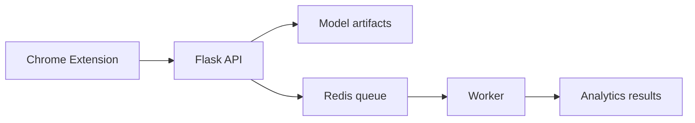
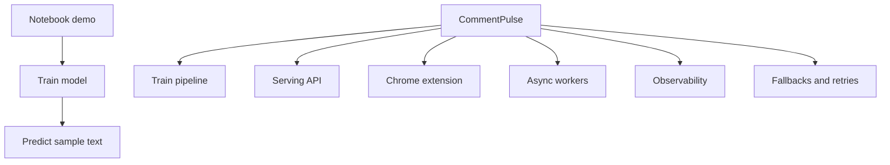

# Section 10: Behavioral And Project Defense

This section prepares concise interview answers for project ownership, trade-offs, failures, improvements, and decision-making. These questions are common in FAANG-style and strong product-company interviews because interviewers want to know how you reason, not just what you built.

## 1. Give Me A One-Minute Summary Of CommentPulse

Interview answer:

> CommentPulse is a production-style YouTube comment sentiment platform. A Chrome extension extracts visible comments from a YouTube page, sends them to a Flask backend, and the backend predicts sentiment using a TF-IDF plus LightGBM model. It also generates analytics like charts, topics, wordclouds, and local insight summaries. The ML training pipeline is managed with DVC, experiment tracking uses MLflow, and heavier analytics can run asynchronously through Redis-backed workers with local fallback for development.



## 2. What Was The Hardest Technical Challenge?

Strong answer:

> The hardest part was turning a notebook-style sentiment model into a service-like system. It required separating training from serving, designing background jobs for slower analytics, handling Redis fallback, and making the Chrome extension interact with the API reliably.

Why this is good:

- shows engineering maturity
- mentions architecture, not just model accuracy
- demonstrates production thinking

## 3. What Trade-Off Are You Most Proud Of?

Answer:

> I chose a lightweight TF-IDF plus LightGBM approach instead of immediately using an LLM or transformer. That kept inference fast, local, cheap, and easy to deploy. The trade-off is weaker semantic understanding, but it is a practical baseline and easier to improve once better labeled YouTube data is available.

Trade-off structure:

```text
Option A: simple, fast, cheap
Option B: more powerful, expensive, complex
Decision: start simple, measure, then upgrade if justified
```

## 4. What Would You Improve First If You Had More Time?

Good answer:

> I would improve the dataset first. The current model quality is limited by the size and representativeness of labeled comments. I would expand the human-labeled YouTube dataset, add stronger data quality checks, and use confidence-based active learning to prioritize uncertain comments for review.

Why:

- focuses on highest leverage ML improvement
- shows understanding that model quality depends on data quality

## 5. How Would You Explain This Project To A Non-Technical Person?

Answer:

> CommentPulse helps a creator quickly understand how viewers are reacting to a video. Instead of reading hundreds of comments manually, the tool groups reactions into positive, neutral, and negative sentiment and summarizes common themes.

Keep it outcome-focused:

- saves time
- summarizes audience feedback
- helps creators decide what to improve

## 6. Tell Me About A Failure Mode And How You Handled It

Example:

> A possible failure mode is Redis being unavailable. Instead of making the app unusable, CommentPulse falls back to an in-process local job executor. That keeps local development and simple demos working. The limitation is that in-memory jobs do not survive restarts and do not scale across replicas, so Redis remains the production path.

This shows:

- resilience
- trade-off awareness
- production thinking

## 7. Why Is This More Than A Simple ML Demo?

Answer:

> A simple ML demo usually stops at training a model and showing predictions. CommentPulse includes a DVC training pipeline, Flask inference API, Chrome extension frontend, async job processing, Redis-backed workers, fallback execution, readiness checks, metrics, structured logs, and dead-letter handling. Those are service-level concerns, not just notebook concerns.



## 8. What Did You Learn From Building It?

Answer:

> I learned that ML engineering is not only about model choice. The hard part is making the model useful: reliable APIs, reproducible pipelines, data quality, artifact management, background jobs, monitoring, and graceful failure behavior.

## 9. How Would You Defend The Current Model's Weak Metrics?

Honest answer:

> I would not overclaim the current model. The metrics are limited because the labeled dataset is small. The value of the project is the end-to-end ML system design. My next model-quality step would be to expand the labeled YouTube dataset, improve class balance, and use the existing DVC pipeline to compare candidates reproducibly.

This is better than pretending the model is perfect.

## 10. How Would You Prioritize Work Before Production?

Priority order:

1. improve labeled dataset
2. fix artifact/versioning strategy
3. add authentication and stricter CORS
4. persist job metadata in PostgreSQL
5. add robust Redis worker integration tests
6. add model monitoring and drift checks
7. deploy with proper secrets management

Interview answer:

> I would prioritize reliability and data quality before adding fancy features. A production ML service needs trustworthy data, versioned artifacts, security, observability, and rollback.

## 11. What Would You Say If Asked About Scalability?

Answer:

> The architecture is designed to scale horizontally. The Flask API can be stateless, job state can live in Redis or PostgreSQL, and workers can scale independently based on queue depth. For larger scale, I would add object storage for artifacts, Redis high availability, PostgreSQL for durable metadata, and backpressure when queue depth grows.

## 12. What Are The Biggest Risks In The Project?

Risks:

- small labeled dataset
- pickle artifact security/versioning
- DOM scraping can break if YouTube changes markup
- local fallback job state is not durable
- unrestricted CORS is risky for public deployment
- no authentication if exposed publicly

Strong answer:

> The biggest risks are model quality, artifact safety, and production hardening. I know where the prototype boundaries are, and I can explain how I would improve each one.

## 13. How Would You Answer "Why Should We Hire You Based On This Project?"

Answer:

> This project shows that I can think beyond a model notebook. I can build an end-to-end system with data pipelines, model training, serving APIs, frontend integration, async processing, observability, and deployment concerns. It also shows that I understand trade-offs and can explain what is production-ready versus what still needs hardening.

## 14. STAR Example: Debugging A Production-Style Issue

Use STAR: Situation, Task, Action, Result.

Example:

```text
Situation:
The app needed to support async analytics, but Redis might not always be available in local development.

Task:
Keep the async endpoints usable without requiring Redis for every local run.

Action:
I implemented a local fallback using ThreadPoolExecutor and kept the Redis worker path for production-style deployment.

Result:
Developers can run the app locally without infrastructure, while Docker Compose can still run the scalable Redis-backed worker flow.
```

## 15. Final Project Defense Summary

Concise closing statement:

> CommentPulse is an end-to-end ML product prototype. Its strongest part is not just the classifier, but the system around it: reproducible training, serving, async processing, observability, and browser integration. The main next step is improving data quality and production hardening.

## Final Interview Summary

In behavioral rounds, the best answers are honest and structured:

- explain trade-offs clearly
- admit limitations
- show what you would improve
- connect technical choices to product value
- demonstrate ownership
- avoid overclaiming model quality
